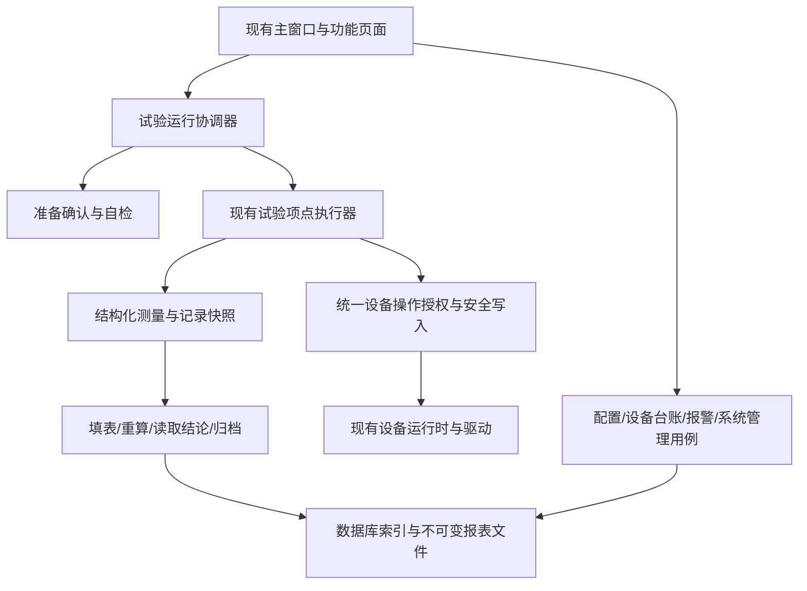

# Avalonia 试验台框架改造编码实施方案

版本：V1.2　初编日期：2026-11-12　最新复核日期：2026-11-13　状态：部分合同和持久化基础已实施，W02/W03 尚未验收完成

> 2026-11-13 实施审核补记：以 [W02/W03 审核与旧入口清理记录](evidence/W02_W03审核与旧入口清理_20261113.md) 为当前实现状态依据。用户本轮明确要求只使用新版方向，并确认新版完成前停用旧试验入口。因此下文原定的“旧分步入口兼容”和“无版本快照兼容读取”不再执行；旧执行服务、固定版式报表生成链已删除。原始历史数据与独立副本转换工具保留，不据旧快照继续试验或重新生成结论。本文其余“拟新增”“待实施”内容仍是设计要求，不能作为已实现证明；第 2 节及原文件级清单保留为编制时基线，已删除文件以本次审核记录为准。

适用工程：`D:/易峥/2026/2026-09/Avalonia_上位机通用模板/项目代码/XXX.TestBench.Template`

本方案以当前磁盘源码及《Avalonia试验台框架_模块评审表_补充版_20261112.xlsx》为依据。它规定本次要改什么、在哪里改、接口如何分工、数据如何保存、界面如何延续、如何验收和回退。文中“已有”表示源码已核对；“新增”“调整”表示本次设计，不表示已实现或已通过测试。

**总体方法：保留 App、Core、Infrastructure、Devices 四层，保留现有通信及安全校验基础，以一个真实试验项目和一份真实 Excel 模板跑通完整流程，再扩展到其他台架。业务仍是评审表中的 7 个模块，下面的技术任务不是新增菜单或独立产品模块。**

阅读顺序：第 1—2 节核对需求和源码事实；第 3—12 节定义实现合同；第 13 节查找代码文件；第 14 节安排实施；第 15 节执行验收；第 16 节确认真实项目资料；第 18 节保留 V1.1 修订记录，第 19 节查看本轮 V1.2 发现及修订。接口、字段和新路径均是明确的设计提案，现有路径以链接标识。

**使用结论：可据此开展通用框架编码；真实台架算法、真实 Excel 映射和目标系统适配仍须取得第 16 节输入后完成。** 本次是方案审查与修订，文中的编码、升级、部署和提交步骤都是后续实施说明，不代表本轮已经执行或获得了设备操作授权。保留原有 R01—R13、P0—P7、T01—T48 及历史修订；本轮补充内容已合入相应章节，新增验收接续编号。

## 1. 需求基线与执行边界

### 1.1 已确定的规则

| 编号 | 本次必须遵守的规则 | 依据 |
|---|---|---|
| R01 | 支持单项、自动执行、停止、步骤进度、准备指导与台架自检；必检项未通过不能开始 | 评审表第 7 行 |
| R02 | 保留类型、型号、项点、顺序和代码固定的参数字段；型号关联报表模板及准备指导 | 第 8 行与当前参数管理实现 |
| R03 | 产品合格判定由 Excel 公式完成；不再增加一套产品合格上下限 | 第 8、10 行 |
| R04 | 安全联锁、输入范围、保护电流、设备异常判断仍由程序/设备负责，不等待 Excel 判定 | R03 的职责边界；现有安全管道 |
| R05 | 设备送检/保养提前提醒、到期提醒；**逾期仅提示，不禁止试验** | 第 9 行 F 列用户填写内容优先于 C 列备选说明 |
| R06 | 每次试验一条主索引，关联自动生成的 Excel；复测创建新记录及新报表，保留原件 | 第 10 行 |
| R07 | 诊断规则由各项目提供；区分无数据、设备异常、产品不合格 | 第 11 行 |
| R08 | 离线注册码/授权文件；**授权到期禁止开始新试验，允许当前试验完成及历史查询、导出** | 第 12 行及本次用户补充确认 |
| R09 | 数据库配置、测试、切换仅管理员操作；试验期间禁止，重启生效，不自动迁移数据 | 第 12 行 |
| R10 | **服务器数据库尚未确定，按项目接入**；本次先提供公共接入合同、SQLite 实现及切换机制 | 本次用户补充确认 |
| R11 | 备份恢复包含数据库和关联报表；共库时统一文件访问位置 | 第 12 行 |
| R12 | 产线协同只预留接口；不实现 MES、前工序放行、断网补传、共享设备调度 | 第 13 行及 F 列 |
| R13 | 新增界面沿用现有 UI，不能擅自重做主窗口、导航、配色和图标体系 | 本次用户要求 |

评审表原文件：`D:/易峥/2026/2026-09/Avalonia_上位机通用模板/outputs/01a1c98d-260b-7360-b78f-9b09fe40de7c/Avalonia试验台框架_模块评审表_补充版_20261112.xlsx`，工作表“模块评审”，B7:G13。方案不修改该表。

### 1.2 允许改动的范围

- 当前 Template 工程内与本方案直接相关的业务、持久化、报表、界面、组合根、配置、离线升级工具、测试和部署说明。
- 保留现有命名空间习惯：App 的文件按 Features 分目录，已有 `XXX.TestBench.App.ViewModels` / `Views` 命名空间不因移文件批量重命名。
- 只在必要位置增加明确依赖；不把所有新服务继续堆入 `ShellServices`。新增子 ViewModel 采用构造参数，主页面负责组合。
- 技术验证、缓存、构建输出、临时文件统一放 `D:/Codex相关/Avalonia改造实施/<阶段>`；交付文档和实际项目文件放工程目录。

### 1.3 禁止顺手扩大的范围

- 不修改相邻旧 WinForms 工程、同事参考工程或未指定项目；不把旧 Office COM DLL 引回主线。
- 不全面升级 .NET、Avalonia、FreeSql、ClosedXML，不更换通信框架或 UI 控件库。
- 不猜 PLC 地址、动作顺序、反馈超时、传感器电流范围、气路/电气安全动作、Excel 输入格和结论格。
- 不为满足“Excel 判定”而删除安全保护、点位质量检查、单位换算、参数合法性检查。
- 不通过关闭校验、自动回退仿真、伪造自检通过或用零代替无数据来完成演示。
- 不做动态表单引擎、可视化流程设计器、任意 C# 脚本编译、热加载插件市场、云授权平台。
- 不以“数据库切换”为名自动复制数据、修改服务器结构或接入一排尚未实现的数据库选项。
- 不清空旧记录，不覆盖历史报表，不原地升级生产库，不绕过已有配置版本合同。

## 2. 当前源码事实及需要纠正的地方

### 2.1 复用基础

| 模块 | 当前可复用内容 | 本次主要差距 |
|---|---|---|
| 试验运行 | `TestExecutionService`、`ITestItemExecutor`、序列/参数/信号快照、示例工艺画面 | 没有完整自动执行、停止与安全收尾、图文准备、自检流程 |
| 产品配置 | 类型/型号/项点 CRUD、型号项点顺序、固定参数及校验 | 未关联型号资源包；报表模板目前固定；需改变合格判定职责 |
| 设备管理 | S7、Modbus TCP/RTU 等现有驱动；设备/点位配置、测试、质量、仿真、安全读写 | 未实现送检保养台账；“校准”目前主要是受控读写入口 |
| 数据报表 | 主记录、项点结果、报表关联、ClosedXML 填表 | 不重算并读取 Excel 结论；打开、预览、打印等链路不完整 |
| 日志诊断 | 审计查询、通信事件、点位新鲜读取；部分手动动作有反馈超时提示 | 缺少统一规则、持久化报警、确认/恢复状态 |
| 系统管理 | 用户/角色/权限、会话、SQLite v8 初始化和结构检查 | 缺少授权、数据库切换、报表路径统一和配套备份恢复 |
| 产线接口 | Core 已有数据访问端口 | 未形成产线业务合同；按评审仅预留 |

### 2.2 编码必须处理的具体事实

1. [MainWindow.axaml](D:/易峥/2026/2026-09/Avalonia_上位机通用模板/项目代码/XXX.TestBench.Template/src/XXX.TestBench.App/MainWindow.axaml)：主窗口“开始试验”设置了 `IsHitTestVisible=False`；“结束试验”仅导航到执行页。必须接同一运行协调器，不能再另建一套首页状态。
2. [TestExecutionService](D:/易峥/2026/2026-09/Avalonia_上位机通用模板/项目代码/XXX.TestBench.Template/src/XXX.TestBench.Core/Application/TestExecutionService.cs)：`StartAsync` 固化快照；`ExecuteItemAsync` 执行单项；`CompleteCoreAsync` 按现有结果行的 Failed 数量汇总，未严格核对整个应执行集合。本次改为核对启动时确定的范围及每项完成状态。
3. [ExecutorFactory](D:/易峥/2026/2026-09/Avalonia_上位机通用模板/项目代码/XXX.TestBench.Template/src/XXX.TestBench.Devices/Executors/ExecutorFactory.cs)：目前只注册 `SimulationPressureExecutor`。示例读数不代表某个真实台架试验算法已完成。
4. [ReportService](D:/易峥/2026/2026-09/Avalonia_上位机通用模板/项目代码/XXX.TestBench.Template/src/XXX.TestBench.Core/Application/ReportService.cs) 只允许 `RecordState.Completed` 生成报表；[ClosedXmlReportGenerator](D:/易峥/2026/2026-09/Avalonia_上位机通用模板/项目代码/XXX.TestBench.Template/src/XXX.TestBench.Infrastructure/Reports/ClosedXmlReportGenerator.cs) 将程序结论写入 E5。新逻辑不能覆盖模板的判定公式，执行异常/中止也应能导出明确标识的过程记录。
5. [DataReportsViewModel](D:/易峥/2026/2026-09/Avalonia_上位机通用模板/项目代码/XXX.TestBench.Template/src/XXX.TestBench.App/Features/Reports/ViewModels/DataReportsViewModel.cs) 固定传入 `assets/report-templates/标准报表.xlsx`，输出路径由数据库位置推算；必须改为按型号快照和统一路径服务解析。
6. [RecordRepository.GetActiveRunningRecordAsync](D:/易峥/2026/2026-09/Avalonia_上位机通用模板/项目代码/XXX.TestBench.Template/src/XXX.TestBench.Infrastructure/Persistence/Repositories/RecordRepository.cs) 未按台架过滤。共库之前必须增加台架范围；不能只改连接字符串。
7. [DeviceManualOperationGuard](D:/易峥/2026/2026-09/Avalonia_上位机通用模板/项目代码/XXX.TestBench.Template/src/XXX.TestBench.Core/Application/DeviceManualOperationGuard.cs) 禁止活动试验中的手工测试/诊断；但工艺手动写及校准入口通过活动记录判断可写。两处规则需统一，不能保留“为调试而先创建正式试验”的用法。
8. [DeviceWritePipeline](D:/易峥/2026/2026-09/Avalonia_上位机通用模板/项目代码/XXX.TestBench.Template/src/XXX.TestBench.Core/Application/DeviceWritePipeline.cs) 当前依据手动/校准权限，并接受调用方传入 `ActiveRunOk`。新增自动执行/自检/停止写入不能只把此值硬编码为 true，需要可信的操作上下文。
9. [SqliteSchemaV8](D:/易峥/2026/2026-09/Avalonia_上位机通用模板/项目代码/XXX.TestBench.Template/src/XXX.TestBench.Infrastructure/Persistence/SqliteSchemaV8.cs) 严格校验表、列和部分索引。新增表/列必须成套修改版本合同、实体、映射、初始化和离线升级，不能只在启动时执行几条 ALTER。
10. [App 启动入口](D:/易峥/2026/2026-09/Avalonia_上位机通用模板/项目代码/XXX.TestBench.Template/src/XXX.TestBench.App/App.axaml.cs) 用程序目录下的 `config` 和 `data` 装配；配置中的数据库值还会与 dataRoot 组合。必须先记录运行时解析出的绝对路径；不得凭文件名假定正在使用哪份数据库，也不得修路径时悄悄创建空库。
11. [默认角色种子](D:/易峥/2026/2026-09/Avalonia_上位机通用模板/项目代码/XXX.TestBench.Template/src/XXX.TestBench.Infrastructure/Persistence/SqliteDatabase.cs) 的 Operator 含 ExecuteTests，但不含 GenerateReports；当前 ReportService 手动入口要求 GenerateReports。自动报表必须设计为本次试验完成流程的受控步骤，不能直接照搬手动入口导致普通操作员试验完成后自动报表失败。
12. [ShellViewModel.TryConfirmProductContextAsync](D:/易峥/2026/2026-09/Avalonia_上位机通用模板/项目代码/XXX.TestBench.Template/src/XXX.TestBench.App/Features/Shell/ViewModels/ShellViewModel.cs) 要求产品号与车号；执行页另有型号/产品号/批次/工位输入，而 [ProductIdentity](D:/易峥/2026/2026-09/Avalonia_上位机通用模板/项目代码/XXX.TestBench.Template/src/XXX.TestBench.Core/Domain/Records/ProductIdentity.cs) 没有车号。仅统一 RunSnapshot 会遗漏产品输入与落库，按第 4.4 节一起处理。
13. [DeviceConfigurationService.ApplyCoreWithLeaseAsync](D:/易峥/2026/2026-09/Avalonia_上位机通用模板/项目代码/XXX.TestBench.Template/src/XXX.TestBench.Core/Application/DeviceConfigurationService.cs) 仍通过 `_hasActiveRun` 决定是否可替换并停止旧 Runtime。必须改为完整操作状态校验，保护没有 RunId 的自检/维护。
14. `DeviceWritePipeline` 当前的连接代次检查针对一次写入前后；并不保证“开始试验时的连接代次一直未变”。它还在设备门内以 `CancellationToken.None` 等待审计。两处分别按第 5.10 节补运行期基线和有界审计。
15. 当前 `TestExecutionService.StartAsync` 将带 GUID 的记录号截断为 16 字符，随机部分仅剩 5 位十六进制；先查重再插入不能保证多客户端并发唯一。新版直接使用 `R-` 加完整 RunId 的 N 格式，保留数据库唯一约束及历史原编号。
16. `app_metadata` 实际只有 `key/value` 两列；第 10 节的数据库身份是新增键值行。当前 `IClock` 仅有 UtcNow，不能据此实现单调超时。2026-11-13 已补报表 Repository 的请求幂等、任务领取和 CAS 终态接口；worker、确认旧进程已退出后的恢复及运行协调器接线仍待实施，见 `docs/evidence/W02_W03审核与旧入口清理_20261113.md`。

当前包引用为 .NET 8、Avalonia 11.3.9、CommunityToolkit.Mvvm 8.4.0、ClosedXML 0.105.0、FreeSql/SQLite Provider 3.5.213。这里只记录当前项目引用，本次不据此进行依赖升级。

### 2.3 基线与既有计划

编制及本轮复核时，`git status --short --branch` 均返回 `fatal: bad object HEAD`。正式编码前先备份可读的源码、配置、数据库及报表，建立可恢复基线；不能依赖损坏的 HEAD 回退，也不能使用 reset/clean 或覆盖整个目录修复。

[既有通用完善计划](D:/易峥/2026/2026-09/Avalonia_上位机通用模板/项目代码/XXX.TestBench.Template/docs/通用上位机框架完善编码实施计划.md) 包含旧 schema 和“程序汇总判定”等历史设计。新需求冲突处以本方案及最新评审意见为准；其中仍有效的设备写入、快照、隔离验证原则继续沿用。[多设备子计划](D:/易峥/2026/2026-09/Avalonia_上位机通用模板/项目代码/XXX.TestBench.Template/docs/多设备多协议点位管理编码实施计划.md) 中的设备身份、配置原子切换、连接代次和回读规则继续有效，不再建立第二套设备运行时。

## 3. 总体结构与关键数据流



| 层 | 本次职责 | 不承担的职责 |
|---|---|---|
| App | 画面、输入、确认、命令状态、报表预览、页面生命周期 | 不直接执行 SQL、Office/协议调用，不计算产品合格 |
| Core | 运行状态、准备与自检、权限与授权门、诊断、记录/报表用例及端口 | 不依赖 Avalonia、SQLite、LibreOffice 或 PDF 原生库 |
| Infrastructure | 数据库实现、文件资源、授权验签、报表计算适配、备份、审计 | 不定义某台架的动作/判断规则 |
| Devices | 现有设备访问、台架执行器、自检/安全收尾的项目实现 | 不操作 ViewModel 或替 UI 弹窗 |

`TestRunCoordinator` 是用例编排对象，不新增第二把设备全局锁；设备状态变更和短原子操作继续使用现有 `DeviceOperationCoordinator`。运行任务、诊断调度器由组合根创建一次，不随切换页面重复创建。

## 4. UI 实施合同：继承当前界面

### 4.1 已核对的视觉来源

基础来源为 [App.axaml 全局资源](D:/易峥/2026/2026-09/Avalonia_上位机通用模板/项目代码/XXX.TestBench.Template/src/XXX.TestBench.App/App.axaml)；页面来源为 [参数管理页](D:/易峥/2026/2026-09/Avalonia_上位机通用模板/项目代码/XXX.TestBench.Template/src/XXX.TestBench.App/Features/Products/Views/ParameterManagementView.axaml) 和 [系统管理页](D:/易峥/2026/2026-09/Avalonia_上位机通用模板/项目代码/XXX.TestBench.Template/src/XXX.TestBench.App/Features/Identity/Views/SystemManagementView.axaml)；提示/确认沿用 [NoticeDialogWindow](D:/易峥/2026/2026-09/Avalonia_上位机通用模板/项目代码/XXX.TestBench.Template/src/XXX.TestBench.App/Shared/Views/NoticeDialogWindow.axaml)、[ConfirmDialogWindow](D:/易峥/2026/2026-09/Avalonia_上位机通用模板/项目代码/XXX.TestBench.Template/src/XXX.TestBench.App/Shared/Views/ConfirmDialogWindow.axaml)。

| 项目 | 当前值/规则 | 新页面必须采用 |
|---|---|---|
| 主题 | Light + FluentTheme | 保持浅色，不引入新主题包 |
| 主色 | `BrandBlueBrush=#0868F7`；悬停 `#0758D7` | 引用资源，不复制另一组蓝色 |
| 工作背景/边框 | `WorkspaceBrush=#F5F8FC`；`PanelBorderBrush=#D6DEEA` | 白色工作面、轻边框 |
| 文字 | 主文字 `#151A24`，次文字 `#5F6878` | 状态同时有文字，不能只靠颜色 |
| 字体 | Microsoft YaHei UI、Noto Sans CJK SC、Arial | 沿用回退链；部署验证中文字体 |
| 页面布局 | `Margin=16,14,16,8`，行距 12；标题面板 Padding 18,14 | 参照参数管理页 |
| 标题/分区 | 页标题 24；分区 18；提示 13 | 不用缩小字号解决拥挤 |
| 按钮/输入 | `parameter-primary/secondary/ghost/danger`；按钮 38、输入 40 | 新页面复用已有 class |
| 表格 | 表头 56、行最小 42、单选、整行选中 | 保持中文列名、清晰单位、合适列宽 |
| 图标 | [AppIconKind](D:/易峥/2026/2026-09/Avalonia_上位机通用模板/项目代码/XXX.TestBench.Template/src/XXX.TestBench.App/Icons/AppIconKind.cs) / `AppIcon` | 优先已有图标，不混用 emoji/外部彩色图标 |

不批量重写旧页面局部 `identity-*` 样式；新增部分可直接复用全局 `parameter-*`。若需要增加共享样式，只增加确有复用的少量资源并测试既有页面外观。

### 4.2 页面落点与操作

| 位置 | 新增/调整内容 | 主要交互 |
|---|---|---|
| 主工艺窗口底部 | 接真实“开始/停止”命令；步骤、状态、计时绑定同一运行状态 | 开始进入准备流程；停止发取消请求；停止中显示“正在安全收尾” |
| 试验执行页 | 顶部产品/模式；准备、自检、执行三个分区；项点表及进度 | “准备指导”“运行自检”“开始单项”“开始自动”“停止”；完成由协调器判定 |
| 准备指导窗口 | 型号名称、步骤列表、图文、逐项确认 | 图文可滚动；必确认项未勾选时不能提交；准备内容不写 PLC |
| 参数管理→产品型号 | “关联资源”按钮和模板/指导版本摘要 | 编辑绑定、验证文件/映射；修改后新试验使用新版本 |
| 硬件校准页 | 保留原校准内容，增加“送检与保养”标签 | 资产列表、到期筛选、编辑计划、登记完成、查看证书 |
| 日志管理页 | 增加“当前报警”“报警历史”，保留操作日志/通信事件 | 详情显示设备/点位/原因/建议；独立“确认”，恢复由规则产生 |
| 数据与报表页 | 查询区、分页记录表、选中记录的报表版本表 | 型号/产品号/日期/台架/结论筛选；打开、预览、打印、导出、失败重试 |
| 报表预览窗口 | 同风格工具栏，中央 PDF 页面画面 | 页码、上一页/下一页、缩放、适应宽度、打印、导出；只读 |
| 系统管理页 | 保留用户/角色；增加授权、数据库与存储、备份恢复标签 | 授权导入；连接测试/保存待重启；路径验证；备份和离线恢复说明 |

新增内容优先嵌入现有导航页面，不为每个服务增加左侧菜单。现有导航内部 Title 被事件匹配，不能只改标题字符串；如显示名称调整，保留内部标识或同时修改并测试所有调用。

### 4.3 页面与服务生命周期

- `MainWindow` 与 `TestExecutionViewModel` 订阅同一个 `RunSnapshot`，不能各自创建 `_recordId`、计时器和 CTS。
- 页面卸载只取消页面加载/预览任务，不取消后台试验。退出应用必须经过停止、收尾和资源释放。
- UI 线程只更新状态；数据库、文件转换、图像渲染及设备等待使用异步调用。长任务按钮禁用，并明确显示阶段及失败原因。
- `CanExecute` 负责体验；Core 再次检查状态、权限、授权、设备版本，防止绕过按钮直接调用。
- 系统管理保留软件版本显示；数据库结构版本、报表引擎版本放在维护详情中，供定位兼容性问题，不把内部实现字段散布在操作员试验流程里。
- 新 XAML 使用编译绑定、`x:DataType`，在 `App.axaml` 注册相应 DataTemplate；不依赖反射猜页面。
- 源码默认窗口 1680×945、最小 1100×700。至少在这两种布局和 125%/150% 缩放检查；小窗口让工具栏换行、内容滚动，不能让停止按钮被挤出屏幕。

### 4.4 唯一产品草稿和状态订阅（V1.2）

组合根创建一个会话级 `PreparationDraftViewModel`，由 Shell 和执行页共同持有；字段为 ProductModelId、ProductNumber、VehicleNumber、BatchNumber、StationNumber、Remark、RunScope、SelectedPointIds、DraftRevision。页面可以有不同展示，不再各自保存一份业务输入。草稿修改递增版本并使原准备会话失效；SelfChecking/Maintaining/Running/Stopping/Finalizing/RecoveryRequired 时不允许修改当前运行草稿。历史记录和已启动快照不随草稿变化。

沿用现有主窗“产品号、车号必填”的行为，由同一个 Core 输入校验器复核；批次、工位和备注可选。给 ProductIdentity 追加可空 VehicleNumber，旧调用者/历史数据缺省为 null；新版记录新增 vehicle_number 并纳入身份快照与报表数据源。不能把车号塞进 BatchNumber 或 StationNumber。以后其他台架要调整必填字段时，在项目适配中明确修改该校验合同，不在两个页面分别判断。

准备窗口确认返回 DraftRevision；协调器只接受仍匹配的草稿。主窗“开始”打开同一准备流程，执行页“开始单项/开始自动”把范围写入同一草稿后走同一入口。注销清空未提交草稿，复测只复制供确认的产品信息，始终创建新的 OperationId/RunId 和准备证据。

RunSnapshot 增加单调递增的 SnapshotVersion。提供统一 Subscribe 方法，在同一个短状态边界内完成观察者注册和当前快照捕获，再在边界外分发；不能分成“先 GetSnapshot，再 Subscribe”两个存在漏事件窗口的调用。UI 丢弃旧版本事件，统一切换到 Dispatcher 更新集合和属性。订阅返回 IDisposable，由页面/组合根按所属生命周期释放；进度事件不得阻塞执行器，不为每个采样点排入 UI 队列。

## 5. 试验执行、准备、自检与设备操作

### 5.1 运行状态及入口

新增 `TestRunCoordinator` 负责状态和任务；现有 `TestExecutionService` 保留领域校验、单项执行与记录持久化职责。协调器公开下列用例，UI 不能绕过协调器调用旧的 Start/Complete 来跳过准备和授权：

| 用例 | 输入/结果 | 必须处理 |
|---|---|---|
| `PrepareAsync` | 操作者、型号、产品标识、执行范围 → 准备会话 | 加载资源版本、参数/序列候选快照；不写硬件 |
| `ConfirmPreparationAsync` | 准备会话及必确认项 → 确认证据 | 记录用户、时间、指导哈希；不是一个全局 bool |
| `RunSelfCheckAsync` | 当前准备会话 → 检查结果集合 | 串行执行项目检查，进度、超时、取消、必要的安全收尾 |
| `StartAsync` | 有效准备会话 → 本次 RunId/RecordId | 原子校验并创建活动记录；发放仅本次有效的运行许可 |
| 内部 `ExecuteNextAsync` / `ExecuteSingleAsync` | 运行 ID、项点 ID | 由协调器工作任务调用；只能属于冻结范围，不能并发或覆盖同项旧结果 |
| `RequestStopAsync` | OperationId、原因（RunId 可空） | 覆盖准备、自检、维护和正式试验；幂等取消与收尾，不要求先有试验记录 |
| `RecoverInterruptedAsync` | OperationId、恢复证据、重新认证的操作者 | 先核对持久占用与现场，必要时封存中断记录；不自动恢复动作 |

流程状态为 `Idle → Preparing → SelfChecking → Ready → Running → Stopping/Finalizing → Idle`，另有独占维护状态 Maintaining。收尾未确认、存在未闭合操作或结果未可靠保存时进入 RecoveryRequired，并区分 SafetyUnconfirmed、InterruptedOperation、PersistencePending 原因。状态不是只保存在 ViewModel/内存中，持久占用规则见第 5.8 节。

记录只有真正开始试验时创建；准备检查日志与后续记录关联。自检失败且未启动的情况保留诊断/审计记录，不虚构一条“产品不合格”试验。

### 5.2 启动门与快照

开始时在同一个短临界区重检：用户 ExecuteTests 权限、当前会话、软件授权、台架空闲、无配置/数据库维护操作、产品标识、有效型号、应执行项点、必需信号、模板可用、准备确认和必检自检通过。

准备证据绑定 `OperationId + BenchId + NodeId + ProductModelId + 执行范围/项点集合 + 产品标识摘要 + 参数/序列版本 + 模板/指导哈希 + 设备配置 Revision + 必需设备连接代次 + 操作者`。任一项变化或重新连接均使 Ready 失效。准备到启动的最大有效时长由项目声明，并以单调计时判断；不跨进程复用，不无限期等待后直接沿用。启动仍要新鲜复核项目声明的关键安全条件。

准备时以一致性读取取得参数/序列/资源版本向量，不能把并发编辑前后的几份数据拼成一份快照。开始时在数据库事务内核对版本与已确认内容，冲突则返回重新准备；服务器 Provider 须验证其事务隔离/CAS 方案。设备本地 Revision 在同一开始门内核对。开始后冻结这些内容及型号/操作者名称、模式、软件版本、项目执行配置版本和授权许可摘要，途中修改不影响本次试验。

自动模式按冻结顺序执行；单项模式开始前明确选择范围并冻结。**单项成功只能表明该项范围完成，不能冒充全项产品合格**；只有对应模板声明支持该单项范围，才读取该范围结论，否则记录“单项记录，未作整机判定”。

### 5.3 执行与判定分离

- `RecordState` 现有值 Running=0、Completed=1、Failed=2、Aborted=3 保持数值，拟追加 Interrupted=4。
- 新记录 `ResultContractVersion=2`：Completed 表示应执行集合全部执行成功；Failed 表示执行故障；Aborted 表示人工中止；Interrupted 表示程序/主机异常中断。
- `ItemResultState` 旧 Pending=0、Running=1、Passed=2、Failed=3、Skipped=4、Aborted=5 不改数值；追加 Succeeded=6，用于新版项点执行成功。新代码不再用 Passed 表达产品合格。
- 单独新增 `EvaluationState`：Pending=0、Qualified=1、Unqualified=2、Error=3、NotEvaluated=4、Legacy=5。保存 Excel 原结论文本及结论来源；运行错误写 `ExecutionError`，不能占用产品结论。
- 只有冻结范围内所有必执行项均为 Succeeded，才进入完整判定。缺项、重复项、Pending/Running、跳过/中止均不能被“没有 Failed”掩盖。
- 项点开始前落库 Pending/Running，结束更新同一条新版结果；一个 RunId 内不允许重复测量覆盖。复测另开 RunId，并可记录 PreviousRunId。

新版 `TestItemResult.Start` 仅接受 Pending，不能允许 Running/Skipped 再开始；执行器完成只允许 Running→Succeeded/Failed/Aborted，整次取消时由协调器把尚未执行的 Pending 标记 Aborted。终态更新按旧状态和操作所属权做条件更新，终态不能被迟到结果覆盖。示例执行器也必须从 Passed 改为 Succeeded；新版若返回旧 Passed，应报合同不匹配，不能继续当作产品合格。

### 5.4 自检合同（拟新增）

```csharp
public enum CheckStatus { Passed, Failed, Unknown, Cancelled }
public sealed record SelfCheckResult(
    string CheckId, string Name, bool Required, CheckStatus Status,
    string Message, string? Advice, DateTime CompletedAtUtc);

public interface IBenchSelfCheck
{
    string CheckId { get; }
    string Name { get; }
    bool Required { get; }
    Task<SelfCheckResult> ExecuteAsync(
        BenchOperationContext context, CancellationToken cancellationToken);
}

public interface IBenchSafeStop
{
    Task<SafeStopResult> StopAsync(
        BenchOperationContext context, StopReason reason,
        CancellationToken cleanupToken);
}
```

`BenchOperationContext` 是新增合同：含 BenchId、NodeId、当前会话/RunId、冻结设备 Revision、只读信号访问、受控设备写入接口、参数快照、审计及进度接口；不能给负责人一个可直接绕过管道写 PLC 的对象。`SafeStopResult` 含 Confirmed/Uncertain/Failed、各动作结果、原因和人工处置提示；`StopReason` 至少区分用户停止、执行故障、通信故障、退出和自检取消。

项目负责人通过普通 C# 类实现并在组合根注册，不让操作员在 UI 编写程序。自检可读可做受控动作，但默认不允许输出；确需动作的检查必须声明所需写点、联锁及收尾策略。必检项 Failed/Unknown/Cancelled 均阻止开始；没有注册本台必需检查时显示“自检未配置”，不能默认全绿。

必检集合和 Required 标志来自冻结的项目检查清单，不能被返回结果中的 Required=false 降级。少一个结果、重复 CheckId、执行异常或超时均按失败/未知处理；不以“返回列表里的项都通过”代替检查完整集合。

### 5.5 统一设备操作许可

新增可信操作上下文，取代把 `ActiveRunOk` 当作可任意传入的授权开关。上下文由协调器发放，带 OperationId、所属会话/RunId、允许操作、点位白名单、设备版本及失效状态；必须在每次用例和写入时查询协调器校验，不能仅凭构造函数可见性或 DTO 内的 true 值授权。

| 操作 | 空闲时 | 自检/正式试验中 | 权限与限制 |
|---|---|---|---|
| 手动调试/校准 | 可申请独占维护上下文 | 禁止与运行并发 | 既有 ManualControl/CalibrateDevices；风险确认 |
| 主动连接测试/主动点位诊断 | 允许，经共享操作门 | 禁止 | 保留现有手工操作守卫 |
| 自动试验写入 | 不允许脱离运行 | 仅本次运行拥有者 | ExecuteTests + 已批准的流程写点/联锁 |
| 自检写入 | 仅有效自检上下文 | 不与正式试验重叠 | 自检声明的写点及风险策略 |
| 停止收尾写入 | 仅由协调器产生 | 允许本次收尾 | 只允许已登记的安全动作；不开放任意写点 |
| 后台只读诊断 | 允许 | 允许读取已有采样 | 不重复主动扫描或争用通信 |

复用 `DeviceWritePipeline` 的点位重定位、模式、设备/通道健康、类型与量程、逆换算、新鲜回读、Revision/ConnectionGeneration 和审计校验。修改入口为权限选择与操作许可校验；不能复制一套简化写入代码。

自动试验中的必要风险确认由项目定义在开始前的准备清单中，并绑定本次准备/运行许可；不能简单把 RiskConfirmed=true 当作确认事实。真正的设备校准写点仍要求校准权限，不能因自动试验上下文而开放所有高风险寄存器。项目声明的允许写点集合、联锁和准备证据必须同时满足。

`DeviceOperationCoordinator` 的已有门只用于短原子状态转换/单次受控操作。不得持锁等待 UI 确认、整次试验、Excel 转换；不得在已持锁路径再次调用会获取同一非重入锁的方法。阶段 P2 必须画清加锁点并用并发测试验证。

落实到现有接口的修改不能遗漏：

- `ItemExecutionContext` 移除对执行器公开的 `IDeviceRuntime Runtime`，改为 `IBenchDeviceAccess`；只读解析也不得泄露原始运行时。同步改 `SimulationPressureExecutor` 和所有构造/测试调用者，不能仅新增安全接口却保留原始 WriteAsync 旁路。
- 原 `TestExecutionService.StartAsync/ExecuteItemAsync/CompleteAsync` 无许可的签名不再作为可调用业务入口；改为必须携带经协调器核验的操作句柄，或收为内部方法。直接调用旧入口的测试应证明会拒绝/已无法编译，而不只是约定 UI 不调用。
- 安全停止可绕过已失效的人工会话，但只能使用该操作登记的收尾能力，不能获得通用管理员写权限。撤销运行许可后，迟到回调和旧 Task 即使继续运行，也不能再次写设备或覆盖新状态。

### 5.6 停止、异常与退出

1. 协调器保存 CTS 和当前执行 Task。停止请求先将状态设为 Stopping 并拒绝新动作，再取消当前流程；重复点击只返回当前停止任务。
2. 等待执行器确认退出。设备写入一旦发出而回读超时，沿用“结果不确定，禁止自动重发”；不把取消等同于设备已停止。
3. 调用项目 `IBenchSafeStop`。使用独立、有明确期限的 cleanupToken，不能复用已取消的运行 token；具体安全动作及超时由台架负责人提供。
4. 收尾成功且执行器不再可能写入，才允许结束硬件占用；失败/不确定写入持久 RecoveryRequired，禁止重启清空。确实仍未退出的驱动操作，不能与另一条收尾指令并发。软件停止不替代硬件急停/PLC 联锁。
5. 保存中止/故障终态与现有测量，生成标有执行状态的过程报表，产品结论为 NotEvaluated。报表错误不能阻止安全收尾。
6. 主动退出/注销、账号停用或会话被明确撤销进入受控停止路径。自然会话有效期到达时，阻止新的人工命令和新试验，但已获许可的自动流程可完成本次；否则长试验会被固定会话期限无故截断。手动分步流程在重新认证前不发下一项，只保留停止/收尾。**软件授权到期不触发停止**：本次许可持续到终态。
7. 进程重启发现本机 Running 记录时提示异常中断，核对现场、保存已有证据后标记 Interrupted；不得自动补发最后一条写指令或自动继续试验。

停止请求的取消标记不能排队等待正在执行的 DeviceWritePipeline 所持设备门，否则无法及时取消。先原子标记并触发本次 CTS，再等待受控操作退出，之后由收尾路径取得设备门；驱动不响应取消时按明确超时进入不确定状态，不能并行发第二条冲突指令来假装停止。

框架第一版不增加暂停/继续、断电续测、多试验并行。每台架同时一项运行；不同台架的共享数据库记录按 BenchId 隔离。

正常完成也必须执行项目声明的结束收尾并确认，之后才能将记录置 Completed、释放硬件占用；不能只在异常停止时调用收尾。新增 StopReason.Completed，允许项目实现与异常停止不同的合理结束步骤，但具体动作仍由负责人提供。

### 5.7 状态保存与外部失败

| 阶段 | 原子保存范围 | 外部失败的处理 |
|---|---|---|
| 创建试验 | 主记录、冻结序列对应的 Pending 项点、开始审计 | 任何一步失败则不发硬件动作；仅确认事务回滚且无需收尾时释放，提交结果未知按 5.10 保留占用查证 |
| 开始单项 | 验证所属 RunId/点位，Pending→Running | 保存失败不执行该项；不靠 UI 状态代替 |
| 完成单项 | 结构化测量、项点终态、关键审计 | 先确保测量证据可保全；库不可用则请求受控停止，不继续下一项 |
| 完成/中止 | 执行终态、完成时间、执行原因、自检/收尾证据、自动报表 Pending 意图、审计 | 一次事务提交；硬件收尾不等待库恢复；失败保留证据和待恢复状态 |
| 报表完成 | 报表关联、产品结论、当前版本指针、完成审计 | 不回滚已发生的试验；按第 6.5 节恢复关联 |

本地证据目录保存 RunId、启动快照、已获得的测量及错误，写入应使用追加或原子替换并校验。数据库故障时不创建另一套本地业务库，不自动改用 SQLite 继续生产，也不自动向服务器补传。恢复索引由明确的恢复操作处理同一 RunId，不能发出设备动作。

现有 UoW 通过连接/事务上下文让仓储参与同一事务；修改装配后必须验证全部相关仓储加入同一事务，不能出现 BeginTransaction 后部分仓储另开连接提交。Excel、设备等待、UI 确认不得放进数据库长事务。

### 5.8 不依赖试验记录的持久操作状态

OperationId 在准备会话或手动维护开始时生成，RunId 仅在正式开始时生成，后者可以为空。新增 `bench_control_state` 作为数据库中的单台架控制登记：BenchId、OwnerNodeId、OperationId、Phase、RequiresRecovery、RecoveryReason、RowVersion、UpdatedAtUtc；一期固定一台架一个控制节点，不做心跳租约、超时抢占或主备切换。

自检/维护第一次实际输出前，先取得台架所属权并持久登记操作，再把本机 `operation-fence.json` 原子保存并刷新到持久存储；文件含 OperationId、BenchId、NodeId、配置版本、是否已准备发出动作、最近阶段及收尾确认状态，不保存登录令牌。写不成功不得发设备动作。只读准备不虚构硬件动作。

数据库在准备发出第一条动作时先将 RequiresRecovery 置为 true，正常收尾确认后才清除；文件标记提供库不可用时的本机证据。纯图文准备/只读检查尚无 RunId、且能确认从未准备发出动作时，重启只需作废旧准备会话，不要求无意义的硬件复位；不能把状态文件丢失当作“从未动作”的证明。

本地状态文件补足“自检尚无 test_records”“数据库已断开”的窗口。启动时综合检查状态文件、bench_control_state 和本台未闭合记录，任何不一致/未清除项均进入 RecoveryRequired；不能因记录已是 Failed/Aborted 或数据库换成另一份而释放。正常结束要先持久保存收尾证据和记录，再清除占用；在任一步断电都按保守恢复处理。

恢复入口放在现有执行页的状态区，不增加主导航：显示操作来源、未确认设备/数据和步骤；允许具有维护权限的用户重新认证后执行只读核查，必要时请求受控收尾。清除前验证旧 Task 已退出、项目要求的安全条件成立、证据已保存，原子清除匹配 OperationId 的状态；不能提供一个不检查条件的“强制通过”按钮。纯数据保存失败只处理数据，不重复已经确认完成的硬件动作。

进入 Preparing/Ready 后申请手动维护会使原准备证据失效，并须先结束该准备会话；不能在“自检通过”和“开始试验”之间改动设备而保留 Ready。准备、自检、维护、正式试验和恢复均使用同一协调器。首次部署和所有客户端遵守一台架一个控制节点，框架不声称可以阻止外部 PLC 工具或绕过本程序的硬件控制。

### 5.9 会话、报告与空闲状态

当前 UserContext 只是构建时权限快照。新人工命令先通过会话服务重建身份；账号停用/角色变更必须被下一命令检查到。自动执行按启动许可运行，应用有独立会话撤销检查；检查后台故障须有明确错误状态，不把“无法检查”解释为管理员权限。

现有 ISessionManager.GetActiveAsync/ValidateSessionAsync 最终可能仅给 null，不能据此判断“自然过期”或“已撤销”。增加明确的 Valid/Expired/Revoked/Missing 查询结果；利用 Session 已有 RevokedAtUtc，在关联运行结束前保留撤销证据，避免直接删除后丢失原因；统一使用 IClock。账号停用或明确收回运行权限按撤销处理；自然过期不能通过新建任意会话的方式偷偷续权。缺失/未知会话状态不等同自然过期，禁止新人工操作，并按已确认的撤销/运行安全策略处置。

硬件收尾不等待报表计算。第一版 Finalizing 等待记录和自动报表意图可靠提交，并等待该报表首次处理结束（成功或明确失败/超时）后才返回可开始状态；等待期间不持设备门或数据库事务，页面明确区分“设备已收尾，报表处理中”。报表失败不会变成设备故障，也不删除试验数据。以后若要试验与多份报表流水并行，再单独评审队列容量和操作体验。

### 5.10 可直接实现的运行、配置与故障合同（V1.2）

**执行驱动。** 一期只有 Auto 与 Single 两种范围，Single 恰好一个已选项点，Auto 是型号冻结的全部启用项点。`StartAsync` 原子占用成功后由协调器启动并保存唯一后台任务，返回 RunHandle（OperationId、RunId、RecordId）；调用者取消等待不等于撤销已经提交的试验，必须通过 RequestStopAsync 停止。Auto 自动顺序执行，Single 自动执行该一项，二者都自动进入收尾及报表，不依赖操作员再点“完成”。第 5.6 节的人工分步重认证规则仅供既有入口兼容，第一版不新增分步/暂停状态与按钮。任何项点执行失败立即结束后续执行并收尾；产品不合格只在 Excel 中产生，不当作执行器故障。

**确定的转移。** Preparing 确认完整后才能 SelfChecking；自检通过进入 Ready；失败且收尾已确认则回 Preparing 并清空通过证据；只读准备取消且确认未动作可回 Idle。有过输出的自检在转 Ready 前完成该检查声明的收尾，确需维持的准备状态必须在项目合同中明确其监测、有效期与取消收尾。Running 的最后一项完成进入 Finalizing；主动停止进入 Stopping；两条路径共用一个只执行一次的收尾任务。若尚未提交记录终态，完成与停止竞争由同一状态门决定，已接受的人工停止记 Aborted；终态已提交后停止不能倒改 Completed。执行/通信故障记 Failed，重启遗留记 Interrupted；收尾未确认时另保留 RecoveryRequired，不能用记录终态解除硬件问题。

**配置门。** 设备配置 Apply、设备模式切换、主动连接测试、手动输出、产品确认、数据库设置都检查同一个操作状态，不能各自查询 Running 记录推断空闲。设备配置实际 Apply 只允许 Idle，且无恢复标记/待提交证据；Preparing/Ready 必须先显式取消准备，SelfChecking/Maintaining/Running/Stopping/Finalizing/RecoveryRequired 均拒绝。编辑候选草稿不等于 Apply。型号/参数可按权限保存新版本，但任何相关编辑必须改变版本向量；已有运行只用冻结快照。

**版本覆盖。** 准备版本向量还必须包含产品类型/型号启用状态、每个 test_item_points 的 RowVersion（含 ExecutorCode、启用状态、名称、ResultKind）、序列 Revision、参数、资源与项目配置。只增加型号 sequence_revision 不足以发现直接编辑项点执行器的变化；相应产品/项点仓储的保存必须使用 CAS 并递增版本。

**连接代次。** IBenchDeviceAccess 保存冻结的 `DeviceId → ConnectionGeneration`；每次读、写、等待反馈均核对该基线、Revision 和 OperationId。运行途中断连/重连即使恢复为 Good，也使原许可失效并受控结束，不自动继续下一项。必要的重连收尾由恢复路径重新核查后签发窄范围 CleanupPermit，不能把原基线改成新代次后继续原试验。

**互斥与期限。** 使用现有 DeviceOperationCoordinator 的设备门，不再持另一把锁等待它。状态转移在该门内短时完成；单次驱动 I/O 可持门，但必须有项目声明的超时。禁止门内调用再次获取门的方法；被授权的底层方法通过内部 Lease 参数区分，不暴露给 UI。停止标记/CTS 撤销使用原子操作先完成，不等待设备门。数据库事务不能等待设备 I/O；外部动作也不能持事务。`IClock` 保留 UTC；新增注入 `TimeProvider` 提供 GetTimestamp/GetElapsedTime 和可取消延迟，步骤/自检/收尾/反馈超时不使用 DateTime 相减。

**审计不阻塞收尾。** 写入前在已有操作证据中持久记录 CommandId、许可、目标和值；写入及回读结束后先撤销该次写能力、保存本地结果证据，再释放设备门。数据库审计在门外以独立、有上限的令牌提交。数据库审计失败标 PersistencePending 并停止后续试验动作，不重新下发该 CommandId；安全收尾按已记录的能力继续。本地证据写入失败同样进入恢复状态，不能丢弃“动作可能已发生”的事实。不要用 Task.WhenAny 超时后遗留一个仍可写设备/新库的旧任务；必须撤销所属权，并确认相关后台操作结束或隔离其结果。

**提交结果未知。** 数据库 Commit 超时/断连不等于已经回滚。开始事务前固定 StartRequestId、OperationId、RunId，并记录数据库身份；不确定时禁止发动作、禁止自动换新 RunId 重试，进入 PersistencePending。恢复后按相同标识查询；已提交则封存未执行/中断记录，未提交才解除该次占用。项点终态、报表提交、维护登记均采用相同“稳定请求标识＋查证”的规则；返回 StateConflict 或 PersistenceOutcomeUnknown，不能把它们当可无条件重试的网络异常。

**持久标记位置。** NodeId、进程锁、operation-fence 和未提交证据位于安装级 StateRoot，独立于可切换的数据库/报表根目录，文件再按 BenchId/OperationId 分层。标记包含 DatabaseInstanceId；启动先检查所有未闭合标记再激活待切库，切库不能使旧标记不可见。StateRoot 是现场持久数据；本次开发验证副本才放 `D:/Codex相关`，不能被运行时缓存清理。克隆安装/移动 StateRoot 须进入离线维护流程。

## 6. 产品资源、测量数据与 Excel 报表

### 6.1 参数和型号资源

保留 [TestParameterValidator](D:/易峥/2026/2026-09/Avalonia_上位机通用模板/项目代码/XXX.TestBench.Template/src/XXX.TestBench.Core/Domain/TestParameters/TestParameterValidator.cs) 及当前项目级/产品级固定字段。增加实际参数时同步更新类型、校验、快照版本、映射、编辑窗口和测试，不做动态参数定义表。现有数值范围只是当前模板代码值，不能直接当作新台架工艺标准。

新增型号资源关联 `ModelResourceProfile`，按 ProductModelId 唯一：TemplateKey、MappingKey、GuidanceKey、Revision、UpdatedBy、UpdatedAtUtc；另有可空 ProcessTemplateKey/ProcessMappingKey，用于明确关联独立过程版式。同一模板支持两种用途时复用同一不可变资源并验证用途映射，不必重复文件。模板和映射必须成对验证；准备指导按型号关联。自检/诊断具体代码由台架注册，所需型号差异通过冻结参数和明确配置传入，不把程序集类名当作操作员输入。

资源采用受控目录中的文件包：Excel 模板、JSON 映射、图文指导及图片；计算 SHA-256，导入后按内容版本保存。运行记录绑定内容版本，不能只记“某路径上的最新版”。图文第一版使用 JSON 步骤 + PNG/JPEG 图片 + 纯文本说明，不引入在线网页、富文本编辑器或外部脚本。

### 6.2 结构化测量合同

当前 `ItemExecutionOutcome` 仅有状态和摘要文本，不足以可靠填入任意真实 Excel。保留摘要用于列表，增加 `Measurements` 集合。每个测量项最少包含：

| 字段 | 含义/约束 |
|---|---|
| Key、Kind | 单个项点内唯一数据键及 Number/Text/Boolean；报表 SourceKey 采用冻结项点 ID + Key，不按中文名匹配，避免多项同名覆盖 |
| Number/Text/Boolean | 仅对应 Kind 的一个值有效；数值必须有限；缺测为 null，不能补 0 |
| Unit | 工程单位，与映射要求一致；不把原始 ADC 数直接写入压力格 |
| CapturedAtUtc | 实际采样/计算时间，不能以保存时间冒充 |
| SourcePointId、DeviceId、Revision、ConnectionGeneration | 有设备来源时记录来源；计算值记录来源键或计算说明 |
| SourceQuality、Valid、Error | 样本质量与有效性；无效必需测量阻止完整判定 |

`ITestItemExecutor` 同时声明输出键、类型和单位，模板验证据此检查。已有 `PointValue` 含 RawValue 与工程 Value；界面两者分栏，报表默认使用已冻结的工程测量。若要写原始值，执行器必须声明并持久保存独立的原始测量键/单位，映射选择该键，不能在生成历史报告时再读取设备或猜测反换算。第一版只保存业务要求的测量点/汇总数据，不顺便扩展高频历史数据库。

测量先持久化，再进行 Excel。数据库保留现有项点表作为内部执行记录，并增加 MeasurementsJson；用户仍看到“一次试验一条主索引”。为异常恢复保存的本地运行证据是持久文件，不是可清理缓存，也不等于断网补传功能。

新增数据字段不是可随意解释的字符串：Number 使用明确精度和有限数值检查，按数值类型写 Excel；产品编号/批次等按文本写，保留前导零；布尔按布尔写；摘要文本不能作为正式测量源。输出显示格式与产品判定舍入规则由真实模板确定，不能先按 UI 显示小数位截断后再判定。系统负责 InvariantCulture 序列化/解析，UI 按本地显示；以 =、+、-、@ 开头的产品文本仍作为文本，不能变成公式。

缺测写入约定空值并使必需测量校验失败；重复 SourceKey、单位不符、未知测量键、超出映射支持的数组/时间序列应明确拒绝。本次不假装单单元格映射已经支持曲线和任意动态行表，真实模板有此需求时在 P1 输出明确的扩展合同。

### 6.3 模板映射合同

新增 `ReportTemplateDefinition`：

- TemplateId、Version、TemplateHash、MappingHash、SupportedRunScopes。
- Inputs：第 6.8.1 节的强类型 Source、其唯一 SourceKey、目标工作表/单元格或命名区域、值类型、单位、Required。Measurement 的 SourceKey 仍由冻结项点 ID＋Key 确定，Metadata/Parameter/System 使用各自种类＋Field，禁止不同种类键互相覆盖。
- Outputs：总体结论位置、可选单项结论位置、允许值的精确映射、需要检查的公式区域。
- 打印区域、纸张方向等优先保留在模板内，框架不重新排版。

真实工作表名、输入格、结论格、允许结论文本必须从项目实际模板提取。本方案不把当前示例的 E5 当作所有模板的结论格。推荐使用命名区域，但不强制重做旧模板；第一版支持明确的单元格映射即可。

导入时检查：文件可读、关键表/格存在、输入与输出无重叠、必需数据键都能提供、单位匹配、结论格有预期公式、外部链接/宏依赖是否受支持。框架只写输入格；不能覆盖公式/合并/打印设置。型号指定的模板缺失时明确失败，不静默创建标准报表。

结果匹配采用明确映射（例如由实际模板定义哪些文本表示合格/不合格），不能使用 `Contains("合格")`，否则“**不合格**”也会被误判。空白、未知文字、Excel 错误值均为 EvaluationState.Error，而不是 Qualified/Unqualified。

### 6.4 报表计算适配与技术验证

拟保留 ClosedXML 做输入填写；新增 `IReportCalculationEngine` 承担强制重算、保存计算后的 XLSX、取得结论及可选 PDF。候选实现为 LibreOffice 独立 worker；不要求 C# UI 进程直接加载 Office/UNO 组件。

```csharp
public interface IReportCalculationEngine
{
    Task<ReportCalculationResult> CalculateAsync(
        ReportCalculationRequest request, CancellationToken cancellationToken);
}
```

Request 包含独立工作目录、输入 XLSX、模板映射、是否生成 PDF、超时配置及关联 RevisionId。Result 包含 EngineName/Version、计算后 XLSX、可选 PDF、结论原值/错误、输入摘要和输出文件摘要。不得只返回一个“转换命令执行成功”的 bool。

LibreOffice worker 的合同：启动独立进程和隔离用户配置 → 隐藏打开输入文件 → 禁止宏与外链更新 → 显式 `calculateAll()` → 检查必需公式/结论 → 保存到另一个 XLSX 文件 → 从同一计算结果导出 PDF → 关闭文档及本 worker。worker 通过任务 JSON 和结果 JSON 与 .NET 通信，参数使用 `ProcessStartInfo.ArgumentList`，不拼接 shell 命令。

模板中的时间、环境等外部条件优先由本次快照作为输入。涉及 NOW、RAND 等易变公式时须在 P1 明确可重复性策略；重算后冻结本次计算状态再保存/导出，不能让 PDF 与 XLSX 各自再算出不同结果。结果验证包括本次 InputHash 和关键输出，不只检查文件存在或进程退出码。

实现候选是随项目交付的小型 Python/UNO worker；**Python/UNO 在目标统信/麒麟上的可用运行时和安装包需要 P1 验证后锁定**。不能把开发机能运行当作目标机可运行。可先编码 Core 接口和假实现测试；未通过真实模板验证前不能宣布报表功能交付。

官方 `XCalculatable.calculateAll()` 表明可请求重算所有单元格；官方命令行文档提供 headless 和独立 UserInstallation 选项。仅 `--convert-to pdf` 或设置“下次打开时重算”，不能作为本次 XLSX 已重算的证据。[LibreOffice 计算接口](https://api.libreoffice.org/docs/idl/ref/interfacecom_1_1sun_1_1star_1_1sheet_1_1XCalculatable.html) · [启动参数](https://help.libreoffice.org/latest/en-US/text/shared/guide/start_parameters.html)

ClosedXML 的 Value 与 CachedValue 行为不同，缓存可能陈旧；不能直接读取旧模板缓存当作当前结果。只有完成本次明确的计算过程后才读计算输出，且不再用另一个引擎重算并覆盖它。[ClosedXML 公式计算说明](https://docs.closedxml.io/en/v0.105.0/concepts/formula-calculation.html)

每台应用初版仅一个报表计算 worker 串行运行。任务具有超时和取消；只能终止本次启动的进程树，不能结束用户正在使用的 LibreOffice。宏、外部数据连接、Excel 加载项和未验证公式不在默认支持范围；发现依赖则列出具体单元格/功能，不能静默换公式。

### 6.5 持久化顺序及失败处理

1. 在同一短事务中保存试验终态/测量快照、InputHash，并创建唯一 RevisionId 的自动 `ReportRecord(Pending)`，记录触发来源、OwnerNodeId 和最终处理依据。完整执行置 EvaluationState.Pending；异常/中止置 NotEvaluated。不能先提交试验完成，再另起一步创建报表任务。
2. worker 通过条件更新领取 Pending→Generating，读取冻结模板/映射。启动时仅恢复本节点已提交的 Pending 或确认无旧 worker 的遗留 Generating；这些是本地报表处理，不是产线离线补传，也不重发硬件动作。
3. 计算、验证结论与输出文件。PDF 失败单独记录，不能把已成功计算的 XLSX 判定改成产品不合格。
4. 向目标存储的独立暂存目录写入文件、校验大小/哈希，再原子发布不可变 manifest（或采用经过验证的等价完成标志）；只有完整发布后才以短事务更新报表记录、产品结论和当前报表指针。失败文件/暂存目录不可作为可用报告被列表扫描出来。
5. 数据库与文件系统不是一个事务：文件已归档但数据库更新失败时，保留 RevisionId/InputHash/manifest，恢复时只补关联，不重新采集、不自动重复试验；补关联必须校验本次输入和所有文件摘要。
6. 计算失败保留原始输入和测量，记录失败阶段、错误及重试入口。重试使用同一数据/模板快照，生成新报表版本；不得套用当前新模板修改历史结果。
7. 已成功的报表默认打开原件，不重复生成。复测创建新的 RunId 和新主记录，原记录/报表永不覆盖。人为编辑外部导出副本不能回写生产结论。
8. Failed/Aborted/Interrupted 可以生成过程报告，明确“执行异常/中止/中断，未作完整判定”。不因已有部分 Excel 公式返回合格就提升为完整合格。

自动生成报表使用协调器在终态提交后发出的、绑定 RunId 的内部完成上下文，作为 ExecuteTests 流程的一部分；不能向 UI 暴露可伪造的“跳过权限”参数。手动重试/重新生成仍需 GenerateReports 权限并检查记录状态；普通查看/打开打印/导出按 ViewRecords 权限。授权到期不额外收回这些历史操作能力。

重启后恢复自动任务不依赖已丢失的内存完成上下文或登录会话：由后台恢复用例核对数据库身份、终态事务创建的 Trigger=Automatic 任务、OwnerNodeId、InputHash 与许可摘要后领取。UI 不能直接创建该 Trigger 的任务；人工请求必须使用手动报表用例。历史授权到期不妨碍已提交自动任务，仍不允许由旧任务创建新试验。

同一记录的计算、人工重试和恢复需数据库条件更新/唯一约束保护，不能只用本机 Semaphore。RevisionNo 在短事务中分配；同一 RunId 同时只允许一个活动报表尝试。迟到的旧 worker 必须凭尝试令牌及输入摘要提交，失败/过期提交不能覆盖更新的成功结论。已成功版本的默认动作是打开，重新评价历史结论不在一期范围。

XLSX 主 manifest 只描述冻结输入、计算 XLSX 及其证据，发布后不改。PDF 作为关联该 RevisionId 的独立不可变附件保存 PdfArtifactId/PdfHash/PdfManifestKey；首次或后补 PDF 都不改主 manifest。更新的是数据库附件指针及 PdfState，原 PDF 也不覆盖，备份清单同时收集主 manifest 与附件。这样避免“PDF 后补后把原报表哈希改掉”。

报表引擎缺失、模板未验证、报表存储不可写或持久证据空间不足时，正式试验开始门明确拒绝，不让操作员做完后才发现必需能力根本不存在；单纯 PDF 预览不可用可以继续并明确提示。运行中发生这些故障按保存数据、受控结束、明确报表失败处理。许可到期不阻止已提交的报表恢复任务。

文件命名以 RunId/RevisionId 为主，不依赖可能重复的产品号和秒级时间。建议 StorageKey 为 `BenchId/日期/RunId/RevisionId/result.xlsx`，使用 `/` 作为逻辑分隔符；物理路径由存储服务转换。原件读取时核对摘要，发现修改显示“文件校验不一致”，不悄悄重算或更新索引。

### 6.6 查询、预览、打印与导出

- 仓储提供 `SearchRecordsAsync(RecordQuery, PageRequest)`，数据库侧筛选与分页，稳定排序 `StartedAtUtc DESC, Id DESC`；初版默认每页 50 条，可选 100，不一次加载全库。
- UI 分列显示“执行状态”“产品结论”“报表状态”，避免 Failed 含义混淆。默认本台架，按权限允许查看全部台架历史；本机运行门始终只查本台架。
- 打开 Excel 为显式外部打开动作；存档原件不用于可编辑工作区，必要时打开导出副本。预览窗口显示归档 PDF，不嵌入 Office。
- 预览新增 `IPdfPageRenderer`，Infrastructure 返回页宽、高、stride 和像素缓冲，App 层再转换为 Avalonia Bitmap；Core/Infrastructure 不引用 Avalonia。只缓存当前页附近少量页面，切换/关闭及时释放。候选适配使用 MIT 许可的 Docnet.Core，并核对其 PDFium 原生组件声明；原生库架构和目标系统兼容性需 P1 验证，版本锁定后才添加包引用。[候选项目说明](https://github.com/GowenGit/docnet)
- PDF 预览生成失败时仍可打开/导出 XLSX，并显示明确原因；不能拿空白预览或旧 PDF 冒充本版本。
- 后补 PDF 必须使用原输入/模板/引擎版本验证，确认关键结果与已归档 XLSX 一致，且不修改原 XLSX；无法证明一致则提示不能生成该版本预览，而不是覆盖其产品结论。
- 第一版“打开打印”调用已验证的系统 PDF 查看器，由用户在查看器中选择打印机与份数。返回只表示成功交给查看器，不能提示“打印完成”。如项目要求应用内直接选打印机、静默打印，另行增加平台打印适配并实机验收，不在本次暗中承诺。
- 导出使用文件选择器，复制指定归档版本；不重算、不改变原件。授权到期不阻止查询、预览、打开打印、导出及已有记录的报表失败重试，但仍遵守原用户权限。

### 6.7 旧记录的只读兼容

ResultContractVersion=1 的记录保持原结论与 Legacy 标识。已有旧 XLSX 可打开/导出；没有历史哈希时显示“旧文件，未记录完整性摘要”，不能误报文件损坏，也不能生成伪造的历史摘要证明。旧路径需通过管理员确认的旧目录映射解析，不给外部输入任意文件读取权限。

旧模板/测量/映射快照缺失时，禁用“重算并生成新结论”；原报表丢失应如实显示缺失，不能拿当前模板生成一个看似原始的报告。允许查看数据库已有摘要/过程信息。具备完整新版证据的记录才允许按原输入失败重试。历史引用的型号、项点、用户和资源采用停用/保留引用策略，不能因主数据编辑或删除破坏历史展示。

### 6.8 报表输入、过程报告与 worker 协议（V1.2）

#### 6.8.1 数据源与不可变输入

映射 Source 改为强类型对象，不只接受“项点 ID＋测量键”。仅开放下列白名单，不支持属性反射、SQL、表达式求值或任意文件路径：

| Source.Kind | 定位字段 | 来源与限制 |
|---|---|---|
| Metadata | Field | RecordNumber、RunId、ProductNumber、VehicleNumber、BatchNumber、StationNumber、Remark、ProductModelName、OperatorName、StartedAtUtc、FinishedAtUtc、DeviceMode、RunScope、ExecutionState；全部来自运行快照 |
| Parameter | Field | 当前固定参数合同中已注册的字段，带字段类型与单位；来自本次参数快照 |
| Measurement | PointId、Key | 冻结项点 ID 和输出键；来自该项已保存 Measurements；键按 Ordinal 区分，导入时拒绝大小写混淆 |
| System | Field | EvaluationAllowed、ExecutionMessage、ReportPurpose；由报表用例根据记录终态生成，不能由 UI 随意提供 |

数据源缺失、类型不符和可选空值分别处理。测量 Number 一期确定为有限 double，JSON 使用可往返表示、Excel 写数值，不以 UI 舍入值替代；超过 Excel 有效数字能力的标识必须声明 Text。时间源是 UTC，映射明确输出为文本或目标时区的 Excel 日期值，不能依赖 worker 主机时区。Measurements 的 Kind 仍为 Number/Text/Boolean，不擅自将时间戳塞入 Number。

例如下列只说明 JSON 结构，**示例命名区域并非真实模板位置，不能直接用于正式试验**：

```json
{
  "SchemaVersion": 1,
  "Purpose": "ProductEvaluation",
  "Inputs": [
    { "Source": { "Kind": "Metadata", "Field": "ProductNumber" }, "Target": { "Name": "Example_ProductNumber" }, "ValueKind": "Text", "Required": true },
    { "Source": { "Kind": "Measurement", "PointId": 101, "Key": "pressure" }, "Target": { "Name": "Example_Pressure" }, "ValueKind": "Number", "Unit": "kPa", "Required": true }
  ]
}
```

映射中的 PointId 绑定本数据库的项点定义；导入其他数据库必须显式重新绑定并验证，不凭同一个 int ID 认定同一项点。资源校验包含 ExecutorCode、输出合同版本和源库身份。模板/映射/指导按字节哈希成为不可变资源，关联保存失败只产生可识别的未引用资源，不覆盖已有版本。

新增 `ReportInputSnapshotV1`，一次性保存 SchemaVersion、DatabaseInstanceId、RunId、记录终态/执行原因、范围、元数据、参数、按冻结顺序排列的项点/测量、模板/映射/指导哈希、报表用途、目标时区及数据合同版本。序列化为 UTF-8 无 BOM 的固定 JSON 文本，保存到 `test_records.report_input_json`；InputHash 为该原始文本 UTF-8 字节的 SHA-256（小写十六进制）。只在终态事务中生成一次；重试读取原文，不重新序列化当前实体。哈希不含 ReportRevisionId、AttemptToken、临时路径或生成时间，确保同一输入重试仍是同一输入。启动阶段的准备摘要另叫 PreparationHash，不能与最终 InputHash 混用。

worker 接收这份原始输入文件及 InputHash，读取文件原字节验证；并验证输入 XLSX、模板和映射各自摘要。报表归档 manifest 保留相同 InputHash 及原始输入文件，数据库/文件恢复据此比较。不得用 .NET 与 Python 各自重排 JSON 后再计算并声称同一摘要。

#### 6.8.2 报告用途与状态组合

新增固定枚举 `ReportPurpose`：ProductEvaluation=0、ProcessOnly=1。由记录状态、冻结范围和模板支持范围确定，不由普通调用者传入 bool 绕过必需数据校验。

| 记录/数据条件 | 用途及产品结论 | 文件处理 |
|---|---|---|
| 全部必执行项 Succeeded、数据完整、模板支持该范围 | ProductEvaluation；Pending→Qualified/Unqualified | 重算并精确读取结论；单项结论必须标明单项范围 |
| Completed 但必需测量缺失/无效 | 产品结论 Error | 拒绝完整判定，记录具体缺项；可生成显式过程报告，不能因有文件就改成合格 |
| Failed/Aborted/Interrupted，或单项模板不支持整机判定 | ProcessOnly；NotEvaluated | 保留实际已有测量，缺测留空并注明未执行/无数据；不把预期缺测当作过程文件生成失败 |
| ProductEvaluation 公式/引擎失败 | Error | 报表 Failed；保留输入、失败阶段和重试依据 |
| ProcessOnly 文件生成失败 | 仍为 NotEvaluated（或原数据错误的 Error） | 报表 Failed；不得变成产品不合格 |
| XLSX 完成但 PDF 失败 | 保持原产品结论 | ReportStatus.Completed，PdfState.Failed，可按权限重试 PDF |

ProcessOnly 的可打印文件必须醒目标注执行状态、“未作完整判定”、实际范围和中止/故障原因，不能仅在应用列表标记而 Excel 打开后仍显示“合格”。型号资源必须登记已验证的过程报告版式：可使用支持 EvaluationAllowed 输入并在公式中正确屏蔽判定的项目模板，或明确关联独立过程模板；不得临时覆盖产品结论公式或静默切换到标准合格报告。P1 同时验证完整与中止样例。ProcessOnly 不调用产品结论匹配，但仍验证文件格式、映射和完整性。

现有 DeviceMode 的 Simulation=0、Hardware=1、Mixed=2 保持不变；文中“离线仿真/OfflineSimulation”是验证场景名称，不是待新增的枚举值。冻结本次实际使用设备的模式明细；Simulation 报告显示“离线仿真，非实机试验”，Mixed 显示“混合模式，含模拟设备”及其来源，不能以运行时总体连接在线推定全部实机。模式必须进入输入摘要、索引与 Excel/PDF 可见标识；即使模拟数据经公式得到合格，也不能在查询或导出时丢失该模式。搜索支持模式筛选，默认业务统计不把含模拟数据的记录当实机合格数量。

#### 6.8.3 领取、重试与产物协议

新增/扩展 `IReportRepository`：`CreatePendingAsync`、`GetByRequestIdAsync`、`TryClaimAsync(revisionId, ownerNodeId, expectedStatus, attemptToken)`、`TryCompleteAsync(result, attemptToken, inputHash, evaluationState, evaluationText, conclusionSource)`、`TryFailAsync(result, attemptToken, inputHash)`、`ListRecoverableAsync(ownerNodeId)`。领取、完成、失败均按尝试令牌、输入摘要及 RowVersion 条件提交，不提供新版无条件 Update；Pending 创建和完成必须在与记录仓储相同的 UoW 中执行。CurrentReportRevisionId 和产品判定只在完整产物关联成功时更新。Generating 任务的重启接管必须由应用用例先确认旧 worker 已退出，本仓储不自动超时抢占。

报表任务身份固定为 DatabaseInstanceId＋RunId＋RevisionId，ActiveAttemptKey 只占用该 RunId。领取令牌可更换但必须使旧令牌失效；不凭超时接管另一节点任务。一期自动恢复只处理本节点，人工重试可在有权限客户端申请，但必须先确认无旧 worker/发布操作仍在执行。Finalizing 的等待包括排队时间，超时后要完成取消/标失败或进入可见恢复状态，不能把仍可能提交的 Generating 当作已结束而无限留下。

worker Request/Result 均有 ProtocolVersion=1、RevisionId、AttemptToken、InputHash、Deadline、EngineName/Version；结果包含 Stage、Outcome、每个输出的相对文件名/大小/哈希及结论原值。结果 JSON 写临时文件后原子发布；父进程验证归属、路径在该任务目录内、摘要和协议版本后才接收。stdout/stderr 只作为限长诊断，不能解析一句“成功”作为业务结果。独立 UserInstallation 之外还需唯一 UNO 通道及启动就绪期限，不能连接到用户已开的 LibreOffice；整个进程树使用同一任务归属。闭环验证后固定运行时、worker 与字体清单。

一期仅接收 `.xlsx` 模板；`.xls`、`.xlsm`、密码保护文件、外链/宏/加载项依赖显式拒绝。旧 `.xls` 必须在项目适配前离线转换并以真实样例重新核对公式和版式，不能仅改扩展名。Docnet.Core 仍是待目标架构验证的候选，不能把其“支持 Linux”理解为已经覆盖目标 ARM/龙芯架构；预览依赖缺失时能力提示与 XLSX 计算分别显示。

## 7. 送检保养、故障诊断与报警

### 7.1 设备台账和提醒

资产不完全等同于通信 DeviceId：压力表、标准器等可以没有通信点位。新增 `EquipmentAsset`（资产编号、名称、型号、序列号、BenchId、可选 DeviceId、启用状态、备注），不把这些字段塞入协议连接配置。

每个资产可有送检和保养两类 `MaintenanceSchedule`，含 CycleDescription、DueDate、AdvanceDays、Enabled、RowVersion；到期日用日期语义，不用 UTC 零点混算。首次登记必须填写有效日期，不能把空日期当作永不过期。

状态计算：停用→不提醒；今天早于 DueDate-AdvanceDays→正常；在提前窗口内→即将到期；今天等于 DueDate→今日到期；今天晚于 DueDate→已逾期。AdvanceDays 为可配置非负整数；不擅自替现场决定送检周期。

提醒在启动后、跨日和登记完成后刷新；同一资产/计划/日期仅提示一次，页面保留到期数量和列表。禁止每次采样弹窗。**提醒服务不参与 StartAsync 的阻止条件，不新增“逾期禁止试验”开关。**

完成登记新增 `MaintenanceRecord`：实际日期、结果、证书附件 StorageKey、下次到期日、登记人/时间、备注；事务保存历史并更新计划。保留历史证书，不覆盖旧附件。登记本身不自动判断设备计量合格或允许带故障使用；设备故障由独立诊断/安全规则处理。

### 7.2 诊断接口（拟新增）

```csharp
public interface IDiagnosticRule
{
    string RuleId { get; }
    DiagnosticResult Evaluate(DiagnosticContext context);
}
```

Context 是一次不可变采样快照，包含 UTC 时间、单调计时信息、BenchId、设备状态、点位质量/单位、连接代次、配置 Revision，以及相关动作开始时间/目标值。Result 包含 RuleId、Normal/Fault/Unknown、严重程度、设备/点位标识、现象、可能原因、排查建议、可选受控停止请求。规则本身不执行通信、不写设备、不保存数据库。

第一版提供三类明确规则模板：

| 规则 | 触发依据 | 不能误判的边界 |
|---|---|---|
| 动作反馈超时 | 已登记的动作目标与动作后新鲜反馈；项目给定等待时间 | 旧反馈、错误连接代次、根本没发动作，均不能算成功；无反馈信号时标“未验证” |
| 模拟量异常 | 已明确单位的电流/测量值及项目给定阈值 | 压力工程值不能套 mA 阈值；无数据/陈旧数据不按 0 处理；无现场依据不默认 4～20 mA |
| 通信异常 | 目标设备/通道连接状态、数据新鲜度 | 不能用其他设备在线代替；Hardware 故障不自动切成仿真 |

阈值、等待时间、持续时间/恢复滞回由项目配置；使用配置版本和单位校验。默认只提示和记录；只有项目明确声明的停止规则才向运行协调器请求受控停止。诊断规则不写 Excel 产品判定结果。

后台诊断读取现有运行时缓存/采样事件，不调用受“试验中禁止手工诊断”约束的主动诊断接口来轮询，也不为每条规则另开设备连接。刷新周期作为配置并在现场验证，不写死为实时能力承诺。

### 7.3 报警状态与持久化

- 报警唯一活动键由 BenchId、RuleId、DeviceId、PointId 组成。持续异常只更新 LastSeen/摘要，不每次采样新增一条。
- 保存 FirstRaisedAt、LastSeenAt、RecoveredAt、AcknowledgedAt、AcknowledgedBy、状态、严重程度、原因/建议及证据快照。
- 确认只是“操作员已知悉”，不能把设备恢复为正常；恢复由可靠新鲜样本确认。恢复后再次发生创建新事件。
- 断线/Unknown 不得把原活动故障自动恢复；可显示“当前无法确认”，并产生独立数据不可用提示。
- 当前报警和历史报警由仓储查询；原 `InMemoryDeviceEventHub` 继续作为通信调试事件源，不能冒充持久报警历史。
- 确认、恢复、配置变更写现有审计。数据库不可用时保留明确故障提示和本地错误证据，不能提示报警已保存成功。

### 7.4 规则持久化、提醒可见性和交互细节

诊断配置放在明确的 `diagnostics.json`（独立 SchemaVersion、ProfileId/Revision），包含规则代码、启用状态、信号键、单位、阈值/等待/恢复条件及项目批准的停止策略。由代码注册的规则清单验证配置，未知规则/单位不通过。保存与当前协调器状态校验并审计，空闲后生效，运行中不热换规则。不新增可视化规则引擎。

规则 Evaluate 必须有执行预算并隔离异常；一条规则抛异常只能变成该规则 Unknown/配置错误，不能导致整个诊断循环退出或替其他规则报告正常。这里的同步规则必须是已审核的有界纯计算，禁止阻塞 I/O、无限循环和持锁；预算用于计时监测与停用异常规则，不能声称 CancellationToken 能强制中断同步死循环，也不能每轮创建一个可能永不退出的 Task。持续报警的 LastSeen 写库合并限频，发生/恢复/确认立即持久化。重启读取既有活动报警并与新鲜样本重新核对，不能先全部恢复再重建。

送检逾期只提示的原则不变。默认操作员可能没有 ManageDevices 权限，因此在现有主窗口状态区显示本台到期提醒和当前报警摘要；详情可只读，编辑计划/登记完成仍需 ManageDevices，确认报警仍需 AcknowledgeAlarms。无权限时明确提示，不能把提醒全部藏在管理员页面。

日期用 DateOnly；重复点击“登记完成”携带同一请求 ID 幂等提交，不能生成两条历史并把日期更新两次。未来完成日期、空结果/下次日期和证书读取失败要有具体校验提示；证书允许明确留空但不能保存不存在路径冒充已上传。计划登记不自动推导周期或把送检结果改写为设备健康。

## 8. 软件授权与权限

### 8.1 离线授权内容及签发边界

新增 `ILicenseService`：读取状态、校验授权文件、导入授权、检查新试验能否开始。客户程序只包含公钥；离线签发工具位于独立 tools 项目，不随客户端发布，不包含私钥文件/默认私钥。

授权载荷采用版本化 JSON：ProductId、LicenseId、CustomerName、MachineBinding、NotBeforeUtc、ExpiresAtUtc（可空表示明确的永久授权）、IssuedAtUtc、KeyId。外层保存 Payload 原始字节的 Base64 和签名，验签直接针对原始 Payload 字节，避免 JSON 重排造成歧义。一期固定使用 .NET 内置 RSA、SHA256 和 RSASignaturePadding.Pss；签发与验签共享格式合同和测试向量。实际发行密钥/机器绑定来源仍按第 16 节提供，目标平台验签通过后才交付。

机器码由平台适配提供可解释的安装/机器身份摘要。具体 Linux/Windows 标识来源须在 P1/P7 实机核对后固定；不假定所有设备都有可读 CPU 序列号，也不把 MAC 地址单独作为不可变身份。机器更换走重新签发，不在客户端提供绕过绑定按钮。纯离线机制不能承诺抵御管理员修改时钟/克隆系统的所有情况。

### 8.2 到期行为（用户已确认）

| 情况 | 行为 |
|---|---|
| 有效且未到期 | 按正常权限允许新试验 |
| 临近到期 | 顶部/授权页提示到期时间；仍可试验 |
| 到期、未授权、签名无效、机器不符 | 禁止创建新 RunId；显示具体原因 |
| 开始时有效、运行途中到期 | 本次运行许可继续有效，可完成后续项点、收尾和报表；下一次开始被拒绝 |
| 查询/预览/打印/导出/已有记录报表重试 | 不受软件到期阻止；仍需对应用户权限 |
| 手工维护/设备诊断 | 保留维护权限和安全限制，不能借此创建正式试验或绕过新试验授权门 |

`StartAsync` 在真正创建记录的原子步骤再次验授权。自检通过后恰好到期也不能开始；运行许可绑定 RunId，不能用旧许可创建新记录。客户端导入失败保留旧授权文件，成功后原子替换并写审计；授权文件不存服务器业务库，不因数据库切换改变授权身份。

时间判断使用统一时钟和 UTC 期限，到期边界为 `now >= ExpiresAtUtc`，同时检查 NotBeforeUtc；显示转换到现场时区，步骤超时使用单调计时。发现明显时钟变化先提示并记录。**一期不追加尚未获用户确认的“回拨即封禁”策略**，授权仍按验签、绑定和有效期判断；不能宣称纯离线系统已防止管理员调时绕过期限。备份恢复不覆盖授权的机器身份和现场时钟。

### 8.3 权限扩展

保留 [PermissionCode](D:/易峥/2026/2026-09/Avalonia_上位机通用模板/项目代码/XXX.TestBench.Template/src/XXX.TestBench.Core/Domain/Identity/PermissionCode.cs) 现有数值。新增权限按当前最大值后分配，不填补历史空号：拟 15 ManageSystemSettings、16 ManageLicense、17 BackupRestore、18 AcknowledgeAlarms。编码前再次检查是否已有其他分支占用。

数据库切换、存储设置、备份恢复、授权导入要求内置 Administrator 身份及对应权限；仅给普通角色勾选权限不能绕过“管理员操作”要求。资产/送检维护复用 ManageDevices；型号资源导入/绑定同时要求 ManageProducts 和 ManageTestDefinitions；既有项点定义操作继续使用 ManageTestPoints；自检复用 ExecuteTests。此处同时要求是 AND，不能因斜线写法在两个用例中解释成不同规则。

管理员判断使用已认证用户角色的 `Role.SystemKey == "Administrator"`，不比较可编辑的角色显示名称；敏感保存前重新验证会话及角色，不能永久信任页面加载时的 bool。

同步修改 PermissionCatalog、角色种子、管理员保护规则、旧库升级权限补齐、UI 可见性和用例校验。升级只补内置管理员所需权限，不自动给所有旧角色增加新权限。执行过程中不能依赖已过期会话发起任意人工命令；受控收尾使用仅本次有效的系统收尾上下文并保留原操作者。

## 9. 数据库配置、切换与存储边界

### 9.1 身份和配置位置

- BenchId：台架稳定标识，用于记录、台账、报警及活动运行隔离；不等于可编辑工位名称。
- NodeId：本机安装实例标识，首次受控配置生成并持久化；恢复到另一台机器时不能盲目复用。
- RunId：全局唯一试验标识；保留现有数据库 int Id 作为内部主键，不把整个数据库主键全面改为 GUID。
- 新增本地 `system-settings.json`（SchemaVersion=1），保存 BenchId/NodeId、DatabaseProfile、存储位置、报表工具路径和提醒设置。它在数据库之外，避免“数据库坏了就无法读连接配置”。
- 连接密码使用 SecretRef 指向受文件权限保护的本机密钥存储；不进入日志、连接测试返回值、源码和普通导出。跨平台密钥实现单独适配，不把 Windows DPAPI 当作 Linux 实现。
- 现有 app.json 保持品牌/模块和旧路径合同。首次启用新配置时读取**实际解析后的旧路径**作为候选，明确确认并保存；新设置生效后不得两处配置轮流覆盖同一字段。

`DatabaseProfile` 拟定字段为 ProfileId、ProviderKey、DisplayName、SqlitePath（本地）、Host/Port/DatabaseName/UserName/SecretRef（服务器）、ConnectionTimeoutSeconds、TLS 配置和配置版本。仅显示当前已注册 Provider 支持的字段，ConnectionString 由 Provider 的构建器生成，不让 UI 字符串拼接成为统一实现。未选定服务器时不设置猜测的端口、账号、TLS 降级策略。

### 9.2 数据库接口及实现方式

Core 保留已有仓储和 `IUnitOfWorkFactory` 端口。Infrastructure 新增数据库 Provider 装配合同，返回一组**来自同一数据源**的仓储、事务工厂、结构检查和备份能力，不能让用户/权限仍查 SQLite 而试验记录查服务器。

拟定义 `IDatabaseProvider`：Key、DisplayName、Capabilities、`TestAsync(profile)`、`OpenAsync(profile)`；`DatabaseServices` 保存仓储/UoW/初始化检查/生命周期对象。此合同在 Infrastructure 层，可依赖 FreeSql；Core 不引用 FreeSql 或 ISqliteConnectionFactory。

现有 SQLite 由 `SqliteDatabaseProvider` 包装。当前带 Sqlite 名称的工厂、仓储基类、实体映射和 SQL 并不因此自动支持其他数据库；服务器适配需要逐项验证事务、主键返回、UTC/日期、布尔、JSON 字符串、并发更新、唯一约束和分页。

**目前只注册已实现的 SQLite。** 服务器类型没有选定时，UI 显示“服务器数据库适配尚未安装/配置”，不提供可保存但无法运行的 PostgreSQL/MySQL 下拉项。选定后实现一个 Provider，并跑同一仓储合同测试，再加入注册表。

### 9.3 连接测试与切换流程

1. 管理员填写候选配置；连接测试不修改当前 Provider、不建库、不建表、不迁移。
2. 测试结果区分网络/认证失败、库不存在、版本不支持、结构不符、必要权限不足、文件存储不可访问。日志脱敏。
3. 保存时要求协调器确实为 Idle，且无未闭合持久操作、未提交结果或报表任务、配置变更/备份；通过共享状态门再检查一次。Ready、Maintaining、Finalizing 也不能切换，不能只排除 Running。
4. 原子写入 PendingProfile 和 PreviousProfile，显示“已保存，重启后生效”；当前进程所有仓储仍指向旧 Provider。
5. 重启先只读验证待启用目标；验证成功才构造整组服务并标记 Active。失败显示错误，依据本次已授权保存的回退记录恢复原配置；不能偷偷创建空库、回退仿真或继续连接半组服务。
6. 切换后按目标数据库账号重新登录，不搬迁用户 ID/角色/历史记录。相同数字 ID 在两个库中不是同一个用户/产品。
7. 原库不可用时仍能显示启动诊断和路径，但不提供无需认证的任意连接修改入口；恢复使用此前授权的上一配置或受控离线运维工具。

SQLite 文件不作为生产线网络共享数据库使用。当前 SQLite 启用 WAL，而 WAL 要求访问进程位于同一主机；共库使用实际选定的服务器 Provider。[SQLite WAL 官方说明](https://www.sqlite.org/wal.html)

### 9.3.1 首次初始化与启动回退

- 新安装：通过明确的初始化入口创建新 SQLite 与管理员账号，初次登录不要求已有软件授权；配置 BenchId/NodeId、存储及授权后才启用正式试验。不得将“选择已有数据库但路径写错”自动解释为新安装。
- 旧安装：先离线升级副本，再保存明确指向该副本的启动配置。未初始化/升级错误的配置显示启动诊断，不偷偷建空库。
- Active、Pending、Previous 是同一份版本化设置的原子状态；保存 Pending 时同步保存通过测试的配置摘要、DatabaseInstanceId、StorageId 和源版本。重启验证的是整组数据库/存储/当前节点登记，不能只测 TCP 连接。
- 只读连接测试对“是否能够读、版本是否匹配”给确定结果；不能据此承诺写入/DDL 权限已验证。实际 Provider 部署须单独验证必要写权限，首次业务事务失败不得发硬件动作。
- 回退只恢复上一已授权的整组配置，不搬数据。必须确认 Pending 激活期间尚未发生业务写入，且 Previous 的身份/版本仍符合记录；一旦新库已经产生业务写入，则禁止自动切回旧库并隐藏新数据，应进入明确恢复流程。目标库用户登录失败不触发回退到旧用户身份。
- 原库失效且没有可用 Previous 时，用受控离线设置工具恢复到已知配置；该工具只由有权限的部署维护人员在应用关闭时使用，不能在未认证启动页提供任意数据库切换。

DatabaseInstanceId 是 app_metadata 中创建时固定的库身份，普通重启/备份恢复保留；不是连接字符串哈希。更改数据目录只保存为待生效，不移动历史文件。正式存储迁移必须独立执行复制→校验→维护窗口切换，不能混进“改目录”按钮。

### 9.4 多台架最小隔离

- `GetActiveRunningRecordAsync` 改为显式 BenchId 参数；更新执行服务、Shell 产品切换、校准、手动守卫、配置应用判断及全部测试替身，不能只改一个仓储方法。
- `bench_control_state` 登记一台架的固定控制节点和当前 OperationId，在正式记录创建前保护自检/维护；事务及 RowVersion 防并发。每 BenchId 最多一条 Running 的条件唯一索引作为第二道约束，不能用它替代操作占用。
- 本机使用台架/安装身份派生的进程级实例锁；数据库控制登记与本机操作状态同时核对。另一 NodeId 只能查询历史，不能接管自检/维护/试验；控制节点变更须在停机、无未闭合操作后由管理员明确处理，不凭超时自动接管。
- 组合根在启用硬件运行时之前核对本节点控制身份；历史查询客户端不因打开工艺页而自动连接并控制硬件。恢复模式可按本台维护权限建立只读核查连接，但输出仍需恢复上下文。
- 参数/型号资源保存使用 RowVersion 乐观并发，旧版本编辑提交失败后提示刷新，不能覆盖另一负责人已保存的新版本。
- 集中查询可跨台架；操作权限、硬件连接和活动运行状态始终属于当前台架。当前不实现产线调度或跨台架硬件控制。

### 9.5 文件位置

新增 `IReportStorage`：写入新版本、读取/验证、导出、获取预览输入、列出备份引用。数据库保存 StorageKey，不直接保存某台 Windows 机器的盘符给其他 Linux 机器用。

本地模式映射到本机报表根目录；共库模式将同一逻辑存储映射到各机路径。数据库 app_metadata 保存 StorageId，部署时在共享根目录建立匹配的存储标识；各客户端既要验证读写/发布能力，也要核对 StorageId，不能因两个不同本地目录都可写就误认为共用存储。共享挂载消失时若露出本机空目录，标识缺失必须拒绝，不自动创建替代目录。

报表目录、模板资源、准备图片、证书、运行证据各有明确根路径。解析使用受控路径和 StorageKey，禁止 `..`、绝对路径注入及跨根目录操作。不要把部署数据写进只读安装目录，也不要在改造时默默搬动现有数据。

### 9.6 启动与 Provider 装配顺序（V1.2）

新增 `ApplicationBootstrapper`，顺序固定为：读取安装级身份/StateRoot与版本化设置 → 获取本机实例锁 → 检查未闭合操作标记 → 确认首次初始化或已有库模式 → 只读检查目标数据库身份/schema/存储身份 → 选择 Active/Pending/Previous → 构造同源 DatabaseServices → 初始化身份/授权/资源服务 → 登录与恢复检查 → 只为已获控制身份的节点创建硬件 Runtime → 启动报表恢复/只读诊断 → 展示 Shell。各步骤失败释放已创建资源，显示具体启动错误；不得先调用旧 Initialize 自动建库再来验证目标。

`IDatabaseProvider.TestAsync` 使用不建目录、不创建数据库、不改变 journal_mode 的独立只读连接路径。现有 SqliteConnectionFactory 构造会建目录，OpenLease 会设置 WAL，不能直接拿它实现只读测试。SQLite 生产 OpenExisting 必须以“已存在且可读写”模式打开；CreateNew 是独立、明确的初始化操作。连接池所有入口（包括仓储直接使用 FreeSql 的入口）都落实并读回必要 PRAGMA，而非只给 UoW 租借连接设置。运行时采用 foreign_keys=ON、journal_mode=WAL、synchronous=FULL 作为本次持久性基线；busy/command timeout 必须有配置上限，不能把锁等待和网络超时当无限等待。只读测试不执行这些设置语句。[SQLite 同步级别说明](https://www.sqlite.org/pragma.html#pragma_synchronous)

数据库配置状态转换也需可恢复：写 Pending → 启动只读验证 → 原子写 Activating（此后崩溃不自动回退）→ 构造可能写入的服务 → 写 Active 并重新登录。自动退回 Previous 只发生在只读验证阶段、且能证明目标没有业务写入时；Activating 后即便“看起来没写过”，也进入人工核查，避免一次审计/初始化写入后丢失目标数据。Settings 自身有递增 Revision 与 CAS，文件备份/原子替换失败保留上一完整版本。

DatabaseServices 固定封装所有用户/角色、产品/参数/项点、记录/报表、控制状态、台账/报警/审计仓储与同一 UoW，及 Inspector、备份能力、DatabaseInstanceId 和 IAsyncDisposable。报表恢复/旧任务持有创建时的该组服务与身份，不能从静态全局变量取得切换后的仓储。数据库切换必须等旧组任务退出，仍以重启为生效边界。

## 10. 数据结构与离线升级

### 10.1 版本策略

现有 SQLite 为 v8，设备/点位配置使用独立版本。**本轮预定新数据库合同为 v9，正式编码前再核对当前版本是否变化。** 新应用只打开当前支持版本；旧库经离线工具生成新副本，保留原件。不能把 v8 校验放宽为“有表就用”。

不改旧枚举值；新增列/表同步实体、仓储映射、初始化、Inspector 合同和测试。现有严格结构检查连新增索引都需登记。设备通信配置 schema 无必要不升级；系统设置使用独立 schema，不混入设备配置原子快照。

### 10.2 表/列改动合同

下表为拟新增字段；类型给出逻辑含义，SQLite 映射为 TEXT/INTEGER/REAL，服务器由 Provider 明确映射。除特别注明外，新表使用内部主键、非空业务键及 UTC 创建/更新时间。

| 对象 | 拟增加/调整 | 约束与兼容处理 |
|---|---|---|
| `test_records` | run_id、bench_id、node_id、result_contract_version、run_scope、previous_run_id；evaluation_state、conclusion_source、execution_error；model_name_snapshot、operator_name_snapshot、resource_snapshot_json、precheck_snapshot_json、input_hash、current_report_revision_id | 新 run_id 唯一；本台最多一条 Running；旧结论保留并标 Legacy；旧记录不可继续执行 |
| `test_item_results` | measurements_json、execution_slot_key 可空；新版使用 Succeeded=6 | 新运行在开始事务内插入 Pending；slot_key 为 RunId+冻结项点 ID 且唯一，旧行留空以保留历史重复项；执行只更新该行 |
| `report_records` | revision_id/no、trigger、owner_node_id、attempt_token、active_attempt_key 可空；storage_key、template_hash、mapping_hash、input_hash、manifest_hash、engine_name/version、calculation_result_json、error_stage；pdf_storage_key、pdf_artifact_id、pdf_hash、pdf_manifest_key、pdf_state | 原列保留；revision_id 及同记录 revision_no 唯一；active_attempt_key 为 RunId，仅 Pending/Generating 非空且唯一，结束后清空 |
| `model_resource_profiles` | product_model_id、template_key、mapping_key、guidance_key、revision、updated_by/at、row_version | product_model_id 唯一；资源内容不可变；删除型号不能破坏旧快照 |
| `equipment_assets` | asset_id、bench_id、device_id 可空、asset_code、name、model、serial_number、enabled、remark | asset_id 稳定唯一；同台架 asset_code 唯一；有历史时停用不物理删除 |
| `maintenance_schedules` | asset_id、kind、cycle_description、due_date、advance_days、enabled、row_version | asset_id+kind 唯一；DueDate 为日期；提前天数非负 |
| `maintenance_records` | schedule_id、performed_date、result、certificate_storage_key、next_due_date、recorded_by/at、remark | 追加保存；登记与计划更新同事务 |
| `alarm_events` | event_id、bench_id、rule_id、device_id/point_id、severity、active_key、首次/末次/恢复/确认时间及确认人、message/advice、evidence_json | active_key 活动时唯一、恢复时清空；一次持续故障一条事件 |
| `audit_logs` | bench_id、node_id、run_id 可空 | 旧行保留；新行尽可能带来源，跨台查询不混淆 |
| `product_models` | row_version、sequence_revision | 型号保存比较 row_version；整组项点顺序保存比较并增加 sequence_revision |
| `project_test_parameters`、`product_test_parameters` | row_version | WHERE 旧版本匹配才更新并递增；影响行数为 0 则刷新后重试，不覆盖 |
| `bench_control_state` | bench_id PK、owner_node_id、operation_id 可空、phase、requires_recovery、recovery_reason、row_version、updated_at_utc | 一台架一行；清除须匹配旧 OperationId/版本；不设超时自动释放 |
| `app_metadata` | 保持 key/value 两列，新增/更新键 schema_version=9、database_instance_id、storage_id 及升级来源/时间 | 这些是键值行而非新增列；版本与 PRAGMA user_version 同事务一致；身份不随路径改变 |

`current_report_revision_id` 是业务引用，写入时校验属于同一 RunId；避免为循环外键强行改变旧表插入顺序。`ReportStatus` 当前 Pending=0、Completed=1、Failed=2 保持不变；本方案确定追加 Generating=3，以支持任务领取/恢复，不重排旧数值。PDF 是否成功单独保存在计算结果/附件状态，不复用产品结论。

型号项点顺序修改在同一事务中比较 `product_models.sequence_revision`、替换该型号的 `model_point_configs`、增加版本并写审计；不能只对单行 SortOrder 做互不关联的更新。新版本字段初始为 0，更新成功加 1；其他用户持旧版本提交时明确报并发冲突。

旧记录升级：在升级清单内固定源库身份并保存旧记录 ID→RunId 的映射，同一升级重试复用该映射；不得每次失败重试产生另一组历史 RunId。旧结论原文不变，ConclusionSource=LegacyCode、EvaluationState=Legacy、ResultContractVersion=1；缺失的测量、自检、模板哈希不伪造。旧记录的 BenchId 使用管理员明确指定的导入台架或“历史来源”标识，不能推断成每个当前客户端。若旧库存在多条 Running，先输出阻塞清单，由离线确认中断处置后再生成满足约束的副本。

上述唯一索引全部登记到 v9 严格结构合同。旧报表的新 revision/attempt 字段可空，不能为了 NOT NULL 随机伪造计算证据；新版插入路径则必须填写。字典、日期、枚举和快照序列化均有 SchemaVersion/固定枚举值，解析未知版本应拒绝执行但允许展示原始历史摘要。

迁移/运行启动不能只处理“多条 Running”：**任何旧 Running 都没有新版有效运行许可**，必须在离线核查中列出并明确转为 Interrupted 或保留阻塞，禁止一条也自动续跑。旧 Succeeded 不存在，旧 Passed/Failed 仅按原合同显示；v9 的状态映射不重写历史判定。

### 10.3 离线升级任务

扩展 [离线升级入口](D:/易峥/2026/2026-09/Avalonia_上位机通用模板/项目代码/XXX.TestBench.Template/tools/XXX.TestBench.Upgrade/Program.cs)，新增 `SqliteV8ToV9Upgrade`，根据源版本选择明确转换器；现有 v7→v8 路径保留。新增版本化系统设置/资源清单校验，不把设备配置转换混进数据库切换。

升级顺序：只读检查源库 → 检查目标不存在且与源路径不同 → 生成一致性副本 → 在副本事务内新增结构/回填 Legacy 字段/权限 → 完整性/外键/约束/记录数量及关键字段核对 → 写版本号和升级报告。失败只废弃本次候选副本，原库和原报表不变。

先对无历史、正常历史、失败/中止历史、重复项点、运行未闭合、损坏库、未知高版本分别验证。回退使用旧程序+原 v8 库+原配置，不让旧程序打开 v9。v9 投入使用后新增记录不得通过回退覆盖丢失；回退前另行保全新增数据和文件，必要时暂停回退并制定迁回方案。

### 10.4 v9 编码时必须落实的补充字段与约束（V1.2）

本节补全第 10.2 节，合起来作为 v9 清单；不能只实现其中一张表。原表/列继续保留，新增字段在 Entity、映射、INSERT/SELECT/条件 UPDATE、升级和 Inspector 中逐项对应。

| 表 | 补充字段/确定映射 | 约束及旧数据处理 |
|---|---|---|
| test_records | operation_id TEXT、start_request_id TEXT、vehicle_number TEXT、report_input_json TEXT、execution_evidence_key TEXT、row_version INTEGER NOT NULL DEFAULT 0 | 前五项旧记录可空；新版必须有操作/请求标识；终态必须保存输入或明确不可生成报告原因；run_id TEXT NOT NULL UNIQUE，升级使用第 10.2 节稳定映射 |
| test_item_results | row_version INTEGER NOT NULL DEFAULT 0 | 新版 CAS 同时校验 record_id、execution_slot_key、旧 state、row_version；不靠内存 TestItemResult 对象判断拥有者 |
| report_records | purpose INTEGER、request_id TEXT、row_version INTEGER NOT NULL DEFAULT 0 | 旧报告 purpose/request_id 可空；新版必填。创建重试的 RequestId 在重复点击/提交结果未知时复用，不重复分配 RevisionNo |
| model_resource_profiles | process_template_key TEXT、process_mapping_key TEXT | 同时为空或同时有效；为空仅表示已验证主模板支持过程用途，不得解释为过程报告随意回退。resource_snapshot_json 同时冻结实际使用的两类资源摘要 |
| maintenance_records | request_id TEXT、request_hash TEXT | 新登记均必填并唯一请求约束；旧历史可空。同 ID 同摘要返回原结果；同 ID 不同输入拒绝 |
| product_types、test_item_points | row_version INTEGER NOT NULL DEFAULT 0 | 启用/停用及影响准备的字段变化均 CAS＋递增；补入准备版本向量 |
| bench_control_state | last_safe_stop_json TEXT、last_evidence_key TEXT | 可空；正常释放前保存收尾证据，包含 OperationId 和原设备代次；存储失败不能先清除恢复标记 |

通用映射固定：GUID 业务标识使用小写 `D` 格式 TEXT（记录显示编号单独用 `R-`＋RunId 的 N 格式）；UTC 时间使用 UTC `O` 格式 TEXT、日期用 `yyyy-MM-dd` TEXT；bool 用 INTEGER 0/1；RowVersion 用 64 位 INTEGER；枚举使用本方案固定数值；JSON 为带 SchemaVersion 的 TEXT；SHA-256 用 64 位小写十六进制 TEXT。未知枚举/JSON 版本可读摘要但禁止执行与重算。非空空串不等于有效业务键。

新枚举固定为：RunScope Auto=0、Single=1；PdfState NotRequested=0、Pending=1、Generating=2、Completed=3、Failed=4；BenchPhase Idle=0、Preparing=1、SelfChecking=2、Ready=3、Running=4、Stopping=5、Finalizing=6、Maintaining=7、RecoveryRequired=8。RecoveryReason 使用独立代码集合，允许同时存在安全与数据问题，不能互相覆盖。

必须登记并验证以下索引（既有唯一约束保留）：

| 索引 | 键/条件 |
|---|---|
| ux_test_records_run_id | UNIQUE(run_id) |
| ux_test_records_start_request | UNIQUE(start_request_id) WHERE start_request_id IS NOT NULL |
| ux_test_records_bench_running | UNIQUE(bench_id) WHERE state=0 |
| ux_item_results_execution_slot | UNIQUE(execution_slot_key) WHERE execution_slot_key IS NOT NULL |
| ux_report_revision_id | UNIQUE(revision_id) WHERE revision_id IS NOT NULL |
| ux_report_record_revision_no | UNIQUE(test_record_id, revision_no) WHERE revision_no IS NOT NULL |
| ux_report_active_attempt | UNIQUE(active_attempt_key) WHERE active_attempt_key IS NOT NULL |
| ux_report_request | UNIQUE(request_id) WHERE request_id IS NOT NULL |
| ux_maintenance_request | UNIQUE(request_id) WHERE request_id IS NOT NULL |
| ux_alarm_active | UNIQUE(active_key) WHERE active_key IS NOT NULL |
| ix_records_bench_time、ix_records_time | (bench_id, started_at_utc DESC, id DESC)、(started_at_utc DESC, id DESC) |
| ix_reports_owner_status、ix_alarm_bench_time | (owner_node_id, status, created_at_utc)、(bench_id, first_raised_at_utc DESC, id DESC) |

其余 model_resource_profiles.product_model_id、equipment_assets.asset_id、equipment_assets(bench_id, asset_code)、maintenance_schedules(asset_id, kind)、alarm_events.event_id 和 bench_control_state.bench_id 的唯一/主键约束按第 10.2 节登记。active_key/slot_key 使用固定结构编码（例如对组成键的版本化 JSON 求摘要），不能用未经转义的任意字符串拼接造成碰撞；校验时同时比较原始组成字段。

新增计划/历史/资源关系设置外键并采用 RESTRICT，不级联删除历史；DeviceId、RuleId、存储键属于配置/文件外部引用，不伪造数据库外键。历史用户可停用，不能使 created_by_user_id 指向不存在的“系统用户”；自动报表保留原试验操作者并由 Trigger 标识自动来源。`current_report_revision_id` 同属运行校验仍由同事务用例负责。

DDL CHECK 与用例共同约束状态组合：新版活动报告 Pending/Generating 必须 active_attempt_key 非空，终态必须为空；revision_id、revision_no、input_hash、owner_node_id 对新版报告必填；新版项点必须有 slot_key。Legacy 行使用明确的旧合同分支，不能通过一律取消 NOT NULL/CHECK 兼容。升级中若发现孤儿引用、非法日期/枚举、冲突业务键，出具逐行清单并停止候选发布，不替用户删改历史。

升级输出的 schema 必须与全新 v9 初始化结果等价，不能只比较记录条数。升级器使用只读源＋一致性副本，检查目标文件、目标 WAL/SHM 及解析后路径不与源重合；源仍被生产程序写入时只允许一致性快照读取，不迁移其原文件。v7→v8→v9 可串接生成独立候选副本，保留每一步报告，不能绕过 v8 的完整性检查。

## 11. 备份、恢复、进程和部署

### 11.1 一份可以恢复的备份

备份清单包括：数据库一致性快照、该快照引用的报表及 PDF、模板/映射/指导资源、证书、当前配置、必要的未提交运行证据、软件/数据库/配置版本、每个文件的大小和 SHA-256。签发私钥绝不进入客户端备份；授权文件可以单列备份，但恢复不能自动改变机器绑定。

本地备份仅在台架空闲且报告写入任务停止提交时进行：进入维护状态阻止新试验/配置变更 → SQLite 一致性备份 → 固定数据库引用清单 → 复制不可变资源 → 校验 → 最后写完成标志 → 退出维护状态。中途失败生成明确失败清单，不能把半包显示成备份成功。

当前 SQLite 启用 WAL，不能只复制主 `.db` 文件忽略日志。采用 SQLite Online Backup API；若所用 .NET Provider 无可用封装，选择并验证官方支持的 `VACUUM INTO` 等一致性方案，而非自行猜测 WAL 拷贝时机。[SQLite 官方备份说明](https://www.sqlite.org/backup.html)

服务器 Provider 的备份必须有独立能力实现，含一致性快照与引用文件清单。未接入此能力时 UI 明确“此数据库暂不支持应用内备份”，不能用导出部分记录伪装全库备份。整个生产线恢复需要所有相关客户端停止写入；单台管理员界面不能在其他台架仍运行时覆盖共享生产库。

### 11.2 恢复流程

管理员选择备份 → 先验证清单、哈希、支持版本、空间和路径 → 显示来源/时间/包含记录和资源 → 停止写入及后台任务 → 关闭数据库连接池 → 保存当前状态的恢复前备份 → 恢复到候选目录/数据库 → 检查通过后切换配置 → 重启重新登录。

不在当前进程内替换正在打开的数据库，不直接删除原目录。备份中缺失的文件必须列出，不能忽略后显示“恢复成功”。从 A 台恢复到 B 台时，业务历史可以保留原 BenchId，当前本机 NodeId/硬件连接/授权不能无审查覆盖。

备份与恢复还必须检查以下边界：

- 备份目标不能位于本次被遍历的源目录内，避免递归把备份打进自身；复制按数据库引用清单而不是任意目录全盘递归。
- 备份包不导出明文数据库连接密码或私钥；恢复后 SecretRef 可要求重新配置，不能显示“所有配置已恢复”却留下失效秘密引用。
- 若使用压缩包，限制条目数/解压大小，拒绝绝对路径、路径穿越与符号链接越界；在候选目录完整校验后再切换，不直接解压覆盖现场目录。
- 服务器备份按同一一致性快照确定引用集合；原件不可变，故可在复制时允许追加新文件，但不得同时删除旧引用。恢复须由 Provider 的独立运维流程确认全线停止写入，不能仅凭本机 Idle 执行。
- 共享盘/磁盘满时保留明确失败；本地证据目录无法写入时不开始新动作。缓存可清理，原件、未完成证据、状态文件不能按临时文件规则清理。

备份 manifest 以 RootKind＋StorageKey 记录报表、资源、证书、证据的归属，恢复时逐根解析和验证，不能把不同根目录的同名文件覆盖在一起。恢复前保留本机现有未闭合 operation-fence；备份里旧的“已结束”标记不能覆盖当前未确认状态。应用内只创建恢复计划和候选包，实际切换由离线维护工具在主进程退出/所有连接关闭后执行。恢复完成必须实际打开候选库并抽查至少一份其引用报表，不只验证压缩包能解压。

### 11.3 应用生命周期

在组合根增加统一异步关闭：拒绝新操作 → 处理当前操作（含无 RunId 的自检/维护）安全收尾 → 结束/取消报表任务并保留恢复证据 → 停止诊断调度 → 停止并释放设备运行时 → 关闭数据库及文件句柄。MainWindow 的关闭与退出按钮走完整关闭；注销共用“停止当前操作/保全证据”的前段，完成后撤销会话并回登录页，保留应用级服务供下次登录，不把注销实现成关闭后仍复用已 Dispose 的服务。

Avalonia Window.Closing 是事件边界，不能仅启动一个不等待的 async void 停止任务就让窗口关闭。先取消本次关闭并显示收尾状态，等待协调器完成后用防重入标志再次关闭；若旧操作仍可能写入，不能仅超时后 Dispose 连接并显示正常退出。外部强制终止只能依靠持久操作标记在下次启动恢复。本机正在运行的停止入口不因软件许可到期或自然会话过期而禁用。

任何运行后台回调须携带 OperationId/AttemptToken 与配置代次，更新前检查所属关系；旧任务迟到不能把新试验 UI 改成已完成，也不能提交到数据库切换后的另一组仓储。

故障和审计使用既有 logger/audit 接口，业务错误显示自然中文；日志附 RunId/RevisionId/设备点位/配置版本供维护人员查询。不可把连接密码、签发材料或整份授权密钥写进日志。

### 11.4 发布边界

- 本次不承诺所有“信创系统”通用；按实际 UOS/麒麟版本、CPU 架构、显示服务、字体、串口权限、打印机和原生依赖验收。
- Windows 与 Linux 分别发布对应 RID；配置/数据/资源根目录显式指定并可写。不能在 Linux 使用硬编码 D 盘或 Windows 路径分隔符。
- LibreOffice、worker 运行时、PDF 渲染原生库进入依赖清单并锁定验证版本；记录许可及第三方声明。LibreOffice 官方采用 MPL 2.0，并含其他开源组件，交付依实际安装包声明处理，不称其为“无任何分发要求”。[LibreOffice 许可说明](https://www.libreoffice.org/licenses/)
- 工具缺失/版本不支持在启动诊断和系统页显示能力不可用；禁止自动下载安装系统包或要求客户联网才能开始普通离线试验。
- 不把本次 Codex 运行环境里的 Node/Python 当作产品部署依赖。本方案使用的文档工具与产品 worker 是两件不同的事。

## 12. 产线接口只做合同

新增 `IProductionLineGateway` 接口和数据 DTO，暂不注册业务实现、不启用菜单、不在启动门或试验完成后自动调用。拟保留：

```csharp
public interface IProductionLineGateway
{
    Task<LineReadiness> CheckReadinessAsync(
        LineTestIdentity identity, CancellationToken cancellationToken);
    Task PublishCompletedAsync(
        CompletedTestEnvelope result, CancellationToken cancellationToken);
}
```

`LineTestIdentity` 包含 BenchId、RunId、产品号、型号快照及协议版本；`CompletedTestEnvelope` 包含执行状态、产品结论、时间、报表 StorageKey/摘要和协议版本。DTO 不泄露数据库连接串，不传本机盘符。未来使用 RunId+报表版本作为幂等标识。

`LineReadiness` 必须能表达 Unavailable/NotIntegrated，不能由空实现返回 Allowed 来假装上一工序已放行。本轮应用完全不依赖该接口；MES、工序规则、网络重试、离线队列与共享设备协调均不实施。

## 13. 文件级编码清单

以下清单是本次直接改造入口。`已有`链接均在编制时核对存在；“拟新增”路径是设计落点，不表示文件当前存在。每个阶段只修改依赖所需文件，不能顺手重构全工程。

### 13.1 已有文件

| 文件/方法 | 修改内容 | 关联阶段 |
|---|---|---|
| [TestExecutionService：Start/ExecuteItem/Complete](D:/易峥/2026/2026-09/Avalonia_上位机通用模板/项目代码/XXX.TestBench.Template/src/XXX.TestBench.Core/Application/TestExecutionService.cs) | 开始门、快照、结构化结果、严格集合完成判断；分离执行与产品判定 | P2/P3 |
| [ITestItemExecutor / ItemExecutionOutcome](D:/易峥/2026/2026-09/Avalonia_上位机通用模板/项目代码/XXX.TestBench.Template/src/XXX.TestBench.Core/Execution/ITestItemExecutor.cs) | 输出声明、测量集合、受控操作上下文、取消和进度 | P2/P3 |
| [TestRecord](D:/易峥/2026/2026-09/Avalonia_上位机通用模板/项目代码/XXX.TestBench.Template/src/XXX.TestBench.Core/Domain/Records/TestRecord.cs)、[TestItemResult](D:/易峥/2026/2026-09/Avalonia_上位机通用模板/项目代码/XXX.TestBench.Template/src/XXX.TestBench.Core/Domain/Records/TestItemResult.cs) | 新身份/快照/执行结果及版本；旧状态兼容 | P2 |
| [RecordState](D:/易峥/2026/2026-09/Avalonia_上位机通用模板/项目代码/XXX.TestBench.Template/src/XXX.TestBench.Core/Domain/Records/RecordState.cs)、[ItemResultState](D:/易峥/2026/2026-09/Avalonia_上位机通用模板/项目代码/XXX.TestBench.Template/src/XXX.TestBench.Core/Domain/Records/ItemResultState.cs) | 追加新状态，不重编号 | P2 |
| [IRecordRepository](D:/易峥/2026/2026-09/Avalonia_上位机通用模板/项目代码/XXX.TestBench.Template/src/XXX.TestBench.Core/Ports/IRecordRepository.cs) | BenchId 活动查询、分页筛选、结果更新与幂等归档 | P2/P4 |
| [DeviceOperationCoordinator](D:/易峥/2026/2026-09/Avalonia_上位机通用模板/项目代码/XXX.TestBench.Template/src/XXX.TestBench.Core/Application/DeviceOperationCoordinator.cs) | 统一操作状态和所属上下文，保持单一设备协调门 | P3 |
| [DeviceWritePipeline / WriteCommand](D:/易峥/2026/2026-09/Avalonia_上位机通用模板/项目代码/XXX.TestBench.Template/src/XXX.TestBench.Core/Application/DeviceWritePipeline.cs) | 可信操作许可；区分手动/执行/自检/收尾，保留安全检查 | P3 |
| [DeviceManualOperationGuard](D:/易峥/2026/2026-09/Avalonia_上位机通用模板/项目代码/XXX.TestBench.Template/src/XXX.TestBench.Core/Application/DeviceManualOperationGuard.cs) | 同一台架和统一运行状态判断 | P3 |
| [ReportService](D:/易峥/2026/2026-09/Avalonia_上位机通用模板/项目代码/XXX.TestBench.Template/src/XXX.TestBench.Core/Application/ReportService.cs)、[IReportGenerator / ReportData](D:/易峥/2026/2026-09/Avalonia_上位机通用模板/项目代码/XXX.TestBench.Template/src/XXX.TestBench.Core/Ports/IReportGenerator.cs) | 模板映射、测量输入、计算归档与状态同步 | P4 |
| [ReportRecord](D:/易峥/2026/2026-09/Avalonia_上位机通用模板/项目代码/XXX.TestBench.Template/src/XXX.TestBench.Core/Domain/Reports/ReportRecord.cs)、[ReportStatus](D:/易峥/2026/2026-09/Avalonia_上位机通用模板/项目代码/XXX.TestBench.Template/src/XXX.TestBench.Core/Domain/Reports/ReportStatus.cs) | 文件版本、摘要、计算证据和错误阶段 | P2/P4 |
| [ClosedXmlReportGenerator](D:/易峥/2026/2026-09/Avalonia_上位机通用模板/项目代码/XXX.TestBench.Template/src/XXX.TestBench.Infrastructure/Reports/ClosedXmlReportGenerator.cs) | 仅写映射输入；保护公式；模板缺失报错 | P1/P4 |
| [SqliteDatabase](D:/易峥/2026/2026-09/Avalonia_上位机通用模板/项目代码/XXX.TestBench.Template/src/XXX.TestBench.Infrastructure/Persistence/SqliteDatabase.cs)、[SqliteSchemaV8](D:/易峥/2026/2026-09/Avalonia_上位机通用模板/项目代码/XXX.TestBench.Template/src/XXX.TestBench.Infrastructure/Persistence/SqliteSchemaV8.cs) | 新版本初始化；保留 v8 合同给离线读取，不篡改旧定义冒充 v9 | P2 |
| [SqliteDatabaseInspector](D:/易峥/2026/2026-09/Avalonia_上位机通用模板/项目代码/XXX.TestBench.Template/src/XXX.TestBench.Infrastructure/Persistence/SqliteDatabaseInspector.cs) | 检查新版表/索引/列/约束；未知结构拒绝 | P2 |
| [RecordRepository](D:/易峥/2026/2026-09/Avalonia_上位机通用模板/项目代码/XXX.TestBench.Template/src/XXX.TestBench.Infrastructure/Persistence/Repositories/RecordRepository.cs)、[SqliteRepositoryBase](D:/易峥/2026/2026-09/Avalonia_上位机通用模板/项目代码/XXX.TestBench.Template/src/XXX.TestBench.Infrastructure/Persistence/Repositories/SqliteRepositoryBase.cs) | 新字段映射、筛选、事务和 Provider 边界核对 | P2/P6 |
| [SqliteConnectionFactory](D:/易峥/2026/2026-09/Avalonia_上位机通用模板/项目代码/XXX.TestBench.Template/src/XXX.TestBench.Infrastructure/Persistence/SqliteConnectionFactory.cs)、[SqliteUnitOfWorkFactory](D:/易峥/2026/2026-09/Avalonia_上位机通用模板/项目代码/XXX.TestBench.Template/src/XXX.TestBench.Infrastructure/Persistence/SqliteUnitOfWorkFactory.cs) | 接入 Provider 生命周期；SQLite 专属 PRAGMA 仍只在 SQLite 内 | P6 |
| [PermissionCode](D:/易峥/2026/2026-09/Avalonia_上位机通用模板/项目代码/XXX.TestBench.Template/src/XXX.TestBench.Core/Domain/Identity/PermissionCode.cs)、[PermissionCatalog](D:/易峥/2026/2026-09/Avalonia_上位机通用模板/项目代码/XXX.TestBench.Template/src/XXX.TestBench.Core/Domain/Identity/PermissionCatalog.cs) | 新权限及管理员边界 | P2/P6 |
| [AppComposition.Create/Initialize](D:/易峥/2026/2026-09/Avalonia_上位机通用模板/项目代码/XXX.TestBench.Template/src/XXX.TestBench.App/Composition/AppComposition.cs)、[ShellServices](D:/易峥/2026/2026-09/Avalonia_上位机通用模板/项目代码/XXX.TestBench.Template/src/XXX.TestBench.App/Composition/ShellServices.cs) | 新服务一次装配、Provider、注册项目扩展及异步释放 | P2—P6 |
| [ShellViewModel](D:/易峥/2026/2026-09/Avalonia_上位机通用模板/项目代码/XXX.TestBench.Template/src/XXX.TestBench.App/Features/Shell/ViewModels/ShellViewModel.cs) | 导航、产品确认、注销、运行状态订阅；管理员系统页权限 | P3/P6 |
| [MainWindow.axaml](D:/易峥/2026/2026-09/Avalonia_上位机通用模板/项目代码/XXX.TestBench.Template/src/XXX.TestBench.App/MainWindow.axaml)、[MainWindow code-behind](D:/易峥/2026/2026-09/Avalonia_上位机通用模板/项目代码/XXX.TestBench.Template/src/XXX.TestBench.App/MainWindow.axaml.cs) | 真实开始/停止/进度绑定及关闭流程，保持整体布局 | P3 |
| [TestExecutionViewModel](D:/易峥/2026/2026-09/Avalonia_上位机通用模板/项目代码/XXX.TestBench.Template/src/XXX.TestBench.App/Features/TestExecution/ViewModels/TestExecutionViewModel.cs)、[TestExecutionView](D:/易峥/2026/2026-09/Avalonia_上位机通用模板/项目代码/XXX.TestBench.Template/src/XXX.TestBench.App/Features/TestExecution/Views/TestExecutionView.axaml) | 准备、自检、单项/自动/停止入口及状态 | P3 |
| [ProcessMonitorViewModel.Commands](D:/易峥/2026/2026-09/Avalonia_上位机通用模板/项目代码/XXX.TestBench.Template/src/XXX.TestBench.App/Features/Process/ViewModels/ProcessMonitorViewModel.Commands.cs) | 统一手动许可，移除“必须先有正式试验”条件；保留反馈证据 | P3/P5 |
| [ParameterManagementViewModel](D:/易峥/2026/2026-09/Avalonia_上位机通用模板/项目代码/XXX.TestBench.Template/src/XXX.TestBench.App/Features/Products/ViewModels/ParameterManagementViewModel.cs)、[ParameterManagementView](D:/易峥/2026/2026-09/Avalonia_上位机通用模板/项目代码/XXX.TestBench.Template/src/XXX.TestBench.App/Features/Products/Views/ParameterManagementView.axaml) | 型号资源入口、并发保存检查，保留原字段和标签 | P2/P3 |
| [DeviceCalibrationViewModel](D:/易峥/2026/2026-09/Avalonia_上位机通用模板/项目代码/XXX.TestBench.Template/src/XXX.TestBench.App/Features/Devices/ViewModels/DeviceCalibrationViewModel.cs)、[DeviceCalibrationView](D:/易峥/2026/2026-09/Avalonia_上位机通用模板/项目代码/XXX.TestBench.Template/src/XXX.TestBench.App/Features/Devices/Views/DeviceCalibrationView.axaml) | 手动校准许可、送检保养子页 | P3/P5 |
| [LogDiagnosticsViewModel](D:/易峥/2026/2026-09/Avalonia_上位机通用模板/项目代码/XXX.TestBench.Template/src/XXX.TestBench.App/Features/Diagnostics/ViewModels/LogDiagnosticsViewModel.cs)、[LogDiagnosticsView](D:/易峥/2026/2026-09/Avalonia_上位机通用模板/项目代码/XXX.TestBench.Template/src/XXX.TestBench.App/Features/Diagnostics/Views/LogDiagnosticsView.axaml) | 当前报警、历史报警子页，保留现有查询 | P5 |
| [DataReportsViewModel](D:/易峥/2026/2026-09/Avalonia_上位机通用模板/项目代码/XXX.TestBench.Template/src/XXX.TestBench.App/Features/Reports/ViewModels/DataReportsViewModel.cs)、[DataReportsView](D:/易峥/2026/2026-09/Avalonia_上位机通用模板/项目代码/XXX.TestBench.Template/src/XXX.TestBench.App/Features/Reports/Views/DataReportsView.axaml) | 分页、状态分列、版本/文件操作，移除固定模板路径 | P4 |
| [SystemManagementViewModel](D:/易峥/2026/2026-09/Avalonia_上位机通用模板/项目代码/XXX.TestBench.Template/src/XXX.TestBench.App/Features/Identity/ViewModels/SystemManagementViewModel.cs)、[SystemManagementView](D:/易峥/2026/2026-09/Avalonia_上位机通用模板/项目代码/XXX.TestBench.Template/src/XXX.TestBench.App/Features/Identity/Views/SystemManagementView.axaml) | 授权、连接/路径、备份子页；不把所有逻辑写在一个 VM | P6 |
| [App.axaml](D:/易峥/2026/2026-09/Avalonia_上位机通用模板/项目代码/XXX.TestBench.Template/src/XXX.TestBench.App/App.axaml)、[App 启动/关闭](D:/易峥/2026/2026-09/Avalonia_上位机通用模板/项目代码/XXX.TestBench.Template/src/XXX.TestBench.App/App.axaml.cs) | 新 DataTemplate、最少共享样式、待生效数据库与关闭生命周期 | P3—P6 |
| [离线升级 Program](D:/易峥/2026/2026-09/Avalonia_上位机通用模板/项目代码/XXX.TestBench.Template/tools/XXX.TestBench.Upgrade/Program.cs) | 新转换器选择和检查报告 | P2 |

还需随字段变更同步对应 `Persistence/Entities` 和仓储映射、测试替身；不是只修改上述入口文件就算完成。禁止生成未被使用的一整套抽象层。

### 13.2 拟新增 Core / Infrastructure 文件

| 拟新增路径 | 职责 |
|---|---|
| `D:/易峥/2026/2026-09/Avalonia_上位机通用模板/项目代码/XXX.TestBench.Template/src/XXX.TestBench.Core/Application/TestRunCoordinator.cs` | 生命周期、流程状态、CTS、运行占用与取消收尾 |
| `D:/易峥/2026/2026-09/Avalonia_上位机通用模板/项目代码/XXX.TestBench.Template/src/XXX.TestBench.Core/Execution/BenchOperationContext.cs` | 受控上下文及与操作许可关联的只读信息 |
| `D:/易峥/2026/2026-09/Avalonia_上位机通用模板/项目代码/XXX.TestBench.Template/src/XXX.TestBench.Core/Execution/RunSnapshot.cs` | UI 所需不可变进度/状态，不放控件对象 |
| `D:/易峥/2026/2026-09/Avalonia_上位机通用模板/项目代码/XXX.TestBench.Template/src/XXX.TestBench.Core/Execution/IBenchSelfCheck.cs` | 自检合同及结果 |
| `D:/易峥/2026/2026-09/Avalonia_上位机通用模板/项目代码/XXX.TestBench.Template/src/XXX.TestBench.Core/Execution/IBenchSafeStop.cs` | 台架安全收尾合同 |
| `D:/易峥/2026/2026-09/Avalonia_上位机通用模板/项目代码/XXX.TestBench.Template/src/XXX.TestBench.Core/Domain/Records/MeasuredValue.cs` | 测量数据键、值、单位、质量与来源 |
| `D:/易峥/2026/2026-09/Avalonia_上位机通用模板/项目代码/XXX.TestBench.Template/src/XXX.TestBench.Core/Domain/Records/EvaluationState.cs` | 产品判定状态，与执行状态分离 |
| `D:/易峥/2026/2026-09/Avalonia_上位机通用模板/项目代码/XXX.TestBench.Template/src/XXX.TestBench.Core/Application/ModelResourceService.cs` | 型号模板/指导绑定和版本校验 |
| `D:/易峥/2026/2026-09/Avalonia_上位机通用模板/项目代码/XXX.TestBench.Template/src/XXX.TestBench.Core/Domain/Reports/ReportTemplateDefinition.cs` | 真实模板映射合同 |
| `D:/易峥/2026/2026-09/Avalonia_上位机通用模板/项目代码/XXX.TestBench.Template/src/XXX.TestBench.Core/Ports/IReportCalculationEngine.cs` | 公式重算与结果证据 |
| `D:/易峥/2026/2026-09/Avalonia_上位机通用模板/项目代码/XXX.TestBench.Template/src/XXX.TestBench.Core/Ports/IReportStorage.cs` | 受控资源键及文件归档/读取/校验 |
| `D:/易峥/2026/2026-09/Avalonia_上位机通用模板/项目代码/XXX.TestBench.Template/src/XXX.TestBench.Core/Ports/IPdfPageRenderer.cs` | 不依赖 Avalonia 的页尺寸/像素缓冲合同 |
| `D:/易峥/2026/2026-09/Avalonia_上位机通用模板/项目代码/XXX.TestBench.Template/src/XXX.TestBench.Core/Application/MaintenanceService.cs` | 资产/计划、完成登记和日期提醒 |
| `D:/易峥/2026/2026-09/Avalonia_上位机通用模板/项目代码/XXX.TestBench.Template/src/XXX.TestBench.Core/Diagnostics/IDiagnosticRule.cs` | 只读规则输入/输出合同 |
| `D:/易峥/2026/2026-09/Avalonia_上位机通用模板/项目代码/XXX.TestBench.Template/src/XXX.TestBench.Core/Application/DiagnosticService.cs` | 单一调度、规则计算、报警状态聚合 |
| `D:/易峥/2026/2026-09/Avalonia_上位机通用模板/项目代码/XXX.TestBench.Template/src/XXX.TestBench.Core/Ports/ILicenseService.cs` | 授权状态、导入和新试验许可 |
| `D:/易峥/2026/2026-09/Avalonia_上位机通用模板/项目代码/XXX.TestBench.Template/src/XXX.TestBench.Core/Ports/IProductionLineGateway.cs` | 未接入的产线扩展合同 |
| `D:/易峥/2026/2026-09/Avalonia_上位机通用模板/项目代码/XXX.TestBench.Template/src/XXX.TestBench.Core/Configuration/SystemSettings.cs` | 本机身份、数据库/存储等独立配置 |
| `D:/易峥/2026/2026-09/Avalonia_上位机通用模板/项目代码/XXX.TestBench.Template/src/XXX.TestBench.Infrastructure/Reports/LibreOfficeCalculationEngine.cs` | worker 调用、超时/隔离/结果校验 |
| `D:/易峥/2026/2026-09/Avalonia_上位机通用模板/项目代码/XXX.TestBench.Template/src/XXX.TestBench.Infrastructure/Reports/FileReportStorage.cs` | 本地/已挂载共享目录的文件实现 |
| `D:/易峥/2026/2026-09/Avalonia_上位机通用模板/项目代码/XXX.TestBench.Template/src/XXX.TestBench.Infrastructure/Reports/PdfPageRenderer.cs` | 经验证的 PDF 原生库适配，包引用仅在此层 |
| `D:/易峥/2026/2026-09/Avalonia_上位机通用模板/项目代码/XXX.TestBench.Template/src/XXX.TestBench.Infrastructure/Persistence/IDatabaseProvider.cs` | Provider 装配合同和能力 |
| `D:/易峥/2026/2026-09/Avalonia_上位机通用模板/项目代码/XXX.TestBench.Template/src/XXX.TestBench.Infrastructure/Persistence/SqliteDatabaseProvider.cs` | 现有 SQLite 整组仓储/事务封装 |
| `D:/易峥/2026/2026-09/Avalonia_上位机通用模板/项目代码/XXX.TestBench.Template/src/XXX.TestBench.Infrastructure/Persistence/SqliteSchemaV9.cs` | 新结构合同与严格验证 |
| `D:/易峥/2026/2026-09/Avalonia_上位机通用模板/项目代码/XXX.TestBench.Template/src/XXX.TestBench.Infrastructure/Configuration/SystemSettingsStore.cs` | 活动/待生效/上一版本配置的原子保存 |
| `D:/易峥/2026/2026-09/Avalonia_上位机通用模板/项目代码/XXX.TestBench.Template/src/XXX.TestBench.Infrastructure/Licensing/OfflineLicenseService.cs` | 离线验签和运行许可创建 |
| `D:/易峥/2026/2026-09/Avalonia_上位机通用模板/项目代码/XXX.TestBench.Template/src/XXX.TestBench.Infrastructure/Backup/BackupService.cs` | 备份清单、一致性快照、文件验证 |
| `D:/易峥/2026/2026-09/Avalonia_上位机通用模板/项目代码/XXX.TestBench.Template/tools/XXX.TestBench.Upgrade/SqliteV8ToV9Upgrade.cs` | 只对副本转换与证据报告 |
| `D:/易峥/2026/2026-09/Avalonia_上位机通用模板/项目代码/XXX.TestBench.Template/tools/report-worker/calc_worker.py` | 候选 UNO 重算 worker；P1 验证通过后固定实现 |
| `D:/易峥/2026/2026-09/Avalonia_上位机通用模板/项目代码/XXX.TestBench.Template/tools/XXX.TestBench.LicenseIssuer/Program.cs` | 独立离线签发工具；项目不被 App 引用，不随客户端发布 |

新增台账/报警/资源仓储接口和实体按第 10 节各表分别建立，位置沿用 `Core/Ports`、`Core/Domain`、`Infrastructure/Persistence/Entities` 与 `Repositories`。台架特有执行器、自检和安全收尾实现放在 Devices 的项目专属子目录，名称由真实台架确定，不预设一个不存在的正式设备项目。

本轮复核补齐以下最小落点，它们都是现有功能的实现支撑，不新增业务模块：

| 拟新增路径 | 职责 |
|---|---|
| `D:/易峥/2026/2026-09/Avalonia_上位机通用模板/项目代码/XXX.TestBench.Template/src/XXX.TestBench.Core/Execution/IBenchDeviceAccess.cs` | 执行器唯一设备访问边界，删除原始运行时旁路 |
| `D:/易峥/2026/2026-09/Avalonia_上位机通用模板/项目代码/XXX.TestBench.Template/src/XXX.TestBench.Core/Ports/IBenchControlStateStore.cs` | 台架操作所属权/版本条件更新，含恢复状态 |
| `D:/易峥/2026/2026-09/Avalonia_上位机通用模板/项目代码/XXX.TestBench.Template/src/XXX.TestBench.Infrastructure/Persistence/Repositories/BenchControlStateRepository.cs` | bench_control_state 实现，与当前数据库/UoW 一致 |
| `D:/易峥/2026/2026-09/Avalonia_上位机通用模板/项目代码/XXX.TestBench.Template/src/XXX.TestBench.Infrastructure/Configuration/OperationFenceStore.cs` | 本机动作前持久标记与恢复证据；不作为可清理缓存 |
| `D:/易峥/2026/2026-09/Avalonia_上位机通用模板/项目代码/XXX.TestBench.Template/src/XXX.TestBench.Core/Configuration/DiagnosticProfile.cs` | 规则代码、单位、时序与版本合同 |
| `D:/易峥/2026/2026-09/Avalonia_上位机通用模板/项目代码/XXX.TestBench.Template/src/XXX.TestBench.Infrastructure/Configuration/DiagnosticProfileStore.cs` | 配置校验、原子保存、空闲生效及审计 |

已有 [AuthenticationService](D:/易峥/2026/2026-09/Avalonia_上位机通用模板/项目代码/XXX.TestBench.Template/src/XXX.TestBench.Core/Application/AuthenticationService.cs) 同步补自然过期/明确撤销与当前账号状态的区别；[TestItemResult.SetResult](D:/易峥/2026/2026-09/Avalonia_上位机通用模板/项目代码/XXX.TestBench.Template/src/XXX.TestBench.Core/Domain/Records/TestItemResult.cs) 补新版 Succeeded 和状态转换；Shell/执行页补 RecoveryRequired 的只读信息与恢复动作入口。新增字段都要更新 Entities、映射、SchemaV9/Inspector 与对应测试，而非只更新领域类。

会话状态改动同时覆盖 [ISessionManager](D:/易峥/2026/2026-09/Avalonia_上位机通用模板/项目代码/XXX.TestBench.Template/src/XXX.TestBench.Core/Ports/ISessionManager.cs)、[InMemorySessionManager](D:/易峥/2026/2026-09/Avalonia_上位机通用模板/项目代码/XXX.TestBench.Template/src/XXX.TestBench.Infrastructure/Services/InMemorySessionManager.cs) 和 [Session](D:/易峥/2026/2026-09/Avalonia_上位机通用模板/项目代码/XXX.TestBench.Template/src/XXX.TestBench.Core/Domain/Identity/Session.cs)，仍保持进程重启后必须重新登录，不新增跨进程自动登录或全局会话数据库。

### 13.3 拟新增 UI 文件

每个窗口/子页配套 ViewModel 与 axaml.cs，业务方法放 ViewModel/用例，code-behind 仅处理文件选择、窗口结果和必须由 UI 发起的交互。

| 视图拟新增路径 | 配套 ViewModel / 注入依赖 |
|---|---|
| `D:/易峥/2026/2026-09/Avalonia_上位机通用模板/项目代码/XXX.TestBench.Template/src/XXX.TestBench.App/Features/TestExecution/Views/PreparationGuideWindow.axaml` | PreparationGuideViewModel；资源读取、准备会话 |
| `D:/易峥/2026/2026-09/Avalonia_上位机通用模板/项目代码/XXX.TestBench.Template/src/XXX.TestBench.App/Features/TestExecution/Views/SelfCheckView.axaml` | SelfCheckViewModel；TestRunCoordinator，展示检查项 |
| `D:/易峥/2026/2026-09/Avalonia_上位机通用模板/项目代码/XXX.TestBench.Template/src/XXX.TestBench.App/Features/Products/Views/ModelResourceDialogWindow.axaml` | ModelResourceDialogViewModel；ModelResourceService |
| `D:/易峥/2026/2026-09/Avalonia_上位机通用模板/项目代码/XXX.TestBench.Template/src/XXX.TestBench.App/Features/Devices/Views/MaintenanceView.axaml` | MaintenanceViewModel；MaintenanceService、当前台架身份 |
| `D:/易峥/2026/2026-09/Avalonia_上位机通用模板/项目代码/XXX.TestBench.Template/src/XXX.TestBench.App/Features/Devices/Views/MaintenanceRecordDialogWindow.axaml` | MaintenanceRecordDialogViewModel；计划/附件输入 |
| `D:/易峥/2026/2026-09/Avalonia_上位机通用模板/项目代码/XXX.TestBench.Template/src/XXX.TestBench.App/Features/Diagnostics/Views/AlarmView.axaml` | AlarmViewModel；报警查询/确认服务 |
| `D:/易峥/2026/2026-09/Avalonia_上位机通用模板/项目代码/XXX.TestBench.Template/src/XXX.TestBench.App/Features/Reports/Views/ReportPreviewWindow.axaml` | ReportPreviewViewModel；IReportStorage、IPdfPageRenderer、文件打开服务 |
| `D:/易峥/2026/2026-09/Avalonia_上位机通用模板/项目代码/XXX.TestBench.Template/src/XXX.TestBench.App/Features/Identity/Views/LicenseView.axaml` | LicenseViewModel；ILicenseService |
| `D:/易峥/2026/2026-09/Avalonia_上位机通用模板/项目代码/XXX.TestBench.Template/src/XXX.TestBench.App/Features/Identity/Views/DatabaseSettingsView.axaml` | DatabaseSettingsViewModel；Provider 测试/设置服务 |
| `D:/易峥/2026/2026-09/Avalonia_上位机通用模板/项目代码/XXX.TestBench.Template/src/XXX.TestBench.App/Features/Identity/Views/BackupRestoreView.axaml` | BackupRestoreViewModel；备份服务、维护状态 |

配套 ViewModel 与 View 同名改后缀，放同功能目录的 `ViewModels` 子目录。例如完整路径为 `D:/易峥/2026/2026-09/Avalonia_上位机通用模板/项目代码/XXX.TestBench.Template/src/XXX.TestBench.App/Features/Reports/ViewModels/ReportPreviewViewModel.cs`。不得为这些子页追加十个主导航项。

### 13.4 关键类型和方法的最小合同

这些是拟新增/修改的设计签名，不是现有 API；按第 13.2 节落点建类型。实现时先完成对应 DTO、状态与错误路径，再绑定页面，不能先做只会返回成功的空服务。

| 服务/类型 | 必要方法或字段 | 关键约束 |
|---|---|---|
| `RunSnapshot` | OperationId、RunId 可空、PreparationSessionId、BenchId、RunState、RecoveryReason、Scope、当前项点/总数/步骤、StartedAtUtc、Elapsed、状态信息、CanStart/CanStop | 不保存 View/控件/CTS；进度来自执行器，不能写静态百分比 |
| `StartRequest` | StartRequestId、OperationId、PreparationSessionId、预期准备证据摘要 | 同一次请求重试复用 StartRequestId；Scope/PointIds、型号和产品标识均从已确认会话取，不能在开始请求中替换；操作者来自当前会话 |
| `IBenchDeviceAccess` | `ReadFreshAsync(signalKey, ct)`、`WriteAsync(signalKey, typedValue, ct)` | 上下文限定信号和操作许可，执行器不能取得可直接写的协议对象 |
| `IRecordRepository` | `GetActiveRunningRecordAsync(benchId, ct)`、`SearchRecordsAsync(query, page, ct)`、新增带并发条件的状态更新 | 事务中校验旧状态和拥有者；更新行数为 0 时报告冲突 |
| `IReportStorage` | `StageAsync(revisionId, files, ct)`、`PublishAsync(manifest, ct)`、`OpenReadAsync(key, ct)`、`VerifyAsync(key, hash, ct)`、`ExportAsync(key, target, ct)` | Publish 为幂等且不覆盖其他版本；调用者不能传任意删除路径 |
| `IPdfPageRenderer` | `GetDocumentInfoAsync(pdf, ct)`、`RenderPageAsync(pdf, pageIndex, scale, ct)` | 返回尺寸/像素信息，明确缓冲所有权及 Dispose；页码/缩放有范围校验 |
| `ILicenseService` | `GetStatusAsync(ct)`、`ValidateImportAsync(file, ct)`、`ImportAsync(actor, file, ct)`、内部 `AcquireRunPermitAsync(runId, ct)` | 状态读取不依赖业务库；许可只能由启动用例取得并绑定本次运行 |
| `MaintenanceService` | 查询资产/到期列表、保存资产/计划、`RecordCompletionAsync(actor, request, expectedVersion, ct)` | 完成历史与新日期同事务；Reminder 查询无设备写入 |
| `DiagnosticService` | `StartAsync(ct)`、`StopAsync(ct)`、读取当前诊断快照 | 单实例；规则不自建连接；活动报警通过仓储聚合保存 |
| 报警用例 | `SearchAsync(filter, page, ct)`、`AcknowledgeAsync(actor, eventId, ct)` | 确认带权限和审计，不修改 RecoveredAt |
| 数据库设置用例 | `TestCandidateAsync(profile, ct)`、`SavePendingAsync(actor, profile, expectedVersion, ct)`、`ValidatePendingAtStartupAsync(ct)` | 测试只读；保存不热替换；重启激活不复用旧库用户身份 |
| 备份用例 | `CreateAsync(actor, destination, ct)`、`ValidateAsync(package, ct)`、`PrepareRestoreAsync(actor, package, ct)` | 恢复在离线/重启维护流程实际执行，不在活跃连接上覆盖文件 |

失败返回采用明确分类及自然中文信息：Validation、PermissionDenied、LicenseUnavailable、StateConflict、DeviceUnavailable、WriteUncertain、StorageUnavailable、CalculationFailed。设备写入“已发出但未确认”必须独立于“尚未执行”；UI 不依赖字符串 contains 判断下一步。

### 13.5 需求到实现/验收的追踪

| 需求 | 主要章节/阶段 | 验收编号 |
|---|---|---|
| R01 运行/准备/自检 | 第 4、5 节；P3 | T01—T07、T25、T28、T31—T34 |
| R02 配置和型号资源 | 第 6.1—6.3、9.4 节；P2/P3 | T02、T08、T21 |
| R03 Excel 判定 | 第 6 节；P1/P4 | T09—T13、T35—T38、T44 |
| R04 安全与测量边界 | 第 5.5—5.7、6.2 节；P3 | T05—T07、T16、T26、T29 |
| R05 送检/保养提醒 | 第 7.1 节；P5 | T14、T15 |
| R06 索引/复测/历史报表 | 第 6.5、10 节；P2/P4 | T12、T13、T23 |
| R07 诊断/报警/日志 | 第 7.2—7.4 节；P5 | T16、T17、T43、T48 |
| R08 离线授权 | 第 8 节；P6 | T18、T27、T30、T41 |
| R09 数据库测试/切换 | 第 9 节；P6 | T19—T21、T39、T47 |
| R10 按项目接入服务器 | 第 9.2—9.4 节；P6+实际 Provider 阶段 | SQLite 合同测试；服务器验收待选型 |
| R11 文件位置/备份/版本 | 第 4.3、9.5、11 节；P4/P6 | T12、T20、T22、T23、T37、T40、T46 |
| R12 产线只留接口 | 第 12 节；P6 | 无业务注册、无放行假实现、无自动上传的结构检查 |
| R13 UI 继承 | 第 4、15.2 节；各 UI 阶段 | T24、T42 与 UI 验收清单 |

V1.2 的追加验收追踪：R01/R04 对应 T49—T54、T62；R02 对应 T49、T51、T61；R03/R06 对应 T55—T57、T60、T63；R05 对应 T58；R08/R09/R11 对应 T53、T59、T64。原 T 编号含义保持不变。

### 13.6 V1.2 补齐的文件和跨层合同

以下是第 13.1—13.4 节的补充，不能因原清单未列出而漏改。表内短路径均以本方案开头的绝对工程根目录为基准，与前文同名链接指向同一文件。

| 已有文件（工程根目录下） | 必须同步的改动 |
|---|---|
| `src/XXX.TestBench.Core/Domain/Records/ProductIdentity.cs` | VehicleNumber、统一产品字段校验；保留旧数据反序列化 |
| `src/XXX.TestBench.Core/Application/DeviceConfigurationService.cs`、`DeviceModeController.cs` | 完整操作状态门，移除只看 Running 的许可判断；与配置替换/模式变更互斥 |
| `src/XXX.TestBench.Core/Application/SignalResolver.cs`、`DeviceWritePipeline.cs` | 运行许可冻结连接代次、有界读写、门外审计；保留原换算/质量校验 |
| `src/XXX.TestBench.Core/Application/ProductService.cs`、`TestPointService.cs`、`TestParameterService.cs` | RowVersion/版本向量、身份/参数修改的同事务审计与并发冲突 |
| `src/XXX.TestBench.Core/Ports/IReportRepository.cs` | 领取、CAS 终态、自动恢复、请求幂等合同 |
| `src/XXX.TestBench.Infrastructure/Reports/ReportRepository.cs` | 与记录同一事务、活动尝试约束、版本号分配；不是新增第二套报告仓储 |
| `src/XXX.TestBench.Core/Domain/TestPoints/SequenceSnapshot.cs` | 新版快照含合同版本/项点版本；读取旧无版本数组走 Legacy 解析，不能直接使历史失读 |
| `src/XXX.TestBench.Core/Common/IClock.cs`、`src/XXX.TestBench.Infrastructure/Time/SystemClock.cs` | 保留 UTC 接口；组合根额外注入 TimeProvider 并在测试使用可控时钟 |
| `src/XXX.TestBench.App/XXX.TestBench.App.csproj`、`src/XXX.TestBench.Infrastructure/XXX.TestBench.Infrastructure.csproj`、`XXX.TestBench.Template.sln` | 仅在 P1 通过后登记实际依赖/发布资源；工具项目、worker 和第三方声明有明确打包规则 |

必要新增落点（仍以绝对工程根目录为基准）：

| 拟新增路径 | 最小职责与禁止混入的内容 |
|---|---|
| `src/XXX.TestBench.App/Features/TestExecution/ViewModels/PreparationDraftViewModel.cs` | 统一输入草稿/版本，不保存 CTS 或自己执行试验 |
| `src/XXX.TestBench.App/Composition/ApplicationBootstrapper.cs` | 分阶段启动、整组 Provider 和恢复门；失败释放资源 |
| `src/XXX.TestBench.Core/Domain/Reports/ReportInputSnapshot.cs`、`ReportPurpose.cs` | 版本化报告输入及用途，不依赖 Excel 类库 |
| `src/XXX.TestBench.Core/Ports/IOperationEvidenceStore.cs` | 动作前/后证据、未闭合查询与匹配清除；Core 不依赖文件实现 |
| `src/XXX.TestBench.Infrastructure/Configuration/OperationEvidenceStore.cs` | StateRoot 下的持久证据；与已有拟新增 OperationFenceStore 协作，不创建另一业务库 |
| `src/XXX.TestBench.Core/Ports/IModelResourceStore.cs` | 资源包验证/按摘要读取；模板、映射和指导共用引用合同 |
| `src/XXX.TestBench.Infrastructure/Configuration/FileModelResourceStore.cs` | 原子导入不可变文件，绑定前校验图片/映射/路径；拒绝越界 |
| `tools/XXX.TestBench.Maintenance/Program.cs` 与同名 `.csproj` | 离线设置恢复/候选恢复包切换，要求应用已退出；不提供硬件控制 |

签发工具也要有 `tools/XXX.TestBench.LicenseIssuer/XXX.TestBench.LicenseIssuer.csproj`；签发/维护工具可参与独立构建验证，但客户端 App 不引用签发程序集。发布清单明确“客户 App、现场维护工具、内部签发工具”三个产物范围，不把私钥或测试许可打入任何客户包。

用例错误沿用现有 DomainException/AuthorizationException 体系增加稳定 ErrorCode，UI 映射自然中文。写入结果另带 Disposition=NotIssued/Confirmed/Uncertain 和 CommandId；审计失败可为 Confirmed＋PersistencePending，不能被异常包装成“未发出”。新增 PersistenceOutcomeUnknown、ConcurrencyConflict、ContractMismatch；操作取消单独标识。避免同时引入一套与现有异常重复的全局 Result 框架。

组合顺序明确为：Provider/身份/授权/资源/证据 → DeviceOperationCoordinator＋操作许可校验器 → DeviceWritePipeline/受控访问 → TestExecutionService → TestRunCoordinator → 报表调度/诊断 → 各 ViewModel。许可校验器读取同一份操作状态，不反向调用协调器再取设备门；诊断通过停止请求端口通知协调器，报表调度通过持久任务读取记录，避免协调器、写管道、报表服务互相构造循环。生命周期与 Dispose 由组合根拥有，页面只拥有订阅和加载任务。

## 14. 实施顺序与每阶段交付

所有阶段在受控开发副本/分支进行。Git 恢复到健康后使用 `codex/` 前缀分支；仅提交经过验证的本阶段文件。当前任务仅生成方案，未执行这些修改和提交。

提交/推送属于后续独立授权动作，不因本方案列出分支和提交步骤就自动执行。Git 尚未修复时可在经备份的独立开发副本实施，不要求通过 reset/clean 才能开工；恢复策略以文件基线和数据副本为准。

| 阶段 | 任务与边界 | 依赖 | 完成判据 |
|---|---|---|---|
| P0 基线 | 保全文件和实际数据路径；核对 Git；记录现有包/配置/权限/状态；截取当前 UI 基线 | 无 | 可以恢复原工程与数据；范围清单明确 |
| P1 报表技术验证 | 一份真实模板、明确输入/结论映射；验证 LibreOffice worker、公式和 PDF 渲染/中文字体 | P0；真实模板和目标环境 | 输入变化能正确改变结论；误差/边界/失败可解释；目标环境可运行 |
| P2 合同与数据 | 运行/测量/结论分离；持久操作状态、报表意图、身份、权限、schema v9 副本升级；仓储/Provider 合同 | P0；数据合同可先做，真实模板映射以 P1 结果收敛 | 新库/旧库副本与约束验证通过；未伪造历史；Core 无 UI/原生依赖 |
| P3 运行与准备 | 协调器、持久恢复、可信许可、单项/自动/停止、自检/指导；接 UI | P2、P6a 基础启动能力；台架规则；生产授权验签未完成前只做隔离测试 | 仿真/故障/重启恢复与无旁路测试通过；未配置的生产硬件不放行 |
| P4 报表业务 | 自动填写/计算/归档、失败重试、查询分页、预览/打开打印/导出 | P1/P2/P3 | 合格/不合格/中止/计算错误均有正确状态和可追溯文件 |
| P5 设备提醒与诊断 | 资产台账、到期提醒、完成登记、规则接口、报警确认恢复 | P2/P3 | 逾期不阻止；无数据不当故障值；报警不会刷屏或被确认假恢复 |
| P6 系统管理 | 拆为前置 P6a（设置读取/首次初始化、验签、身份与生命周期基础）和 P6b（管理 UI、切换/备份恢复、签发工具、产线合同） | P6a 依赖 P2 可前置；P6b 依赖 P2/P4；实机前全部必需能力完成 | 过期策略、回退边界、实际恢复验证；未选服务器不虚报支持 |
| P7 联合验收与交付 | 一台真实台架、目标统信/麒麟、完整模板、实际权限/打印机；检查 UI 和安装包 | P1—P6 | 分层验收记录和回退包齐全；未验证项明确保留 |

P1 失败只阻止真实模板报表适配与相关发布，不阻止 Core 接口、台账、权限等独立编码。服务器类型未定只阻止该 Provider 的实现和服务器部署验收，不阻止 SQLite 模式与可扩展切换机制。

P2/P3 使用的假授权、假设备访问、假报表引擎只存在于测试组合根，不进入生产默认注册；生产缺少已验证实现就显示不可用，不能留下 AllowAll 开关。P1 是模板/原生能力验证，不需要等待 v9 或完整 UI 才开始；P6 的基础验签实现可按 P3 接口提前完成，但最终装配仍按明确依赖检查。

性能验收不写无依据的毫秒指标：P1 记录代表性模板的计算/预览耗时、内存峰值和任务超时依据；P3 记录 UI 响应、采样/命令延迟及取消响应；P5 记录报警风暴下的合并写库效果。随后按现场节拍锁定超时/刷新配置和合理上限，不能在配置中留无限等待。

每阶段完成说明固定包含：本次实际修改文件、行为变化、测试结果、外部待验证项、配置/schema 影响、回退方式。禁止用“功能全部完成”概括尚未实测的硬件/系统能力。

### 14.1 直接领取的编码顺序与最小闭环

| 工作包 | 按顺序完成的内容 | 可检查的出口 |
|---|---|---|
| W01（P0） | 文件基线、现库/报表路径与摘要清单；检查 Git；记录原权限和 UI | 旧程序＋旧数据的恢复说明；不要求先改业务代码 |
| W02（P2） | 一次定义状态/身份/测量/报告输入/版本与错误合同；统一枚举和序列化 | DTO 往返、未知版本拒绝、旧快照可读；所有调用者能编译 |
| W03（P2） | v9 新库及副本升级、全部 Entity/仓储、事务/CAS/唯一约束 | 新库与升级库结构等价；旧数据数值/摘要保留；提交不确定用例 |
| W04（P6a） | Bootstrapper、StateRoot、Provider、受控初始化、许可与存储身份基础 | 不创建错误空库；恢复标记先于硬件启用；生产无假授权注册 |
| W05（P1，可与 W02—W04 并行） | 一份模板的完整/中止/边界样例、worker/字体/PDF、冻结资源映射 | 明确实际支持格式/公式/架构/版本及失败原因；缺真实模板仅完成端口验证 |
| W06（P3） | 设备许可/证据/配置门 → 协调器 → 一个明确标注的仿真执行器与安全收尾 | 开始到单项/自动终态、停止/断连/重启恢复均可离线验证 |
| W07（P4） | 终态＋Pending 同事务 → worker → 不可变归档 → 索引更新/恢复/重试 | 一次试验一条索引；完整/不合格/中止/报表错误各走正确状态 |
| W08（P3/P4） | 共享产品草稿、主窗/执行页、报表分页/版本/预览 | 两入口同一产品与运行状态；车号落库；重复打开不重算 |
| W09（P5） | 资产/计划/证书、诊断/报警/确认与主窗只读摘要 | 逾期仅提示；Unknown 不假恢复；登记幂等与异常规则隔离 |
| W10（P6b） | 管理页面、Pending/Activating 切换、备份/恢复工具、许可签发工具、产线 DTO | 管理员边界、恢复实测、发布范围与秘密引用清单 |
| W11（P7） | 真实项目执行器/自检/收尾＋目标系统安装/通信/报告/打印 | 分别记录源码、构建、离线、实机证据，不合并成一个“通过” |

先做 W06→W07 的一个纵向闭环再批量完善 UI。不得先批量写十个页面而运行/持久化合同还在变化。每个工作包提交审查前检查生产组合根不包含测试替身、旧旁路签名不再可调用、存储/配置变更有回退说明。实现阶段只在变更触及后执行相应行为测试；本次文档复核不执行上述编码命令。

## 15. 验收与回归矩阵

### 15.1 行为测试

| 编号 | 场景 | 预期结果 | 建议层级 |
|---|---|---|---|
| T01 | 无准备确认、必检失败/Unknown/取消 | 禁止新试验；给出具体项，不生成产品不合格 | Core/App |
| T02 | 型号、产品号、参数、设备 Revision/连接代次变化 | 原准备证据失效，重新自检 | Core/Integration |
| T03 | 双击开始、同时点单项和自动、两个入口并发 | 仅创建一个活动 RunId；不会并发下发动作 | Core/Integration |
| T04 | 序列缺项、重复项、Skipped/Aborted，只有一项成功 | 不能算完整完成/合格；单项范围明确 | Core |
| T05 | 停止发生于写前、写中、回读中、采样等待中 | 不发新动作；不确定写不自动重试；有收尾结果 | Core/Integration/实机 |
| T06 | 收尾超时、取消令牌已取消、设备断连 | 独立收尾期限；显示未确认安全；禁止下一试验 | Core/实机 |
| T07 | 手动控制与自动/自检并发、配置应用中启动 | 统一操作许可拒绝冲突，无锁死 | Core/Integration |
| T08 | 报表模板不存在、映射错误、必需测量缺失 | 明确失败，不换标准模板、不补 0 | Core/Integration |
| T09 | 真实模板分别输入合格、不合格、边界、空值、非法值 | 与人工确认期望一致；“不合格”不误匹配“合格” | 报表引擎/目标系统 |
| T10 | 模板含旧缓存/手动计算模式、输入发生变化 | 本次确实重算；不读取旧结论 | 真实计算引擎 |
| T11 | 公式报错、worker 超时、PDF 生成失败 | 产品结论 Error 或独立 PDF 失败；保留数据及错误 | Integration |
| T12 | 文件归档成功后数据库提交失败/应用被终止 | 可按 RevisionId/manifest 恢复关联；不重复试验 | Integration |
| T13 | 重试、重复打开、复测、外部篡改归档文件 | 重试另版；打开不生成；复测另记录；篡改可识别 | Integration/App |
| T14 | 到期前、提前窗口、到期当天、逾期、跨日 | 日期状态正确；仅提醒，不拦开始；不反复弹窗 | Core/App |
| T15 | 登记完成/证书缺失/并发更新计划 | 历史不覆盖；更新一致；冲突明确 | Integration |
| T16 | 断线/陈旧数据/单位不匹配/旧反馈 | Unknown 或明确异常，不冒充 0/成功 | Core/实机 |
| T17 | 持续报警、确认、恢复、再次报警 | 去重；确认不恢复；可靠恢复后新故障另事件 | Core/Integration |
| T18 | 授权签名损坏、机器不符、到期前后、运行中到期 | 新试验受限；已开始试验完成；查询导出可用 | Core/目标系统 |
| T19 | 无权限直接调用用例而非按钮 | 用例拒绝并审计；不存在 UI 绕过 | Core |
| T20 | 数据库连接测试、保存、未重启、重启失败 | 测试不改库；当前不热切换；失败回到上一已授权配置 | Integration/App |
| T21 | 两 BenchId 共库、同 BenchId 并发、同时编辑参数 | 台架不互相阻止；同台只一项；编辑冲突不覆盖 | Provider 合同/服务器待接入 |
| T22 | SQLite WAL 活跃、备份中途失败、缺报表、损坏备份 | 一致性备份；不标假成功；恢复前可检测缺失 | Integration |
| T23 | v8 正常/重复/未闭合记录、未知版本、升级失败 | 原件未变；历史不伪造；异常清单明确 | Upgrade/Integration |
| T24 | 查询大批历史、快速切页/关预览、后台试验中换页面 | 分页、取消过期加载、Bitmap 释放；不停止试验 | App/Headless/实机 |
| T25 | 注销/窗口关闭/进程异常重启 | 受控收尾；无自动续测/补发；后台资源可释放 | App/实机 |
| T26 | Hardware 通信失败 | 保持硬件故障状态，不自动仿真 | Integration/实机 |
| T27 | 默认 Operator 执行试验，无 GenerateReports 权限 | 自动报表正常；不能借内部入口手动重算其他记录 | Core/App |
| T28 | 正常最后一项完成，但结束收尾失败 | 不释放下一试验；记录具体收尾问题，不伪装正常结束 | Core/实机 |
| T29 | 采集后数据库断开，之后恢复 | 保全测量并受控停止；恢复不自动补发/重新采样 | Integration/实机 |
| T30 | 授权期限边界、时钟变化、系统备份恢复 | 按确认的期限/验签规则处理；时钟异常提示，无额外未经确认的封禁策略 | Core/目标系统 |

以下为 V1.1 补充的故障与边界验收：

| 编号 | 场景 | 预期结果 | 建议层级 |
|---|---|---|---|
| T31 | 自检/维护已准备输出但尚无 RunId 时终止进程 | 重启识别未闭合 OperationId；不因没有 Running 记录放行 | Integration/实机 |
| T32 | 停止后旧 Task 继续回调/申请写入，收尾前后分别断电 | 旧许可失效；持久恢复状态不被跳过；旧回调不能写新记录 | Core/Integration |
| T33 | 直接调用旧 Start/Complete 或在执行器取得原始 Runtime | 无许可入口不可用；执行器无法绕过受控访问 | 编译/架构/行为 |
| T34 | 自检缺项/重复/返回 Required=false；之后改范围、维护、超时、并发改参数 | 必检集合不能降级；Ready 失效，一致性核对失败需重新准备 | Core/Integration |
| T35 | 终态保存前后、worker 领取前后分别崩溃 | 终态和 Pending 意图同事务；启动可恢复报表，不发硬件动作 | Integration |
| T36 | 两客户端重试同记录、旧 worker 晚于新版本提交 | 一个活动尝试；过期令牌不覆盖成功报告/结论 | Integration/Provider |
| T37 | XLSX 已归档后重试 PDF、在附件提交中断电 | 主 manifest 不变；附件有独立摘要；缺失状态明确 | Integration |
| T38 | 旧记录无模板/测量/哈希，旧报表存在或丢失 | 保留 Legacy 原结论；可读原件；不伪造重算或完整性证据 | Integration/App |
| T39 | 新安装、路径拼错、旧库未升级、只有读权限、待生效失败 | 初始化与选库区别明确；不偷偷建库；只读测试不宣称可写 | Integration/App |
| T40 | 两台不同本地目录均可写、共享挂载丢失、StorageId 不符 | 检出不是同一存储；不回退本机空目录 | Integration/部署 |
| T41 | 长试验遇自然会话过期、账号明确撤销、软件授权到期 | 三种情况区分；已许可自动试验不被自然过期误停，明确撤销受控停止 | Core/App |
| T42 | 默认操作员无 ManageDevices，有逾期/报警 | 主状态区可见只读提醒；编辑/确认权限分别生效 | App/Headless |
| T43 | 规则抛异常、报警持续、重启已有活动报警 | 规则隔离；写库限频；不假恢复/重复活动事件 | Core/Integration |
| T44 | 同名测量键、不同地区小数格式、前导零、公式样式文本 | 按项点键与类型准确填表；不转成公式/丢精度/覆盖 | Core/引擎 |
| T45 | 新版重复项点/终态再开始/迟到结果、旧版重复项点升级 | 唯一槽与状态转换拒绝非法操作；旧数据保留，枚举映射正确 | Core/Integration/Upgrade |
| T46 | 备份目标在源内、解压越界、缺文件/SecretRef、磁盘满 | 明确拒绝或列缺失；不覆盖生产路径、不标假成功 | Integration |
| T47 | Ready/Maintaining/Finalizing 时切库、目标已写后启动异常 | 不得切换；产生业务写入后不自动回退隐藏数据 | Integration/App |
| T48 | 运行中修改诊断配置、未知规则/单位、试验门缺报表引擎 | 新配置不热应用，错误可见；必需能力缺失不能开始正式试验 | Core/Integration |

以下为 V1.2 新增的可编码合同验收，原 T01—T48 全部保留：

| 编号 | 场景 | 预期结果 | 建议层级 |
|---|---|---|---|
| T49 | 主窗输入产品号/车号，切执行页改型号；旧准备弹窗迟到确认 | 两处显示同一草稿；DraftRevision 不符拒绝；车号入库及报告；旧数据为空可读 | Core/App/Integration |
| T50 | 开始自动/单项后不再点击任何按钮；完成与停止同时发生 | 协调器完成唯一后台任务；单项只执行一项；收尾一次；终态不被迟到停止改写 | Core |
| T51 | Preparing/Ready/无 RunId 自检/维护时 Apply 配置或切模式；编辑项点 ExecutorCode | 配置按状态矩阵拒绝/先取消准备；旧 Runtime 不被偷换；项点版本变化使准备失效 | Core/Integration |
| T52 | 两次写入之间设备断开重连，后一项数据重新 Good | 原许可仍失效；不自动续测；收尾重连使用独立窄范围许可 | Core/模拟协议/实机 |
| T53 | Start/项点终态/报表/登记的 Commit 已提交但客户端收到超时 | 按原请求 ID 查证；不重复动作、记录、报表版本或登记；未证实前保持恢复状态 | Integration |
| T54 | 写入回读完成后审计永久等待/失败，同时请求停止 | 设备门可释放，收尾不等数据库；保留 CommandId 和真实 Disposition；不自动重发 | Core/Integration |
| T55 | Aborted 缺必需测量、Completed 缺必需测量、单项范围不支持整机结论 | 分别按 ProcessOnly/数据错误/范围处理；过程文件可用但不会冒出完整合格 | Core/真实模板 |
| T56 | 表头产品号/车号/时间/参数映射，测量原始值与工程值，跨文化设置 | 来源强类型、文本保真、单位一致、时间明确；不重读历史设备值 | Core/真实引擎 |
| T57 | 序列化属性顺序/空白变化、跨语言读取、重试、归档后关联恢复 | 始终复用原始输入字节；InputHash 与 manifest 一致；错误字节拒绝关联 | Integration |
| T58 | 同 RequestId 重复登记/重试报表；相同 ID 提交不同内容 | 同输入幂等返回；不同输入冲突；RevisionNo/计划日期不重复推进 | Integration |
| T59 | SQLite 候选路径不存在/只读/WAL 活跃，Pending 进入 Activating 后崩溃 | 测试不建目录/库/改 PRAGMA；Activating 不自动退回隐藏写入；生产连接设置可核查 | Integration |
| T60 | worker 协议不符/串任务/路径越界/迟到结果；导入 xls/xlsm | 不接收伪成功或别任务产物；不启动未验证格式；旧 worker 不覆盖当前尝试 | Integration/引擎 |
| T61 | 直接修改产品类型启用/项点执行器，两客户端同时保存；新库对比升级库 | 版本向量完整、CAS 不覆盖；schema/索引/新旧枚举及外键等价 | Core/Upgrade |
| T62 | 系统 UTC 调整、慢规则/异常规则、快速进度事件及页面反复加载 | 超时按单调时间；规则故障可见；不无限创建 Task；UI 丢弃旧快照并释放订阅 | Core/App |
| T63 | Simulation/Mixed 报告合格；后续查询、预览和导出 | 索引和文件保持模式及模拟来源标记，不计为实机合格；PDF 与同版本 XLSX 对应 | Integration/App/模板 |
| T64 | 注销后重新登录；切库/恢复旧备份时本机仍有未闭合 fence；正常恢复包 | 注销不复用已释放服务；旧 fence 不被覆盖；候选库及引用报告真实可读 | App/Integration |

### 15.2 UI 验收

- 对照本次编码前截取的实际主窗口、参数管理、系统管理和确认弹窗；样式以当前源码及真实显示为准，不拿概念效果图替代。
- 1680×945 与 1100×700、125%/150% 缩放、中文长型号/长路径/多行报警、键盘 Tab 导航、空数据和加载中状态分别检查。
- 新页颜色、字体、按钮高度、标题和表格沿用第 4 节；不出现标题截断、单位消失、动作列看不见、停止按钮不可达。
- 警告/故障/正常有文字；未配置、无数据、计算中、失败与成功区分清楚；没有虚构实时值或静态计时冒充运行。
- 弹窗居中、取消不保存、保存失败保留输入、危险动作明确确认；运行状态变化后按钮状态及时更新。新增弹窗优先以真实 owner 居中；布局沿用现有样式，不因此批量改旧弹窗行为。
- 自检/维护无 RunId 时停止仍可用；RecoveryRequired 明确显示来源和可执行动作；普通操作员可见到期提醒；报表计算不冻结主窗口。
- PDF 预览对应选中版本；中文字体、分页、边距和打印机实际输出检查通过后才算报表视觉验收。

### 15.3 现有测试落点与命令

扩展 [TestExecutionServiceTests](D:/易峥/2026/2026-09/Avalonia_上位机通用模板/项目代码/XXX.TestBench.Template/tests/XXX.TestBench.Core.Tests/TestExecutionServiceTests.cs)、[ReportServiceTests](D:/易峥/2026/2026-09/Avalonia_上位机通用模板/项目代码/XXX.TestBench.Template/tests/XXX.TestBench.Core.Tests/ReportServiceTests.cs)、[DeviceWritePipelineTests](D:/易峥/2026/2026-09/Avalonia_上位机通用模板/项目代码/XXX.TestBench.Template/tests/XXX.TestBench.Core.Tests/DeviceWritePipelineTests.cs)、[DeviceManualOperationGuardTests](D:/易峥/2026/2026-09/Avalonia_上位机通用模板/项目代码/XXX.TestBench.Template/tests/XXX.TestBench.Core.Tests/DeviceManualOperationGuardTests.cs)；新增协调器、自检、诊断、提醒、授权和设置测试。持久化扩展 [SqliteDatabaseTests](D:/易峥/2026/2026-09/Avalonia_上位机通用模板/项目代码/XXX.TestBench.Template/tests/XXX.TestBench.Integration.Tests/SqliteDatabaseTests.cs) 并加入 v8→v9/归档恢复用例。页面扩展现有 App/Headless 测试，保持 Headless 独立进程运行。

使用现有 [build-and-test.ps1](D:/易峥/2026/2026-09/Avalonia_上位机通用模板/项目代码/XXX.TestBench.Template/tools/build-and-test.ps1)，它支持外部 TaskRoot 并管理临时/包缓存：

```powershell
pwsh -NoProfile -File 'D:\易峥\2026\2026-09\Avalonia_上位机通用模板\项目代码\XXX.TestBench.Template\tools\build-and-test.ps1' -Configuration Release -TaskRoot 'D:\Codex相关\Avalonia改造实施\P7验证'
```

这条是编码后的验证命令，**编制方案期间未执行**。开发中先跑受影响的行为测试，最终再完整回归；不因历史测试通过就宣称本轮通过，也不以新测试数量作为验收目标。离线仿真、真实 PLC、真实报表引擎和 UOS/麒麟分别记结果。

## 16. 仍需真实项目输入的事项

以下缺失项必须如实保留，不能由编码人员凭感觉填值；它们仅阻止对应的项目适配和现场验收。

| 输入 | 用途 | 未提供时可以做什么 |
|---|---|---|
| 真实 Excel 模板、正确/错误样例数据、结论含义、打印样张 | 输入映射、公式兼容性与计算验收 | 写引擎端口、映射验证器和故障测试；不能编造真实单元格 |
| 试验项动作/测量/计时、必检项、安全收尾顺序 | 实际执行器、自检、安全停止 | 做框架和明确标注的仿真示例；真实输出不启用 |
| 反馈信号、单位、电流范围、等待时间和诊断处置 | 台架规则配置 | 做规则模板及 Unknown 路径，不能使用通用猜测阈值 |
| 统信/麒麟具体版本、CPU 架构、字体、设备接口和打印机 | 部署包、worker、PDF 原生库、权限与打印验证 | 做 Windows/离线测试；目标系统标待验收 |
| 服务器数据库种类、版本、部署/备份要求 | 一个实际 Provider 及其合同测试 | 用户已确认暂不指定；先完成 SQLite 和接入合同 |
| 真实准备图片、型号步骤、资产编号及到期日期 | 准备指导与送检台账 | 做图文/日期交互，演示数据必须标明示例 |
| 授权签发主体、机器绑定依据、期限及提醒天数 | 签发工具与实际授权文件 | 做签名校验/状态/过期行为；用测试密钥只在测试工程验证 |

已确认的两项不再作为待决：授权过期禁止新试验但允许当前完成/历史操作；服务器按项目选择。设备逾期仅提示也不再作为可选行为。

每份实际项目输入应交付为可核查的适配清单，而非口头填值：

- 执行清单：ExecutorCode/输出合同版本、每项步骤、信号键/单位/允许写点、前置条件、反馈期望、单项/自检/收尾/准备有效期限、异常处置。缺任一实际输出必需项则该硬件能力不注册。
- 资源包：Template/Mapping/Guidance 的版本与摘要、完整/中止/单项版式、允许结论文本值、可人工核对的期望样例和打印样张。指导 JSON 最少含 SchemaVersion、GuidanceId、Version、按序 Steps（StepId、Title、Text、ImageKey 可空、RequiresConfirmation）；图片键只能指向包内已校验图片，失败要显示“资料缺失”，不能算已确认。
- 环境清单：OS/CPU/RID、LibreOffice/UNO/Python/PDFium/字体的实际版本与来源、打印查看器、设备接口权限、现场时区、StateRoot/各存储根与剩余容量要求。不能用 Windows 绝对路径作为 Linux 默认值。
- 授权清单：产品标识、发行者与公钥 KeyId、机器绑定适配版本、期限语义/提醒天数、独立签发工具验证样例；生产缺签发材料时保持不可开始，不内置永久测试许可证。

这些输入按第 14.1 节只阻止相关项目适配。Core DTO、SQLite 仓储/升级、权限、准备草稿、台账和故障路径可以先编码；涉及未提供的现场动作、真实单元格或原生架构不得填入猜测值。

## 17. 完成定义与编码使用说明

按第 14 节 P0—P7 的依赖和第 14.1 节 W01—W11 顺序实施（P6a 前置，P1 可并行）；不得跳过真实报表证明就批量改完所有报表页面。每个阶段从文件清单和对应 T 编号选工作，完成后核对受影响调用者/测试替身，验证再进入下一阶段。

本轮编码完成应满足：用户要求的 6 个常用模块可以在已声明环境下使用；产线模块仅有明确合同；SQLite 模式全链路通过；服务器适配的未选择状态如实显示；新增 UI 与原样式一致；历史数据/报表可读；授权与设备提醒行为符合用户确认；提供变更记录、部署依赖、操作说明、备份恢复和现场验收清单。

如果没有真实台架/模板/目标系统，则交付状态只能分别写“框架编码及离线验证完成，项目适配/现场验收未完成”，不能写整套试验台已经可上线。

**本轮交付边界：仅将本方案由 V1.1 修订为 V1.2。原 V1.1 完整备份在 `D:/Codex相关/Avalonia方案复核_20261112_V1.2/Avalonia试验台框架_改造编码实施方案_20261112_V1.1_原件.md`；V1.0 备份属于上一轮记录。本轮未修改业务代码、原评审 Excel、运行配置和数据库；未进行程序构建/自动测试、硬件读写、目标系统安装或发布。文档检查不等于方案已经通过实现验证。**


## 18. V1.1 复核发现与修订记录

复核结论：V1.0 的模块范围与总体方向可沿用，但不能把“已有完整章节”当作接口和异常链已经闭合。本轮按故障发生位置、重启恢复、权限和真实调用入口逐项补正；未增加业务模块，未将待提供的台架资料伪造为既定配置。

| 项 | V1.0 的缺口或不够明确处 | V1.1 修订位置与结果 |
|---|---|---|
| C01 | 自检尚无试验记录，崩溃后可能检测不到未收尾；RecoveryRequired 只有内存含义 | 5.8、9.4、10.2：OperationId、持久操作标记及台架控制行；重启不能解除 |
| C02 | 新安全接口之外，执行器仍可持有 Runtime；旧 Start/Complete 入口可能绕过 | 5.5、13：移除原始运行时，旧入口须验证操作句柄，同步改调用者 |
| C03 | 开始请求仍可带新范围；自检结果没有有效期/手动操作失效规则 | 5.2、5.8、13.4：冻结范围、版本向量、准备期限与维护失效 |
| C04 | 试验终态和报表任务分开保存，有断电漏报告窗口 | 5.7、6.5：终态与 Pending 意图同事务，恢复仅处理报表 |
| C05 | 两客户端重试/旧 worker 迟到可能覆盖结论；PDF 后补可能破坏主 manifest | 6.5、10.2：活动尝试约束、令牌/版本检查、独立 PDF 附件 |
| C06 | 旧记录没有模板/测量/哈希，却可能进入新版重算链 | 6.7、10：Legacy 只读路径；不凭现模板伪造历史报告 |
| C07 | “连接成功”与可写混用；首次初始化、错误路径、失败回退条件不完整 | 9.3.1：显式初始化、库身份核对、只读能力说明、已写目标禁止自动回退 |
| C08 | 多客户端目录都可写，并不能证明是同一共享存储 | 9.5：StorageId 校验，挂载丢失不能回退本机空目录 |
| C09 | 新版每项一行没有数据库约束方案，旧重复行又不能删除 | 10.2：execution_slot_key 可空唯一；旧行留空、新版必须提供 |
| C10 | 自然会话到期等同撤销可能中断长试验；回拨封禁超出用户已确认规则 | 5.6/5.9、8.2：区分自然过期/明确撤销/软件到期；移除额外回拨封禁 |
| C11 | 诊断规则的保存位置、热更新、异常隔离、报警重启状态不明确 | 7.4：版本化配置、空闲生效、规则隔离、合并写入、恢复活动报警 |
| C12 | 送检页面在设备权限下，默认操作员可能看不到提醒；关闭事件可能不等待收尾 | 7.4、11.3、15.2：主状态区只读摘要、异步关闭防重入 |
| C13 | 测量键跨项重复、文本/数字写入和精度规则不完整 | 6.2：项点限定键、类型/单位校验、文化无关序列化及文本保真 |
| C14 | 备份目的地在源内、压缩包越界、秘密引用失效等恢复细节遗漏 | 11.2：候选目录与范围校验、清单验证、SecretRef 显式重配 |
| C15 | 前期运行依赖后期授权，易留下生产 AllowAll 假实现；性能没有验收依据 | 14：测试组合根隔离、真实硬件前能力门、实测后锁定超时 |

行为验收由 T01—T30 扩展为 T01—T48，并同步更新关键需求追踪。真实 Excel/台架逻辑/目标系统原生依赖/服务器数据库类型仍按第 16 节提供和验证；这些是明确的实施输入，不以本次文字复核替代。

## 19. V1.2 复核发现与修订记录

复核结论：原 V1.1 的业务范围保持不变，但仍有“原则明确、落点未闭合”的问题。下列修订合入原章节，不要求编码人员在两套相互冲突的方案中选择。第 18 节继续保留，用于追溯上一轮已经补过的内容。

| 编号 | 本轮发现 | 修订位置与编码结果 |
|---|---|---|
| D01 | 主窗/执行页两套产品输入，车号没有领域/数据库位置 | 2.2、4.4、10.4：共享草稿、统一必填校验、VehicleNumber 与版本失效 |
| D02 | Start、ExecuteNext、Complete 的驱动者不明确，容易等待 UI 手动补完 | 5.1、5.10：协调器唯一后台任务，Auto/Single 范围与完成/停止竞争明确 |
| D03 | 配置 Apply 只看 Running，漏掉无记录的自检/维护 | 5.10、13.6：补 DeviceConfigurationService/模式切换及完整状态矩阵 |
| D04 | 型号顺序版本不能发现直接修改项点执行器/启用状态 | 5.10、10.4：产品类型和项点 RowVersion 纳入准备向量 |
| D05 | 单次回读同代不等于运行全程同代，重连后可能继续下一项 | 5.10：固定每设备连接代次，原许可失效，收尾另签窄许可 |
| D06 | 管道持锁等待无取消审计，库故障可能卡住停止 | 5.10：CommandId 持久证据、门外有界审计、真实写入状态独立保存 |
| D07 | Commit 超时被当成回滚会重复建记录或执行 | 5.7、5.10、10.4：稳定请求标识和查证恢复；不确定时不发动作 |
| D08 | 状态文件随切库路径移动会让旧占用失踪；UTC 时钟不足以计时 | 5.10：独立 StateRoot、库身份、TimeProvider 单调期限 |
| D09 | 报表只有测量数据键，表头/参数无可靠映射 | 6.8.1：四类白名单 Source、车号/时间/单位/原始值来源 |
| D10 | InputHash 有名字，没有统一字节与输入存储合同 | 6.8.1、10.4：冻结原始 UTF-8 JSON，终态同事务保存并重用 |
| D11 | 必需测量缺失拒绝与中止过程报告生成相冲突 | 6.8.2：ProductEvaluation/ProcessOnly、状态组合及可打印“未判定”标识 |
| D12 | 自动报表恢复丢失内存授权；worker 请求/结果和领取接口不完整 | 6.5、6.8.3、13.6：持久任务来源核查、CAS 方法、版本化 worker 协议 |
| D13 | XLS/XLSM、模拟报告、目标 PDF 架构未形成明确支持边界 | 6.8：一期格式限制、仿真可见标识、原生能力分开验收 |
| D14 | 只读测试可能复用自动建目录/设 WAL 的旧连接工厂 | 9.6：独立只读路径、OpenExisting/CreateNew、生产连接设置与读回 |
| D15 | 配置回退无法证明新库未写；启动顺序会先接硬件 | 9.6：Pending/Activating/Active 与 Bootstrapper 明确排序 |
| D16 | schema 清单漏请求幂等、车号、证据、CAS；metadata 被误看成列 | 10.2、10.4：补字段/类型/索引/外键与 Legacy 约束分支 |
| D17 | 短记录号查重不能防多客户端竞争 | 2.2、10.4：新编号使用完整 RunId；旧编号原样保留 |
| D18 | 注销若走完整 Dispose 会使后续登录复用失效服务；恢复可覆盖 fence | 11.2/11.3：拆关闭与注销后段、保留当前恢复标记、实际校验候选包 |
| D19 | 同步诊断“预算”不能强行中断死循环；缺 UI 事件所属/释放约束 | 4.4、7.4：有界纯规则、快照版本及订阅释放 |
| D20 | P3 依赖 P6 的启动/授权能力，原线性顺序易留下假实现 | 13.6、14.1：前置 P6a、补遗漏文件、W01—W11 可领取工作包 |

本轮文档验收保持原 R01—R13、P0—P7、T01—T48 与 C01—C15，新增 T49—T64 和 D01—D20；检查章节编号、文件链接、代码围栏和需求追踪。真实项目输入与实机证据仍按第 16—17 节区分，不以新增条目数量代表程序已完成。
