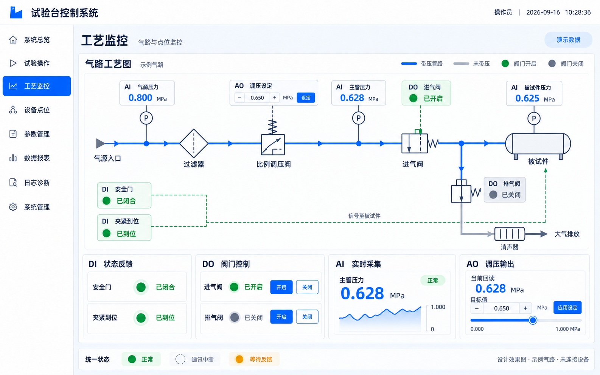

# 工艺气路界面与点位控件立即编码实施方案

版本：v1.1　日期：2026-09-16　状态：待实施，本文不代表功能已完成。v1.1 新增产品信息栏及其上下文、布局和验收约定。

## 1. 实施目标与边界

将当前“工艺监控”点位表格页改造成“顶部产品信息栏＋上方气路图＋下方 DI、DO、AI、AO 控件＋底部状态图例”。沿用现有系统外壳、蓝白主题、字体和导航；实现可复用控件，并从第一阶段就采用正式的数据绑定结构，后续选择具体 PointId 即可刷新界面，无须重画页面。

目标项目：`D:\易峥\2026\2026-09\Avalonia_上位机通用模板\项目代码\XXX.TestBench.Template`。本文所有相对源码路径均以此为根。

视觉基准：



该图是视觉设计基准，气路拓扑和数值是示例，不是现场工程图。第一版按图搭建示例气路；真实点位未绑定时显示“未绑定 / --”，不得把图中的数值作为生产默认值。最终现场管路、阀型、量程、反馈极性及联锁条件须按实际设备资料确定。

v1.1 的产品信息栏是附图基础上的明确增量，附图尚未包含该栏。实现和验收以“附图主体风格＋第 3.4 节产品栏规格”为准，不要求省略新增栏来保持旧图像素位置。

本期包括：视觉还原、产品信息栏与既有产品选择上下文复用、原生矢量气路、独立控件、统一缓存刷新、工艺点位绑定弹窗、受控写入、质量与反馈状态、针对性验证。不包括任意拖拽气路编辑器、新协议驱动、其他业务页面重设计或真实 PLC 写入验收；允许为工艺页产品栏调整共享外壳的可见性和通知，保持原总览页行为。

## 2. 当前源码基线及必须保留的行为

| 源码 | 已确认行为 | 实施要求 |
|---|---|---|
| `src/XXX.TestBench.App/MainWindow.axaml`、`ViewModels/ShellViewModel.cs` | 已有 ProductInfoBar，仅 IsOverviewPage 时显示；产品类型/型号来自 SelectedProductModel，产品编号当前固定“未录入”；车号为静态示例 | 工艺页复用同一产品上下文，增加独立产品栏可见性；不能直接放宽 IsOverviewPage，避免同时显示总览底部操作栏；工艺栏不复制静态车号 |
| `src/XXX.TestBench.App/Views/ProcessMonitorView.axaml` | 顶部刷新、选点、写值和高风险确认；下方点位表格 | 替换页面内容布局；手动控制能力转移到 DO/AO 卡片 |
| `src/XXX.TestBench.App/Views/ProcessMonitorView.axaml.cs` | 挂载时创建 1 秒 DispatcherTimer，卸载时停止，读取 VM 缓存 | 改造已有计时器，不另加第二套轮询 |
| `src/XXX.TestBench.App/ViewModels/ProcessMonitorViewModel.cs` | LoadAsync 枚举点位；RefreshAsync 按 PointId 读缓存；写入经过 WritePipeline | 保留 PointId、设备归属及现有权限/活动任务限制；拆分职责 |
| `src/XXX.TestBench.Core/Ports/IDeviceRuntime.cs` | ActiveRevision、SignalBindings、TryGetCachedValue、GetDeviceStatus、ReadFreshAsync | UI 常规刷新只读缓存，写入回读继续由安全链执行 |
| `src/XXX.TestBench.Core/Domain/Devices/PointValue.cs` | 工程值 Value、原始值 RawValue、Quality、TimestampUtc、Revision、ConnectionGeneration | 不重复量程换算；验证质量与版本，防止展示旧样本 |
| `src/XXX.TestBench.Core/Application/DeviceModeController.cs` | 当前 Runtime 和 StateChanged | 切换运行时时重新解析绑定，清理旧异步结果 |
| `src/XXX.TestBench.Core/Application/DeviceWritePipeline.cs` | 权限、连接、模式、活动任务、联锁、高风险确认、逆换算、写入、新鲜回读和审计 | DO/AO 必须经此入口，不直接调用驱动 |
| `src/XXX.TestBench.Core/Configuration/MultiDeviceConfigurationValidator.cs` | 拒绝未被执行器声明的 SignalKey | 必须扩展工艺展示信号白名单，不能直接往现有绑定字典塞新键 |
| `src/XXX.TestBench.App/ViewModels/SignalBindingsViewModels.cs` | 保存时由当前行重建绑定字典 | 改为只更新本弹窗管理的键，防止覆盖另一类绑定 |

当前工作树已有大量未提交改动，包括上述工艺页、设备配置及通讯代码；实施前重新查看 status/diff，基于当前文件增量修改。根目录旁独立的 `项目代码/XXX.TestBench.Devices/` 归属未确认，不读取为目标、不修改、不纳入提交。

## 3. 视觉还原规格

### 3.1 外壳和布局

沿用 `MainWindow.axaml` 的 78 高顶部、178 宽导航以及系统名称/用户/时间，不在工艺 UserControl 内重复绘制外壳。不替换现有品牌资源。工艺页面不额外增加第二条系统状态栏。

基准窗口为当前默认 1680×945、100% 缩放；补充检查 1920×1080。系统顶栏下方、右侧工作区顶部增加独立产品信息栏，单行最小高 70，位于工艺页标题之前，由 MainWindow 外壳承载。其下工艺内容仍为四行：页标题 56、气路图 `*`、四卡片区 224、图例 44；外边距 12，区域间距 10。产品栏占用真实布局行高，不叠加到气路画布上。气路区最小高 390；1680×945 加入产品栏后可能需要纵向滚动，优先保留图形和文字尺寸，产品栏固定可见，下方页面滚动，不缩小字号硬塞。内容宽度低于 1180 时产品栏换两行、卡片改 2×2；气路使用最小设计宽度并允许横向滚动，不能拉伸变形。1100×700 为可用性检查，不要求保持四卡同列。

颜色直接复用 App.axaml 资源：蓝 `#0868F7`、工作区 `#F5F8FC`、面板白、边框 `#D6DEEA`、正文 `#151A24`、次要文字 `#5F6878`、绿色 `#18A654`、红色 `#F5222D`；新增告警橙 `#F59E0B`、未知灰 `#98A2B3`。圆角 6–8，面板边框 1；管线 3，符号线 2；无重阴影、无发光。中文沿用 Microsoft YaHei UI / Noto Sans CJK SC。标题 22–26、卡片标题 17–18、正文 14–16、测量数值 30–36。

### 3.2 气路区

标题“气路工艺图”，示例标识“示例气路”。右上图例为带压管路、未带压、阀门开启、阀门关闭；增加未知态，未知不能等同未带压。

主体从左至右：气源入口 → 过滤器 → 比例调压阀 → 进气阀 → 被试件。进气阀下游分支向下接排气阀 → 消声器 → 大气排放。压力传感器分别连接气源、主管、被试件。安全门/夹紧到位显示于图左下，使用虚线表示控制信号；正式设备资料未确认前，不把示意虚线解释为真实气管。

采用 Avalonia `Path`、`Polyline`、`Line`、`Ellipse`、`Border`，不将效果图作为背景图叠加热点。无需引入第三方绘图库。图中符号必须有明确端口，所有管线端点精确连接；生成图中不严谨的阀芯细节用统一矢量符号修正，保留位置、比例、颜色和整体观感。

新增固定逻辑坐标画布 1360×440，绘图区域统一缩放并保持纵横比；文字/浮动卡片布局按相同锚点计算，保证端口与管线不漂移。参考锚点如下，位置含义均为元件中心，允许在视觉验收时统一微调：

| 元件 | X | Y |
|---|---:|---:|
| 气源入口 | 40 | 190 |
| 过滤器 | 265 | 190 |
| 比例调压阀 | 465 | 190 |
| 进气阀 | 850 | 190 |
| 下游分支接头 | 970 | 190 |
| 被试件 | 1190 | 190 |
| 排气阀 | 970 | 310 |
| 消声器 | 1135 | 395 |
| 气源/主管/被试件测压点 | 140 / 690 / 1190 | 190 |

绘图层仅画管线和符号，浮动点位层显示读数/状态，操作层处理选择与设定。可点击区域至少 36×36，支持键盘焦点和中文 AutomationProperties.Name。图中和下方卡片同时绑定同一 VM 实例，不各自保存状态。

### 3.3 四类卡片

| 类型 | 视觉及交互 |
|---|---|
| DI | “状态反馈”：安全门、夹紧到位；指示灯＋中文状态。三态 bool?，空值为未知，不能按 false 显示 |
| DO | “阀门控制”：进气阀、排气阀各一行；实际反馈＋开启/关闭按钮；写入中和等待反馈时显示橙色且禁止重复提交 |
| AI | “实时采集”：主管压力大数值、MPa、质量徽标和迷你趋势；图上另有气源/被试件压力 |
| AO | “调压输出”：设定回读、目标输入、加减、滑条、应用设定；草稿与回读分开，采样不能覆盖用户正在编辑的值 |

图中 AO 设定与下方 AO 卡片共享草稿和命令，只允许一次提交。注意：AO 设定寄存器回读与 AI 实测压力是两种值，不能像示例图一样未经说明互相替代。图上 AI 展示实测压力，AO 卡片“设定回读”展示独立配置的回读信号；无回读时明确“未配置回读”。

### 3.4 产品信息栏（v1.1 新增，必须实现）

位置为顶部品牌栏下方、工艺监控标题上方，与气路面板同属右侧工作区域，不能覆盖左侧导航。白底、底边框 `#D6DEEA`、水平内边距 16，正文 16，标签加粗、值常规。宽屏按下列顺序显示，字段间用留白或浅色竖分隔线，右侧保留“选择型号”蓝色描边按钮：

```text
产品类型：制动阀类    产品型号：示例型号    产品编号：未录入    [选择型号]
─────────────────────────────────────────────────────────
工艺监控                                      [点位绑定]
气路工艺图 …
DI / DO / AI / AO …
```

上述产品类型/型号仅说明布局，不写死到运行界面。第一版必显字段为产品类型、产品型号、产品编号；车号、批次和备注没有可靠数据源，本期不添加示例占位字段，避免误认为真实产品信息。

| 字段/入口 | 真实数据来源与规则 |
|---|---|
| 产品类型 | 绑定 ShellViewModel.CurrentProductTypeText，来源 SelectedProductModel.ProductTypeName；工艺页标签使用“产品类型”，不沿用总览的“车型”标签 |
| 产品型号 | 绑定 CurrentProductModelText，展示 ProductModelName，不展示内部 ProductModelId |
| 产品编号 | 绑定 CurrentProductNumberText；当前实现为“未录入”，本期如实展示，不把型号、PointId 或试验记录号当成产品编号，也不声称已接入实际被试件编号 |
| 选择型号 | 复用 MainWindow.OnProductSelectorClick、LoadProductModelOptionsAsync、ProductModelSelectionWindow 和 SelectProductModel；不新增另一套选择列表或仓库 |

实现约束：

1. ShellViewModel 新增 `IsProcessMonitorPage => CurrentPage is ProcessMonitorViewModel` 和 `ShowProductInfoBar => IsOverviewPage || IsProcessMonitorPage`。CurrentPage setter 同时通知三个可见性属性；原 IsOverviewPage 语义保持不变，BottomControlBar 仍仅总览可见。
2. MainWindow 的 ProductInfoBar 外层改绑 ShowProductInfoBar。原总览字段布局作为仅总览显示的子容器保留；另增仅工艺页显示的紧凑字段布局，两个子容器互斥，共用 ShellViewModel 的产品数据与选择事件。ProcessMonitorView 内不再放第二个产品栏。
3. 产品类型、型号列采用可收缩 Grid，型号列优先分配空间。长文本单行省略并提供完整 Tooltip；禁止用无限宽水平 StackPanel 导致挤出按钮。内容宽度低于 1180 时两行布局：首行类型/型号，次行编号/选择按钮，高度至少 104；保持 16 字号。
4. 未选产品时类型/型号显示“未选择”，编号“未录入”；仍能只读查看已配置设备点位。型号选择后依靠 SelectedProductModel 的现有属性通知立即更新，不加入通讯刷新计时器，不按 250 ms 查询产品数据库。
5. 存在活动试验时禁止从工艺页切换型号；打开选择窗口前和应用选择前均通过现有 RecordRepository.GetActiveRunningRecordAsync 重新检查。取消或检查失败不更改原选择，提示使用现有统一反馈窗口。前端产品选择只是显示上下文，不能作为设备操作授权或替代安全链的活动记录检查。
6. 切换页面保留同一 Shell 的产品选择，注销沿用现有 SelectedProductModel 清理。产品选择不自动更换 Process.* 绑定、气路拓扑或量程，也不自动创建活动任务；后续若要求按型号切换工艺配方，应另立配置契约。
7. 如本次实施要让工艺 VM 感知产品变化，传递只读上下文/通知，禁止复制一份可独立修改的产品选择。未接入活动记录的产品快照前，产品栏表示“当前选择”，不能宣称它已经与正在执行的试验产品一致。

## 4. 组件与数据契约（以下均为拟新增）

控件放在 `src/XXX.TestBench.App/Controls/Process/`，采用 UserControl＋StyledProperty；公共属性接受 VM 或基本展示值，控件不得访问 ShellServices、通讯运行时、文件或数据库，也不拥有刷新计时器。

| 文件 | 职责和主要属性 |
|---|---|
| `PointStatusBadge.axaml(.cs)` | State、Text；统一质量徽标 |
| `DigitalInputControl.axaml(.cs)` | Model: DigitalInputPointViewModel；标题、三态灯、状态文字 |
| `DigitalOutputControl.axaml(.cs)` | Model: DigitalOutputPointViewModel；实际反馈、提交状态、开/关命令 |
| `AnalogInputControl.axaml(.cs)` | Model: AnalogInputPointViewModel；数值、单位、范围、趋势 |
| `AnalogOutputControl.axaml(.cs)` | Model: AnalogOutputPointViewModel；草稿、回读、范围、步进、应用命令 |
| `PneumaticDiagramControl.axaml(.cs)` | Model: ProcessDiagramViewModel；装配气路和点位浮动卡片 |
| `PneumaticValveSymbol.cs` / `PneumaticPipeControl.cs` | 阀符号和管段；反馈状态、压力状态，不推断通讯 |
| `MiniTrendControl.cs` | 使用 DrawingContext 绘制有限样本，断线段断开，不新增绘图库 |

VM 放在 `src/XXX.TestBench.App/ViewModels/Process/`。下列签名为实施契约，不表示仓库现有 API：

```csharp
public enum ProcessDataState
{ Unbound, Waiting, Good, Stale, Bad, Disconnected, InvalidBinding }
public enum ProcessWriteState
{ Idle, Confirming, Writing, AwaitingFeedback, Succeeded, Failed, Uncertain }
public enum PipePressureState { Unknown, Unpressurized, Pressurized }

public sealed record ProcessSample(
    string SignalKey, string? PointId, object? EngineeringValue,
    ProcessDataState State, DateTime? TimestampUtc,
    string Revision, long ConnectionGeneration);

public interface IProcessSnapshotReader
{
    // 只读取传入运行时的缓存；无硬件 I/O。
    IReadOnlyDictionary<string, ProcessSample> Capture(
        IDeviceRuntime runtime, DateTime utcNow);
}
```

`ProcessPointViewModel` 公共字段：DisplayName、PointId、DeviceName、State、StatusText、TimestampUtc、IsSimulation。DI 增加 `bool? IsActive` 与 `TrueText/FalseText`；AI 增加 `double? Value`、Unit、Decimals、LimitState、TrendSamples；DO 增加 `bool? Feedback`、WriteState、OpenCommand、CloseCommand；AO 增加 `double? Readback`、`string TargetText`、`double? ParsedTarget`、IsDirty、IsEditing、Min、Max、Step、ApplyCommand。无效输入须保留草稿并显示错误，不能悄悄写成 0。

ProcessDiagramViewModel 持有这些点位 VM 的引用和各管段压力状态；ProcessMonitorViewModel 负责页面聚合、加载及提交协调。气路渲染不得创建另一套点位 VM。

## 5. 点位绑定设计与配置事务

### 5.1 固定工艺信号目录

新增 `src/XXX.TestBench.Core/Configuration/ProcessSignalCatalog.cs`，声明固定信号目录及中文名称。这里的 DI/DO/AI/AO 表示用途，不按地址前缀或用户名称自动猜测。

| SignalKey | 中文业务名称 | 契约 |
|---|---|---|
| `Process.SafetyDoor` | 安全门反馈 | 读，Boolean/Bool |
| `Process.ClampReady` | 夹紧到位反馈 | 读，Boolean/Bool |
| `Process.SupplyPressure` | 气源压力 | 读，数值工程值，单位 MPa |
| `Process.MainPressure` | 主管压力 | 读，数值工程值，单位 MPa |
| `Process.DutPressure` | 被试件压力 | 读，数值工程值，单位 MPa |
| `Process.InletCommand` | 进气阀命令 | 写，Boolean/Bool；true 开启、false 关闭 |
| `Process.InletFeedback` | 进气阀反馈 | 读，Boolean/Bool；true 已开启、false 已关闭 |
| `Process.ExhaustCommand` | 排气阀命令 | 写，Boolean/Bool；true 开启、false 关闭 |
| `Process.ExhaustFeedback` | 排气阀反馈 | 读，Boolean/Bool；true 已开启、false 已关闭 |
| `Process.PressureSetpoint` | 调压目标 | 写，数值工程值，单位 MPa |
| `Process.PressureSetpointReadback` | 调压设定回读 | 读，数值工程值，单位 MPa |

数值契约支持当前点位目录的整数及浮点数值类型，排除 Bool/String/Char；支持已有量程映射，不要求所有 AI/AO 原始类型均为 Float32。压力单位由固定目录声明，选点时显示“所选点位工程值必须为 MPa”，不得根据 DBD 等地址推断类型或单位。AO 的可写范围取点位工程范围与控件范围交集；无可靠范围时禁止写入并提示配置量程。示例控件范围 0–1 MPa、步进 0.001 只用于设计预览，不能自动写入生产配置。

第一版布尔极性固定如上，绑定弹窗明确显示；不兼容反相、脉冲、双线圈时拒绝按此模型使用，后续需增加明确的控制契约，不能靠猜测实现。反馈必须绑定真正反馈点；无独立反馈时状态显示“未配置反馈”，命令寄存器回读只能说明指令被接收。

### 5.2 复用现有信号绑定存储

沿用 `SignalBindingsConfig` v1 的 `Bindings: SignalKey → PointId` 和当前完整配置快照，不新增 UI 自写 JSON。所有工艺键均可缺失；缺失仅影响对应控件，不新增试验执行器的必需信号，不能造成无关试验无法启动。

必须同步实现以下配套修改，否则配置无法正确应用：

1. `MultiDeviceConfigurationValidator.ValidateSignalBindingContracts` 分别识别既有执行器目录和 ProcessSignalCatalog。工艺键仅允许目录白名单；未知键仍拒绝。新增工艺键校验类型、可写能力、范围；没有工艺键的旧配置继续有效。不可通过创建虚假执行器绕过校验。
2. 新增工艺绑定弹窗 `ProcessPointBindingsDialogWindow` 和对应 VM：显示业务名称、读写用途、要求、当前设备/点位名称、质量，支持清除。设备和点位名称优先，内部键仅在诊断详情显示。只列兼容点，校验仍由服务端重做。
3. `DeviceConfigurationService` 新增补丁式保存接口，保留完整 ApplySignalBindingsAsync 给既有内部调用：

```csharp
Task<DeviceConfigurationApplyResult> ApplySignalBindingPatchAsync(
    UserContext actor,
    IReadOnlyDictionary<string, string?> patch,
    string expectedRevision,
    CancellationToken ct = default,
    bool s7OptimizedBlockAccessConfirmed = false);
```

4. null/空白值代表删除该键；没出现在 patch 中的键保持不动。在同一配置应用协调锁内读取当前快照、比对 expectedRevision、合并及校验，并复用原 ApplyCoreAsync 的 stage/candidate runtime/CommitActiveAsync/publish。不能先检查版本后放锁，也不能嵌套重复取得同一非重入锁。版本冲突返回“配置已更新，请重新加载”，不覆盖他人修改。
5. 工艺绑定弹窗和现有 SignalBindingsDialogViewModel 均改为只提交各自管理的键及打开时版本，避免旧业务绑定弹窗擦除 Process.*。保留现有 S7 优化块确认和失败不关闭窗口的行为。
6. 页面标题右侧增加低强调“点位绑定”按钮，仅 ManageDevices 权限显示；属于与效果图相比的一项必要功能补充，不改变主体布局。仍遵守活动试验期间禁止配置应用规则。

没有新增 JSON 字段，因此不提升 schemaVersion，也不自动迁移旧绑定。实际回滚到不支持 Process.* 的旧程序前，须在新版程序通过配置事务清除 Process.* 或切回原先完整配置版本；不能直接编辑 active.json。

## 6. 刷新、线程和生命周期

1. `LoadAsync(ct)` 建立点位目录和绑定快照；不要每 250 ms 枚举全部点位或重建集合。绑定由当前 runtime.SignalBindings 解析；已删除、类型改变、设备归属改变的点位均标记无效。
2. 页面只拥有一个 DispatcherTimer，周期 250 ms，表示 UI 缓存刷新节拍，不保证硬件 250 ms 采样。驱动轮询周期继续由设备配置管理。
3. 每帧捕获一个 runtime 引用、ActiveRevision、每台设备状态及所需唯一 PointId 的缓存。重复引用同一点只取一次。创建同一帧快照后一起更新图和卡片；刷新中运行时/版本变化则丢弃该帧。
4. 有效样本必须满足 PointId/DeviceId 匹配、Quality=Good、Revision 匹配、ConnectionGeneration 与设备状态匹配、设备在线、时间戳有效且未过期。新流程面向正式版本化运行时，缺少这些元数据时显示“未就绪”，不可默认正常。
5. 最大样本年龄由 ProcessSignalCatalog 定义，默认 2 秒；按 `min(运行时判定的有效期, 工艺目录有效期)` 的保守语义处理：运行时已 Stale 即无效，即使未满 2 秒也不得恢复 Good。未来时间戳/时间回退导致不可验证时记为无效。不得拿 UI 刷新时间代替采样时间。
6. 显示优先级：未绑定 → 绑定无效 → 设备断线 → 未收到新样本/版本代次不匹配 → 数据无效 → 已过期 → 正常。超限是独立业务状态，只能基于 Good 值计算。
7. 所有 ObservableCollection/ObservableObject/UI 属性更新在 Dispatcher.UIThread 执行。后台结果带页面 generation，旧 generation、旧 runtime 或旧 Revision 的完成结果不得覆盖新页面状态。
8. 附着时幂等启动；脱离、注销、窗口关闭和 DataContext 替换时停止并解绑 StateChanged、取消页面任务。只释放页面资源，不 Dispose/Stop 共享 Runtime。命名 Tick 处理器，避免匿名事件重复挂载。
9. StateChanged 触发后先将显示置等待，重新解析目录；异步加载只允许一个在途，后续变更使先前结果失效。Timer 也检查 runtime 引用/Revision，避免漏掉事件。
10. 趋势缓存每个 AI 最多 120 个唯一采样时间点，按采样时间排序；缓存重复值但时间未变不追加，断线插入断点，切换 PointId/Revision/代次清空。不得每帧构建无界列表。

## 7. 气路和输出控件状态规则

### 7.1 管段与阀门

阀门绿色只能来自有效的实际反馈，不来自用户点击或 WritePipeline 返回的命令点回读。未知反馈用灰色虚线/问号，与“已关闭”实线灰明确区分。

带压管路蓝色必须由相应区域有效的压力样本驱动；阀门关闭不能推出下游无压，可能存在残压。第一版：气源段取 SupplyPressure，调压后至进气阀前取 MainPressure，下游至被试件及排气阀入口取 DutPressure；排气阀后区域无测压点时为中性灰并标注“排放段”，不宣称实测无压。图例与实际含义保持一致。

示例压力判定用 0.020 MPa 进入带压、0.010 MPa 退出带压，位于两者之间保持上次有效状态；首次落在滞环内则 Unknown。这是示例显示参数，不可作为联锁或卸压完成依据。阈值放固定工艺定义中集中声明，现场投用前按实际工艺调整。箭头表示设计流向，第一版不做动态流动动画，因为压力不证明存在流量。

### 7.2 DO/AO 写入

流程：Idle → Confirming（需要时）→ Writing → AwaitingFeedback → Succeeded / Failed / Uncertain。

提交时重新解析当前 PointId、Revision 和 Actor，检查目标设备、权限、IsWritable、输入类型/范围及活动记录，再调用现有 DeviceWritePipeline.ExecuteAsync。继续使用真实活动记录计算 ActiveRunOk；不能为使按钮可点直接传 true。无活动任务时显示“当前状态不允许手动操作”。现有导航 ManualControl 权限不在本期调整。

按钮可用性不代替管道校验。一个输出只允许一个在途命令；DO 开/关共享锁，AO 图上及卡片共享锁。页面切换/绑定变更时禁用旧命令，禁止自动补发、重试或重新应用草稿。

管道返回代表命令点写入及新鲜回读完成，不表示阀门已动作。DO 继续等待反馈点的 Good 新样本：时间戳不早于提交时间、版本/代次一致且值匹配；默认反馈超时 3 秒。无独立反馈时显示“指令已确认，动作未验证”，不显示“已开启”。若明确反馈超时，显示“反馈未到位”，不自动反向写入。

AO 设定回读优先绑定独立回读信号；若设备只提供可读写设定寄存器，可显式绑定同一 PointId 并标为“设定回读”，不能标成实测压力。完成条件按目标点工程分辨率设容差，默认 `max(Step/2, 1e-6)`；这只是附加显示完成判据，不能放宽管道本身原始值回读一致性规则。

写入后取消、超时、审计异常按现有异常语义显示“结果待核对”，不提示单纯失败后鼓励重试。高风险确认每次提交单独确认，不保留永久勾选。原始异常写日志，界面用业务名称和简洁中文。

安全门、夹紧信号在本期用于显示；不能把示例图自动变成未经确认的安全联锁。正式启用真实 DO/AO 前必须为现场工艺补齐 InterlockCheck，确保与实际设备安全逻辑一致。示例未配置现场联锁时保持硬件输出禁用；Simulation 可使用明确的仿真联锁进行演示。PLC 本身的安全功能不由 UI 替代。

## 8. 文件职责与实施顺序

| 批次 | 新增/修改文件 | 完成条件 |
|---|---|---|
| A 视觉骨架及产品栏 | `Views/ProcessMonitorView.axaml(.cs)`、`Controls/Process/*`、`ViewModels/Process/*`、`MainWindow.axaml(.cs)`、`ViewModels/ShellViewModel.cs`、必要的 App.axaml 资源 | 产品栏复用当前选择并支持型号选择；总览布局及底部操作栏可见性不变；默认未绑定，正常启动不注入假值 |
| B 正式数据展示 | ProcessMonitorViewModel 拆分 `.Monitoring.cs`、`.Bindings.cs`、新增 ProcessSnapshotReader | 图卡同源，单计时器，版本/代次/过期规则完整 |
| C 绑定保存 | ProcessSignalCatalog、MultiDeviceConfigurationValidator、DeviceConfigurationService、现有 SignalBindingsViewModels、新工艺绑定弹窗 | 事务保存，版本冲突保护，两类绑定互不覆盖 |
| D 输出交互 | ProcessMonitorViewModel `.Commands.cs`、输出 VM、现有 Confirm/Notice 弹窗复用 | 范围、权限、任务、联锁、写入与实际反馈状态完整 |
| E 接线与验收 | 必要时修改 Composition/AppComposition.cs、Composition/ShellServices.cs；新增针对性测试 | 使用同一个 DeviceModes/WritePipeline/配置服务；无额外通讯连接 |

ProcessMonitorViewModel 继续保留原构造入口 `(ShellServices services, UserContext actor)`，通过内部适配器承接现有服务。PointRow 若被其他页面或测试引用，先 rg 确认再决定移动/删除，不能直接整体覆盖旧文件。原选点表格调试能力已有设备点位诊断页承接，不在新工艺主页面放第二张完整点表。

每批次先完成对外契约与相应行为验证，再接下一批次。UI 完成后绑定工作属于本方案必做范围，不以“后续再补通讯”为由交付只有静态图的页面。

## 9. 验收及可执行验证命令

### 9.1 必测行为

- 视觉：1680×945、1920×1080 与基准图并排检查；保留外壳，新增固定产品栏，其下气路、四卡、主要元件位置和标签遵循原风格；无文字裁切、端口断开、数值重叠。新增产品栏造成的纵向位移是预期变化。1100×700 产品栏两行显示，下方可滚动可操作。截图放 `D:\Codex相关\process-monitor-validation`。
- 产品上下文：未选时显示未选择；选型号后产品类型/型号同步变化；取消保持原选择；长名称完整提示；产品编号未接数据时只能显示未录入；切换总览/工艺页保留同一选择，其他页面不误显产品栏，工艺页不误显总览底部操作栏；存在活动试验时打开/应用选择均被拦截；注销后清空，不触发任何设备写入或绑定切换。
- 绑定：空绑定、有效绑定、删除点位、类型改变、只读点作为输出、未知 SignalKey、过期版本保存；工艺/试验绑定双向保存均不丢失对方键。
- 刷新：点位值变化后下一次 UI 节拍图卡同步；断线、Stale、Bad、旧代次、旧 Revision 和未来时间戳不显示 Good；重复样本不增长趋势；进入离开 20 次仍只有一个计时器，无卸载后更新。
- 输出：无权限/无任务/无联锁/超量程不写；连续点击只写一次；写入成功但反馈未到不变绿；反馈超时、写后取消、审计异常不重发；AO 编辑草稿不被采样覆盖。
- 气路：关阀但下游压力仍高，管路仍显示带压；断线显示未知而不是无压；样本落在滞环内不闪烁。
- 运行时替换：旧异步完成结果不可覆盖新绑定、新草稿和新反馈；新运行时尚无样本时恢复等待状态。

新增测试文件建议：Core.Tests/ProcessSignalBindingTests.cs、App.Tests/ProcessMonitorViewModelTests.cs、App.Tests/ProcessOutputCommandTests.cs、App.Headless.Tests/ProcessMonitorViewTests.cs、Integration.Tests/ProcessBindingConfigurationTests.cs。在现有 ShellHeadlessTests.cs 中补充产品栏可见性、型号通知、换行和总览回归用例，并补充选择前/应用前活动记录变化的行为测试。测试中使用可控制时间的时钟/样本，不依赖真实睡眠或 PLC；Headless 读取控件和视觉树必须在 Dispatcher.UIThread。

在目标项目根执行（未来编码后运行，本次文档交付未执行）：

```powershell
$artifacts = 'D:\Codex相关\process-monitor-validation\artifacts'
dotnet restore .\XXX.TestBench.Template.sln --artifacts-path $artifacts
dotnet build .\XXX.TestBench.Template.sln --no-restore --artifacts-path $artifacts
dotnet test .\tests\XXX.TestBench.Core.Tests\XXX.TestBench.Core.Tests.csproj --no-build --artifacts-path $artifacts --filter 'FullyQualifiedName~ProcessSignalBinding'
dotnet test .\tests\XXX.TestBench.App.Tests\XXX.TestBench.App.Tests.csproj --no-build --artifacts-path $artifacts --filter 'FullyQualifiedName~ProcessMonitor|FullyQualifiedName~ProcessOutput'
dotnet test .\tests\XXX.TestBench.App.Headless.Tests\XXX.TestBench.App.Headless.Tests.csproj --no-build --artifacts-path $artifacts --filter 'FullyQualifiedName~ProcessMonitor'
dotnet test .\tests\XXX.TestBench.App.Headless.Tests\XXX.TestBench.App.Headless.Tests.csproj --no-build --artifacts-path $artifacts --filter 'FullyQualifiedName~ShellHeadlessTests'
dotnet test .\tests\XXX.TestBench.Integration.Tests\XXX.TestBench.Integration.Tests.csproj --no-build --artifacts-path $artifacts --filter 'FullyQualifiedName~ProcessBinding'
```

每条测试确认实际发现测试数大于 0；超时/挂起不记通过。随后针对受影响的 SignalBindings/DeviceConfiguration/DeviceWritePipeline 既有测试执行回归，记录原有失败与新增失败。测试输出及临时文件均放 D:\Codex相关，不能放工作树。

静态效果、编译、自动测试、离线模拟、真实 PLC/设备/UOS/现场验收分别报告。需要真实设备才能完成的步骤：核对点位表与单位/极性、验证阀门反馈、压力采样、AO 回读及联锁、通讯恢复和长时间运行；不能用效果图或 Headless 代替。

## 10. 回滚和交付

代码回滚以本次范围提交的反向变更为单位，保留原有未提交工作，禁止 reset/clean。配置回滚使用配置服务发布旧完整快照为新版本；同一应用事务内恢复点位与信号绑定，不单独改磁盘 JSON。无法安全回滚时保持输出禁用并提示人工核对。

交付应包含：实现文件列表、最终工艺页截图、可绑定信号清单、验证结果和未验证项、绑定弹窗操作说明、实际硬件输出仍缺少的现场契约。任何新增第三方依赖必须完全开源免费并核查传递依赖；本方案预期无需新增 UI/绘图库。

### 可直接交给编码任务的指令

按本方案 v1.1 和附图实现 XXX.TestBench.Template 的工艺监控页面，附图上方须增加第 3.4 节规定的产品类型、产品型号、产品编号及选择型号信息栏。先保护现有工作树改动，再按 A–E 实施；复用 Shell 产品上下文并保持总览行为，使用原生矢量符号、共享点位 VM 和单一缓存刷新节拍，完成正式的固定工艺信号到 PointId 绑定及配置事务。保留现有写入安全链，明确命令回读与实际反馈，未绑定/过期/断线显示未知。不得把示例值、推测 PLC 地址或未确认联锁写入生产配置。按第 9 节完成针对性验证和截图对照，逐层报告证据；真实设备验收单独进行。
